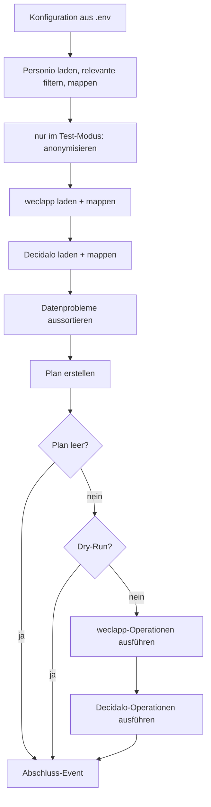

# Umsetzungsplan HR-Sync

> Stand: 2026-10-28 · Ergebnis der ersten Brainstorming-Session · Entwurf · ergänzt 2026-10-30 um die Felder der
> Phase 2 (Abschnitt 4.4)

## 1. Ziel und Umfang

HR-Sync überträgt beim Onboarding die Stammdaten neuer Mitarbeiter aus **Personio** nach **weclapp** und **Decidalo**.

- **Richtung:** nur Personio → weclapp und Personio → Decidalo. Personio ist die Quelle.
- **Schlüssel:** die Mitarbeiternummer (MA-Nummer).
- **Operationen:** nur **Anlegen**. Bestehende Personen bleiben unverändert, abweichende Felder werden geloggt.
- **Felder:**
  - Phase 1 (umgesetzt): MA-Nummer, Vorname, Nachname, E-Mail, Eintrittsdatum.
  - Phase 2 (festgelegt am 2026-10-30, siehe [4.4](#44-felder-der-phase-2)): Karrierestufe, Telefonnummer, Standort und
    Wochenstunden. Daraus abgeleitet: Service-Kategorie und Feiertagskalender in Decidalo, Urlaubsanspruch,
    Bundesland und Arbeitszeitprofil in weclapp.
  - Weitere Felder folgen später (O19, Ablauf in [4.3](#43-weitere-felder-ergänzen)).
- **Verteilung:** Am Ende erscheint HR-Sync als PyPI-Paket `hochfrequenz-hr-sync`, das auch andere Firmen nutzen
  können (siehe [Abschnitt 9](#9-pypi-paket)).
- **Nicht im Umfang:** Aktualisieren bestehender Personen, Offboarding (Personen, die nur noch im Zielsystem stehen;
  in weclapp werden sie dann deaktiviert, nie gelöscht, O21), Hosting und Zeitplan im Detail (die Richtung steht,
  siehe O9).

### 1.1 Entscheidungen aus der Brainstorming-Session

| Thema | Entscheidung |
|---|---|
| MA-Nummer in Personio | Custom Attribute mit `id == "company_employee_id"` (Typ `string`, z. B. `"00165"`). Sie bleibt immer ein String, damit führende Nullen erhalten bleiben |
| MA-Nummer in weclapp | Custom Attribute am `user`, konfiguriert über die **ID der Definition** (`WECLAPP_EMPLOYEE_NUMBER_ATTRIBUTE_ID`, bei Hochfrequenz `7621`). Der Wert steht als String in `stringValue`, z. B. `"00165"` |
| Abweichungen bei bestehenden Personen | nicht überschreiben, nur loggen |
| Person ohne MA-Nummer (in jedem System) | Warn-Event, Person wird für den Plan nicht betrachtet |
| Personio-Person ohne E-Mail | Warn-Event, Person wird für den Plan nicht betrachtet |
| Personio-E-Mail bei mehreren Mitarbeitern | Warn-Event `duplicate_email` für jeden Betroffenen, keiner wird für den Plan betrachtet |
| **Grundsatz bei Datenproblemen** | Gibt es zu einem Mitarbeiter ein Datenproblem, in Personio oder in einem Zielsystem, passiert mit ihm nichts: in keinem Zielsystem, und es gilt auch kein „der Erste gewinnt“. Angelegt wird nur, wer überall stimmig ist. Das Problem wird als Warnung geloggt. **Abweichungen** (z. B. ein anderer Nachname in weclapp) sind kein Datenproblem: Sie werden nur geloggt und blockieren das Anlegen im anderen System nicht |
| E-Mail | wird nach weclapp und Decidalo übertragen (weclapp braucht sie zum Anlegen) |
| Decidalo-displayName | `"Vorname Nachname"` |
| Anlegen in Decidalo | über den **synchronen Import-Endpunkt** `POST /importapi/User/ImportSync` (Client: `import_users_sync`), nicht über `ImportAsync`. Die Ergebnisse pro Zeile kommen direkt in der Antwort, ohne Polling und ohne Callback |
| Neue Decidalo-User | Neben den Stammdaten bekommt jeder neue User feste Werte nach dem Vorbild eines produktiven Users (AP 8): Mitarbeitertyp ID `2` / `"Internal"`, Berechtigungsrolle ID `2` / `"Employee"`, `location` und `countryCode` `"DE"`, `companyName` `"Hochfrequenz Unternehmensberatung GmbH"`, `includeInResourceManagement=true`, `hasLogin=true`. Alle außer `includeInResourceManagement` sind einstellbar, die Werte sind die Standardwerte von Hochfrequenz. `isImported` wird nicht gesetzt. Dazu kommen die Felder der Phase 2: `jobTitle`, `serviceCategoryName`, `mobilePhoneNumber`, `holidayListCode` und `standardWeeklyHours` (4.4). Weitere personenbezogene Felder wie Team kommen später (O19) |
| Decidalo-Zeilenstatus | Nur `Created` ist ein Erfolg. Jeder andere Status, auch `Updated`, ist ein Fehler, weil HR-Sync nur neue User schickt |
| Deaktivierter Decidalo-User | Gehört seine MA-Nummer einem relevanten Personio-Mitarbeiter (z. B. Wiedereintritt), ist das ein Datenproblem: Warn-Event `deactivated_in_target`, und nach dem Grundsatz passiert mit dem Mitarbeiter nichts |
| Anlegen in Decidalo: ein Aufruf je Mitarbeiter | Beim Ausführen des Plans geht HR-Sync Mitarbeiter für Mitarbeiter durch: Jeder `ImportSync`-Aufruf legt genau einen User an, die Aufrufe laufen nacheinander. Es gibt keine Pakete mit mehreren Usern, eine Paketgröße spielt also keine Rolle (O7) |
| Gescheiterter Aufruf | Scheitert ein Aufruf als Ganzes, ist die Operation dieses Mitarbeiters ein Fehler. Die restlichen Operationen dieses Systems werden übersprungen (`skipped`) |
| Vollständiges Laden aus Decidalo | Nach dem Laden fragt HR-Sync nach, ob nach dem letzten User noch einer kommt (`top=1`, `skip=Anzahl`). Kommt einer, bricht der Lauf vor dem Planen ab (Exit-Code 2). Sonst würde ein fehlender User als neu geplant, und das Upsert von `ImportSync` würde den bestehenden User überschreiben (O7) |
| Neue weclapp-User | nach der Vorgabe von Hochfrequenz (3.2, 4.4): `status=ACTIVE`, `mobilePhoneNumber`, Lizenzen `WECLAPP_PROJECT` und `ADDON_HUMAN_RESOURCES`, Rollen `7166` (Zeiterfassung) und `4329` (weclapp Projekt), Zusatzfelder 7621 (MA-Nummer), 8211 und 8217 (Kostensatz, vorerst fest 59 EUR/h und „Erstanlage (weclapp)“, O20), 9795 (Urlaubsanspruch), 9902 (Bundesland) und 14175 (Karrierestufe). Das Standardfeld `title` bleibt leer, sonst steht es auf Rechnungen vor dem Namen. Den `username` vergibt weclapp selbst, per API lässt er sich nicht setzen (3.2). weclapp verschickt beim Anlegen per API keine Einladungsmail (O2). Aktive User kosten Lizenzgebühren, die Kosten sind eingeplant |
| Neue weclapp-Personalakte | `POST employee` mit `userId` und einem Arbeitszeitprofil (`workScheduleProfileAssignments`): Profil aus den Wochenstunden, `startDate` = Eintrittsdatum. `entryDate` setzt HR-Sync nicht, die `employeeNumber` vergibt weclapp selbst (O17) |
| Relevante Personio-Mitarbeiter | **nur mit einem Employment im Status `ACTIVE`, dessen Startdatum heute oder in der Vergangenheit liegt** |
| Eintrittsdatum | `employment_start_date` dieses Employments. Gibt es mehrere, gilt das mit dem neuesten Startdatum |
| Datumswerte | tagesgenau als `datetime.date`, ohne Uhrzeit und ohne Zeitzonen. Alle Mitarbeiter sind in Deutschland. „Heute“ ist `date.today()` beim Start des Laufs |
| Programmstruktur | synchron, gut wart- und debugbar. async nur gekapselt in den Adaptern für Personio und Decidalo, mit einem `asyncio.run` je Schritt (Laden, Ausführen) und System. Anfragen nacheinander. Jeder Adapter trennt Laden (IO) und Mappen (reine Logik), siehe Abschnitt 3 |
| Logging | Wide Events mit Loguru. Ausgabe umschaltbar (lesbar oder JSON) |
| Personenbezogene Daten in Logs | nein: nur MA-Nummer, systeminterne IDs, Feldnamen und Zahlen. Die MA-Nummer allein ist unkritisch, problematisch wird sie erst zusammen mit weiteren Daten wie dem Namen. Meldet ein Scanner wie CodeQL die Ausgabe einer MA-Nummer allein, ist das ein Fehlalarm (AP 8) |
| Betrieb | zeitgesteuert auf einem internen Server (Cron, Task Scheduler oder Container-Job), die Secrets liegen dort in einer `.env`. Welcher Server, welches Intervall und wer benachrichtigt wird, ist offen (O9) |
| PyPI-Paket | `hochfrequenz-hr-sync`, Befehl `hr-sync`, Import-Paket `hr_sync`, Lizenz MIT wie die Clients. Der Zeitpunkt des ersten Releases ist offen (O14) |
| Zielgruppe des Pakets | auch andere Firmen: Alles Firmenspezifische ist konfigurierbar und dokumentiert. Ausnahme sind die Mappings und festen weclapp-Werte der Phase 2: Sie stehen fest im Code (4.4, O15). CLI, Umgebungsvariablen, Exit-Codes und Event-Felder sind eine stabile Schnittstelle |
| Stabile Version | erst, wenn auch die Clients stabil sind. Bis dahin erscheint HR-Sync nur als Pre-Release |
| E-Mail im Zielsystem schon vergeben | Gehört die E-Mail eines Mitarbeiters im Zielsystem einem anderen User (ohne oder mit anderer MA-Nummer), ist das ein Datenproblem: Es gibt ein Warn-Event `email_in_use`, und nach dem Grundsatz passiert mit dem Mitarbeiter nichts, in keinem System |
| weclapp-Umgebung | Es gibt keinen Test-Tenant, wir arbeiten in der Produktion. Das Feld für die Personalnummer gibt es dort schon, ein späterer Test-Tenant bekommt es auch |
| Zielsysteme | wählbar mit `--target weclapp` bzw. `--target decidalo`, Standard sind beide |
| Testumgebungen | In Testumgebungen landen keine echten Namen, E-Mails oder Telefonnummern: Im Test-Modus (`HR_SYNC_ENVIRONMENT=test`) wird anonymisiert. MA-Nummer, Eintrittsdatum, Karrierestufe, Standort und Wochenstunden bleiben echt (8.2), die Testdaten sind damit pseudonymisiert, nicht anonym. Die Decidalo-Testumgebung braucht Zugriffsschutz wie die Produktion (O25) |
| Decidalo im Test-Modus | eigene URL und eigener Key (`DECIDALO_TEST_BASE_URL`, `DECIDALO_TEST_API_KEY`), `hasLogin=false`. Die Testumgebung ist nur im Test-Modus erreichbar |
| Decidalo-URLs | Produktion `https://import.decidalo.app`, Testumgebung `https://import.decidalo.dev`. Die Standard-URL des `decidalo-client` ist die Testumgebung, HR-Sync übergibt die URL deshalb immer ausdrücklich (O18). Bis AP 8 stand hier fälschlich `.dev` als Produktion |
| Integrationstest | Personio produktiv lesen, nur den ersten Planeintrag in die Decidalo-Testumgebung schreiben. Danach die Testperson wahlweise automatisch löschen (erst nachdem geprüft ist, dass sie angelegt wurde) oder zum Ansehen liegen lassen. Läuft nur lokal |
| weclapp vor AP 5 | Seit AP 5 ist weclapp ein normales Ziel (PR 1 nur im Dry-Run, seit PR 2 auch schreibend, siehe oben). Bis dahin galt: `--target weclapp` ist wählbar und gehört zum Standard. Solange der weclapp-Adapter fehlt, bricht ein Lauf mit weclapp als Ziel mit Exit-Code 2 ab (`problem=target_not_available`). Bis AP 5 braucht jeder Lauf also `--target decidalo`. CLI und Standard ändern sich mit AP 5 nicht mehr |
| Test-Modus vor AP 8 | ~~`HR_SYNC_ENVIRONMENT=test` bricht mit Exit-Code 2 ab, bis der Test-Modus steht~~ **Erledigt mit AP 8:** Der Test-Modus steht (Abschnitt 8) |
| Integrationstests im normalen Testlauf | nein: `uv run pytest` lässt sie immer aus, auch mit gefüllter `.env`. Sie laufen nur mit `-m integration` bzw. `-m integration_write`. Ein normaler Testlauf liest so nie Personio produktiv und braucht kein Netz |
| Test-Modus ohne `--max-employees` | keine Sonderregel: Ohne Option legt ein Lauf im Test-Modus alle fehlenden Mitarbeiter anonymisiert in der Testumgebung an. Für einen kleinen Lauf setzt man `--max-employees 1` selbst |
| Aufräumen in der Testumgebung | nur der Integrationstest löscht, und nur seine eigene Testperson. User aus einem Testlauf über die CLI bleiben liegen (anonymisiert, ohne Login), bei Bedarf löscht man sie in Decidalo. HR-Sync selbst bleibt „nur anlegen“ |
| Unerwartete Fehler | Jeder Fehler beendet den Lauf mit einem `sync.run` mit `outcome=error` und Exit-Code 2, auch ein Programmierfehler. Geloggt werden Fehlertyp und Codestelle (Modul, Funktion, Zeile), nie Meldung, Traceback oder Dateipfad (siehe Abschnitt 6). Ein Abbruch mit Strg+C erscheint als `sync.run` mit `outcome=error` und `error.type=KeyboardInterrupt` und beendet den Prozess wie üblich |
| Begrenzung des Plans | `--max-employees N` (N ≥ 1): Die Planung bricht ab, sobald N Mitarbeiter mit Operationen im Plan stehen, z. B. `--max-employees 1` für einen überschaubaren Testlauf. Gilt in jedem Modus, mit und ohne Dry-Run, und lässt sich mit `--only` kombinieren. Geladen und geprüft wird trotzdem alles: Hinweise aus dem Laden erscheinen für alle Mitarbeiter, Hinweise und Abweichungen aus der Planung nur bis zum Abbruch |
| Felder der Phase 2 | Karrierestufe, Telefonnummer, Standort und Wochenstunden aus Personio, dazu abgeleitete Werte je Zielsystem. Quellen, Ziele und Mappings in 4.4 (Vorgaben vom 2026-10-30) |
| Pflichtfelder | Alle übertragenen Felder sind Pflicht: Namen, E-Mail, MA-Nummer, Eintrittsdatum, Karrierestufe, Telefonnummer, Standort und Wochenstunden. Fehlt eins oder liegt sein Wert außerhalb der Mappings, ist das ein Datenproblem, und mit dem Mitarbeiter passiert in keinem System etwas. Das gilt auch für Felder, die nur ein Zielsystem braucht (4.4) |
| Mappings der Phase 2 | fest im Code (`mappings.py`), nicht einstellbar: Karrierestufe → Service-Kategorie und Urlaubsanspruch, Standort-ID → Standort, Feiertagskalender und weclapp-Bundesland, Wochenstunden → Arbeitszeitprofil. Ebenso die festen weclapp-Werte (Lizenzen, Rollen, Kostensatz, IDs der Zusatzfelder). Das weicht von „Firmenspezifisches ist einstellbar“ ab (9.1, O15) |
| Abweichungen der Phase-2-Felder | werden wie die anderen Felder verglichen und nur geloggt (4.2, 4.4) |
| Wochenstunden in Decidalo (O22) | Decidalo bekommt die Wochenstunden als `standardWeeklyHours` und vergleicht sie. Sonst plant die Ressourcenplanung eine Teilzeitkraft womöglich mit voller Kapazität. Das geht über die Vorgabe für Decidalo hinaus, die das Feld nicht nennt (4.4) |
| Personio-Attribute der Phase 2 (O22) | Variablen mit Hochfrequenz-Standard wie `PERSONIO_EMPLOYEE_NUMBER_ATTRIBUTE`: `PERSONIO_CAREER_LEVEL_ATTRIBUTE` und `PERSONIO_MOBILE_PHONE_ATTRIBUTE`. Die Attribut-IDs sind kein Mapping, also gilt „Firmenspezifisches ist einstellbar“ (7) |
| `reason`-Werte der Phase 2 (O22) | drei allgemeine Werte: `missing_field` (Pflichtfeld fehlt), `unmapped_value` (Wert außerhalb der Mappings) und `invalid_phone_number`. `detail` nennt den Feldnamen des Modells, z. B. `reason=missing_field detail=career_level`. Ein späteres Feld braucht so keinen neuen Wert. Die bestehenden Werte wie `missing_email` bleiben (5) |
| Ersatznummer im Test-Modus (O22) | `+49 000 <MA-Nummer>`, z. B. `+49 000 00165`. Nach `+49` beginnt keine deutsche Nummer mit `0`, die Ersatznummer gehört also sicher niemandem (8.2) |
| Zugriff auf die Decidalo-Testumgebung (O25) | nur, wer auch die Produktion sieht. Dort stehen dieselben Felder ohnehin echt. Die pseudonymisierten Testdaten dürfen deshalb weiter in die Testumgebung (8) |
| Telefonnummer in weclapp (AP 5, PR 2) | wie bei allen bestehenden weclapp-Usern: `+49`, die ersten drei Ziffern der nationalen Nummer, dann der Rest ohne Leerzeichen, z. B. `+49 151 46414222` (aus `0151 46 41 42 22`). Nummern mit einer anderen Landesvorwahl schreibt HR-Sync ohne Leerzeichen, z. B. `+43123456789`, weil sich deren Vorwahl ohne Tabelle nicht sicher abtrennen lässt. Verglichen wird weiter in der kanonischen Form (4.2) |
| Schreiben in weclapp (AP 5, PR 2) | Mit `0.1.0a3` fällt die Sperre: weclapp ist ein normales Ziel. Eine zusätzliche Sicherung im Code gibt es nicht, wie bei Decidalo. Schutz bieten `email_in_use`, die Prüfung des Tenants und der Ablauf von AP 9 (erst Dry-Run, dann der erste echte Lauf nur mit `--only` und der Testperson). **Ohne die ausdrückliche Zustimmung des Auftraggebers läuft nichts gegen eine Produktion** |
| weclapp bis `0.1.0a3` (AP 5) | Der `weclapp-client` `0.1.0a2` kann `mobilePhoneNumber` und die Auswahlwerte der Zusatzfeld-Definitionen noch nicht (Hochfrequenz/weclapp_client.py#33). AP 5 kommt deshalb in zwei PRs: PR 1 mit allem, was `0.1.0a2` kann, PR 2 nach `0.1.0a3` mit Telefonnummer und Prüfung der Auswahlwerte. PR 2 schließt Issue #17. Bis PR 2 lief weclapp als Ziel nur im Dry-Run, ein echter Lauf brach mit `problem=target_not_available` ab. So entstand kein User ohne Telefonnummer. **Erledigt mit PR 2:** Mit `0.1.0a3` ist die Sperre weg, `target_not_available` gibt es nicht mehr |
| Wiedereintritt in weclapp (AP 5) | Ein weclapp-User, der nicht im Status `ACTIVE` ist (z. B. `DEPARTURE`), gilt als deaktiviert. Gehört seine MA-Nummer einem relevanten Personio-Mitarbeiter, ist das wie bei Decidalo ein Datenproblem `deactivated_in_target`: Mit dem Mitarbeiter passiert in keinem System etwas, bis jemand den User reaktiviert |
| Namen über 50 Zeichen (AP 5) | weclapp nimmt für Vor- und Nachname höchstens 50 Zeichen. Längere Namen sind ein Datenproblem in Personio (`reason=value_too_long`, `detail` ist der Feldname), auch mit `--target decidalo` |
| Integrationstest gegen weclapp (AP 5) | Es gibt nur die Produktion. Der Test liest weclapp und schickt für den ersten Planeintrag `POST user` mit `dryRun=true`, weclapp speichert dabei nichts. Marker `integration`, die Zugangsdaten kommen aus der `.env`, ohne sie wird übersprungen (8.3) |
| AP 8a in zwei PRs | PR 1 die Quelle: `mappings.py`, Modell und Datenprobleme, Personio, Anonymisierung, Konfiguration. PR 2 das Ziel: Decidalo senden und laden, Vergleich im Planner, Integrationstest (O24). Nur PR 2 schließt Issue #19 (12) |

## 2. Ablauf



1. Konfiguration aus `.env` laden.
2. Daten nacheinander laden: Personio und die Zielsysteme aus `--target` (Standard: weclapp und Decidalo). Jeder Loader
   mappt auf das gemeinsame Modell und liefert einen **Snapshot**: die Datensätze nach MA-Nummer und die Hinweise auf
   Datenprobleme. Aus Personio kommen nur relevante Mitarbeiter (siehe [3.1](#31-personio-quelle)).
   Im Test-Modus wird der Personio-Snapshot direkt nach dem Laden anonymisiert (siehe
   [Abschnitt 8](#8-testumgebungen-und-anonymisierung)).
3. Datenprobleme aussortieren (siehe [Abschnitt 5](#5-datenprobleme)). Für jedes gibt es ein Warn-Event.
4. Plan erstellen. Das ist eine reine Funktion ohne IO: Für jede gültige Personio-Person (mit `--only` nur für die
   angegebenen MA-Nummern, siehe [Abschnitt 7](#7-konfiguration-cli-und-fehlerbehandlung)) und jedes Zielsystem gilt:
   - Die Person fehlt: Operation `CREATE`.
   - Die Person ist vorhanden: Felder vergleichen und Abweichungen festhalten (nur die Feldnamen).
   - Gibt es in einem Zielsystem ein Datenproblem zu der Person, z. B. eine doppelte MA-Nummer oder ihre E-Mail an
     einem anderen User, plant der Planner für sie keine Operation, in keinem Zielsystem (siehe 4.2).
5. Hat der Plan keine Operationen, endet der Lauf. Im Dry-Run wird der Plan nur geloggt.
6. Plan ausführen, erst weclapp, dann Decidalo.
7. Abschluss-Event mit Summen und Exit-Code.

Schlägt das Laden eines Systems fehl, bricht der Lauf **vor** der Planung ab. Auf unvollständigen Daten wird nicht
geplant, sonst würden bestehende Personen doppelt angelegt.

## 3. Die Systeme und ihre Clients

| System | Paket | Art | MA-Nummer steht in | Besonderheiten |
|---|---|---|---|---|
| Personio | [`personio-client`](https://github.com/Hochfrequenz/personio_client.py) `0.1.0a1` | async (aiohttp), nur lesend | Custom Attribute `company_employee_id` | Eintrittsdatum, Standort und Wochenstunden am Employment, Karrierestufe und Telefonnummer als Custom Attributes, ein Request pro Person |
| weclapp | [`weclapp-client`](https://github.com/Hochfrequenz/weclapp_client.py) `0.1.0a2` | **synchron** (httpx) | Custom Attribute am `user`, über die ID seiner Definition (bei Hochfrequenz `7621`) | eine Person = `user` + `employee`; E-Mail ist Pflicht; viele Felder der Phase 2 fehlen noch im Client (AP 2a) |
| Decidalo | [`decidalo-client`](https://github.com/Hochfrequenz/decidalo_client.py) `0.3.1` | async (aiohttp), Import-API | `employeeID` | nur `displayName`; Anlegen über den synchronen Import `ImportSync` (ein Upsert) |

Personio und weclapp sind Pre-Releases. Wir pinnen auf die Minor-Version, z. B. `weclapp-client>=0.1.0a1,<0.2`.

**HR-Sync ist synchron.** `personio-client` und `decidalo-client` gibt es nur async. Ihre Adapter kapseln das: Je
Schritt (Laden, Ausführen) öffnet genau eine Funktion den Client in einem einzigen `asyncio.run(...)`, stellt die
Anfragen nacheinander und schließt den Client wieder. Für den Rest des Programms (Planner, Events, Orchestrierung, CLI, weclapp)
ist async unsichtbar. Das hält Stacktraces und Breakpoints linear und die Tests ohne Event-Loop.

**Nacheinander statt parallel.** Auch innerhalb eines Systems laufen die Anfragen nacheinander. Die Log-Events kommen
dann in der Reihenfolge der Arbeit, Fehler lassen sich reproduzieren, und das Rate Limit von Personio wird geschont.
Die längere Laufzeit (grob 30 s bei 100 Mitarbeitern) ist für einen zeitgesteuerten Lauf unkritisch. Wird sie doch
zum Problem, lässt sich Parallelität in der Lade-Funktion nachrüsten, ohne dass sich sonst etwas ändert.

**Aufbau jedes Adapters: laden, mappen.**

| Teil | Aufgabe | Tests |
|---|---|---|
| `fetch_…` | nur IO: Daten mit dem Client holen und so zurückgeben, wie sie kommen | wenige Tests mit einem kleinen Fake-Client |
| `map_…` | Regeln, Mapping und Snapshot, ohne IO und ohne async | mit einfachen Daten, ohne Client |
| `load_…` | ruft beides auf und erzeugt das Event `sync.load` | Inhalt des Events |

Die Executor der Zielsysteme folgen demselben Muster:

| Teil | Aufgabe | Tests |
|---|---|---|
| `send_…` | nur IO: die Anfragen stellen und die Antworten zurückgeben | mit einem Fake-Client |
| `evaluate_…` | aus den Antworten ein `OperationResult` je Operation machen, ohne IO | mit einfachen Daten |
| `execute_…` | ruft beides auf und erzeugt ein Event `sync.operation` je Operation | Inhalt der Events |

Fast der ganze fachliche Code steckt damit in reinen Funktionen. Man kann sie im Debugger mit echten Daten aus einem
Lauf füttern.

### 3.1 Personio (Quelle)

**Welche Mitarbeiter relevant sind:** Ein Mitarbeiter ist für den Sync nur relevant, wenn er ein Employment hat, das
beide Bedingungen erfüllt:

1. Der `status` des Employments ist `ACTIVE`. Weil Personio die Groß- und Kleinschreibung nicht einheitlich verwendet,
   vergleichen wir ohne Rücksicht darauf.
2. Das `employment_start_date` liegt **heute oder in der Vergangenheit**.

Erfüllen mehrere Employments beide Bedingungen, gilt das mit dem neuesten Startdatum. Alle anderen Mitarbeiter sind
nicht relevant, z. B. künftige Mitarbeiter (`ONBOARDING` oder Start in der Zukunft), Mitarbeiter in Elternzeit o. Ä.
(`LEAVE`) und ausgeschiedene (`INACTIVE`). Sie werden erst angelegt, sobald ihr Employment die Bedingungen erfüllt.

**Sonderfall: aktives Employment ohne Startdatum.** Erfüllt kein Employment beide Bedingungen, hat der Mitarbeiter
aber ein Employment im Status `ACTIVE` ohne `employment_start_date`, ist das ein Datenproblem: Es gibt ein Warn-Event
(`missing_entry_date`), und der Mitarbeiter kommt nicht in den Plan. Diesen Fall prüfen wir **vor** dem Datumsfilter,
sonst würde er still als „nicht relevant“ verschwinden.

Die Prüfung läuft pro Mitarbeiter in dieser Reihenfolge:

1. Gibt es ein Employment mit `ACTIVE` und Startdatum heute oder früher? Dann ist der Mitarbeiter relevant.
2. Sonst: Gibt es ein Employment mit `ACTIVE` ohne Startdatum? Dann gibt es ein Warn-Event `missing_entry_date`.
3. Sonst ist der Mitarbeiter nicht relevant, mit dem Grund `employment_not_active` oder `start_date_in_future`.

„Heute“ ist `date.today()` beim Start des Laufs. Es zählt nur der Tag, Zeitzonen spielen keine Rolle, weil alle
Mitarbeiter in Deutschland sind. Der Loader bekommt das Datum als Parameter, damit Tests es festlegen können.

**Laden und mappen:**

- `iter_persons(status="ACTIVE")` als Vorfilter. Der Personenstatus `ACTIVE` umfasst die Employment-Status `ACTIVE`,
  `ONBOARDING` und `LEAVE`. Die genaue Regel prüfen wir danach am Employment.
- `iter_employments(person.id)` für jede Person, nacheinander, daraus das relevante Employment bestimmen.
- MA-Nummer, E-Mail und doppelte MA-Nummern prüfen wir erst **nach** diesem Filter (Abschnitt 5). Künftige
  Mitarbeiter, denen MA-Nummer oder E-Mail noch fehlen, lösen also keine Warnung aus.
- Für geladene, aber ausgeschlossene Mitarbeiter mit MA-Nummer merkt sich der Snapshot den Grund (`excluded`). Das
  braucht `--only` für eine genaue Meldung (Abschnitt 7).
- MA-Nummer: `custom_attributes` mit `id == "company_employee_id"`, `value` ohne führende und folgende Leerzeichen.
- Vorname, Nachname, E-Mail: `first_name`, `last_name`, `email`.
- Eintrittsdatum: `employment_start_date` des relevanten Employments.
- Felder der Phase 2 (4.4, ab AP 8a):
  - Karrierestufe: Custom Attribute `dynamic_625934eadbe629.22673150` (String, z. B. `"Senior Consultant"`,
    `PERSONIO_CAREER_LEVEL_ATTRIBUTE`).
  - Telefonnummer: Custom Attribute `dynamic_6239d4b55575b2.63567609` (String, z. B. `"0151 27 409 444"`,
    `PERSONIO_MOBILE_PHONE_ATTRIBUTE`).
  - Standort: `office.id` des relevanten Employments, über das Standort-Mapping zum Namen.
  - Wochenstunden: `weekly_working_hours` des relevanten Employments.
  - Wie MA-Nummer und E-Mail prüfen wir sie erst nach dem Relevanzfilter: Fehlt eins oder liegt sein Wert außerhalb
    der Mappings, ist das ein Datenproblem (Abschnitt 5).
  - Die Attribut-IDs sind Variablen mit Hochfrequenz-Standard wie `PERSONIO_EMPLOYEE_NUMBER_ATTRIBUTE` (O22).
- Credentials nur mit dem Scope `personio:persons:read`.

Umgesetzt in [`systems/personio.py`](../../src/hr_sync/systems/personio.py) (AP 4, Felder der Phase 2 in AP 8a):

- `fetch_persons(client)` holt die Personen und ihre Employments nacheinander, als Liste von `LoadedPerson`. Den
  Client öffnet und schließt die Funktion selbst in einem `asyncio.run`, auch bei einem Fehler.
- `map_persons(persons, attributes=…, today=…)` ist rein. Sie liefert den Snapshot sowie die Zahlen `without_id` und
  `not_relevant` je Grund. `attributes` (`PersonioAttributes`) bündelt die IDs der Custom Attributes für MA-Nummer,
  Karrierestufe und Telefonnummer, `sync.personio_attributes` füllt sie aus den Einstellungen.
- `load_personio(client, attributes=…, today=…)` ruft beides auf und erzeugt das Event `sync.load` mit `persons`,
  `without_id`, `records`, `notices` und `not_relevant`.
- `relevant_employment(employments, today)` setzt die Relevanzregel um. Das Ergebnis ist das relevante Employment
  oder der Grund, warum es keines gibt.
- `map_person(person, employment, attributes=…, employee_number=…)` mappt einen relevanten Mitarbeiter und liefert
  dazu die Probleme in seinen Feldern (`FieldProblem` mit Grund und Feldname), in der Reihenfolge der Felder. Die
  Service-Kategorie und den Urlaubsanspruch füllt es aus dem Mapping der Karrierestufe, den Standort mit dem Namen aus
  dem Standort-Mapping.
- `attribute_value(person, attribute_id)` liest ein Custom Attribute, z. B. die MA-Nummer. Eine Zahl wird zum String,
  leere Werte gelten als fehlend. Bis AP 8a hieß die Funktion `employee_number_of`.
- Ein Mitarbeiter mit Problemen in seinen Feldern kommt mit diesen Problemen in den `SnapshotBuilder` (`add(…,
  problems=…)`), nicht über `exclude()`. So zählen seine MA-Nummer und seine E-Mail bei den Dubletten mit (4.4).
  Hat er eine doppelte MA-Nummer, eine fehlende oder eine doppelte E-Mail, gibt es nur diese Warnung (5).
- `client` ist als Protocol `PersonioSource` typisiert (asynchroner Kontextmanager, `iter_persons`,
  `iter_employments`). mypy prüft, dass der echte `PersonioClient` das Protocol erfüllt.
- Personen ohne `id` (laut Spec optional) lassen sich nicht abfragen. Sie werden übersprungen und in `without_id`
  gezählt.

### 3.2 weclapp (Ziel)

**Laden:**

1. Die Definitionen der Custom Attributes über ihre IDs laden: die MA-Nummer
   (`custom_attribute_definitions.get(WECLAPP_EMPLOYEE_NUMBER_ATTRIBUTE_ID)`) und die Zusatzfelder der Phase 2 (8211,
   8217, 9795, 9902, 14175, siehe 4.4). Gibt es eine nicht, oder passt ihr Typ (`attribute_type`: String, Zahl,
   Auswahl) oder ihre Entität (User, `attribute_entity_type` bzw. `entities`) nicht, ist das ein Konfigurationsfehler:
   Der Lauf bricht ab. Außerdem muss die Auswahl-Definition 9902 die Auswahlwerte 9903, 9904 und 9905 haben.

   Präzisiert in AP 5:
   - Die Entität prüft HR-Sync über `"user" in entities`. `attribute_entity_type` ist bei User-Attributen leer,
     weclapp setzt es nur für Attribute vom Typ `ENTITY` (Befund P6 im Repo des Clients).
   - „Zahl“ heißt `DECIMAL` oder `INTEGER`, „Auswahl“ heißt `LIST`.
   - Auch die Arbeitszeitprofile aus dem Mapping müssen in weclapp existieren (`GET workScheduleProfile`), sonst bricht
     der Lauf ebenso ab.
   - Für 9902 muss jeder Standort einen aktiven Auswahlwert haben (`selectableValues`, ein leeres `active` zählt als
     aktiv). Fehlt einer, bricht der Lauf mit seiner ID ab. Seit `0.1.0a3` des Clients (AP 5, PR 2).

   Typ und Entität identifizieren ein Zusatzfeld nicht eindeutig: In einem anderen Tenant kann dieselbe ID ein
   anderes Zahlenfeld am User sein. Die Bezeichnung (`label`) prüft HR-Sync trotzdem bewusst nicht. Benennt jemand
   ein Feld in weclapp um, bräche sonst jeder Lauf ab, bis ein neues Release kommt. Die festen IDs der Phase 2 gelten
   nur für den Tenant von Hochfrequenz. Andere Firmen können weclapp als Ziel erst nutzen, wenn diese Werte
   einstellbar sind (9.1, O15).
2. Alle `user` und alle `employee` laden. Die Employees werden über `user_id` den Usern zugeordnet. Ein User, der nicht im Status `ACTIVE` ist, gilt als deaktiviert (`Snapshot.deactivated`, siehe 1.1).
3. MA-Nummer: `user.custom_attribute(definition.id).string_value`, z. B. `"00165"`.
4. Für den Vergleich (4.4): `firstName`, `lastName`, `email`, `mobilePhoneNumber` und die Zusatzfelder 9795, 9902 und
   14175 am User, dazu die Arbeitszeitprofile an der Personalakte. Für sie gelten zwei getrennte Regeln:
   - **Wochenstunden:** aus dem heute gültigen Profil. Gültig ist ein Profil, dessen `startDate` heute oder früher
     liegt und dessen `endDate` fehlt oder heute oder später liegt. Gibt es mehrere, zählt das mit dem spätesten
     `startDate`. Künftige und abgelaufene Profile zählen nicht. Gibt es kein gültiges Profil, fehlen die Wochenstunden.
   - **Eintrittsdatum:** das `startDate` des frühesten Profils. HR-Sync legt beim Anlegen genau ein Profil ab dem
     Eintrittsdatum an. Ändern sich die Stunden später, kommt in weclapp ein neues Profil dazu, das früheste bleibt.
   Hat die Personalakte gar kein Profil, fehlen beide Werte.

**Anlegen** (pro Person, in dieser Reihenfolge, nach der Vorgabe von Hochfrequenz vom 2026-10-30):

1. `POST user` mit `firstName`, `lastName`, `email`, `status=ACTIVE`, `mobilePhoneNumber` (international),
   `licenses`, `userRoles` und den Zusatzfeldern 7621 (MA-Nummer), 8211 und 8217 (Kostensatz), 9795 (Urlaubsanspruch),
   9902 (Bundesland) und 14175 (Karrierestufe), siehe 4.4. Das Standardfeld `title` bleibt leer. weclapp verschickt
   dabei keine Einladungsmail (O2).

   **Abweichung von der Vorgabe:** Die Vorgabe nennt auch `username` = E-Mail. Per API lässt sich `username` aber nicht
   setzen: weclapp weist einen `POST user` damit ab (400, `platform.read_only_property`, Befund P4 im Repo des
   `weclapp-client` vom 2026-10-29). weclapp vergibt den `username` selbst, bei fast allen bestehenden Usern ist er
   gleich der E-Mail. HR-Sync sendet ihn deshalb nicht. Ob er bei einem neuen User der E-Mail entspricht, prüft AP 9.

   ```json
   {
     "firstName": "Max", "lastName": "Mustermann",
     "email": "max.mustermann@hochfrequenz.de",
     "status": "ACTIVE", "mobilePhoneNumber": "+49 151 23411444",
     "licenses": ["WECLAPP_PROJECT", "ADDON_HUMAN_RESOURCES"],
     "userRoles": [{"id": "7166"}, {"id": "4329"}],
     "customAttributes": [
       {"attributeDefinitionId": "7621", "stringValue": "00274"},
       {"attributeDefinitionId": "8211", "numberValue": "59"},
       {"attributeDefinitionId": "8217", "stringValue": "Erstanlage (weclapp)"},
       {"attributeDefinitionId": "9795", "numberValue": "25"},
       {"attributeDefinitionId": "9902", "selectedValueId": "9903"},
       {"attributeDefinitionId": "14175", "stringValue": "Consultant"}
     ]
   }
   ```

2. `POST employee` mit `userId` und `workScheduleProfileAssignments: [{"workScheduleProfileId": …, "startDate": …}]`:
   das Arbeitszeitprofil aus den Wochenstunden, `startDate` ist das Eintrittsdatum als Zeitstempel in Millisekunden.
   `entryDate` setzt HR-Sync nicht, die `employeeNumber` vergibt weclapp selbst (O17).

**Vor dem Anlegen prüfen, ob es den User schon gibt:** Die Vorgabe verlangt das, weil jede Projekt-Lizenz kostet.
HR-Sync lädt dafür alle User und prüft MA-Nummer und E-Mail (`email_in_use`, auch bei Usern ohne MA-Nummer, 4.2). Das
deckt die Abfrage `GET user?email-eq=…` der Vorgabe ab.

**Was danach automatisch passiert** (in weclapp, nicht in HR-Sync): Innerhalb von 15 Minuten wird der neue Mitarbeiter
allen internen Projekten (INT) zugewiesen. Der Kostensatz aus 8211 gilt für seine Zeitbuchungen. Ins Zeitportal kommt
er mit seiner Microsoft-Anmeldung, sobald er als aktiver User angelegt ist (gleiche E-Mail-Adresse).

**Halb angelegte Personen:** Scheitert Schritt 2, gibt es einen User mit MA-Nummer, aber ohne Personalakte. Der
Client wiederholt einen `POST` mit unklarem Ausgang bewusst nicht. Der nächste Lauf erkennt diesen Zustand und plant
die Operation `COMPLETE`, die nur noch die Personalakte samt Arbeitszeitprofil anlegt. Das ist kein Update, sondern der
Abschluss der Anlage.

**Voraussetzung:** Der `weclapp-client` muss erweitert und neu released werden (AP 2a). Stand von `main` im Repo
des Clients am 2026-10-30: Auf PyPI gibt es nur `0.1.0a1`. `entry_date` aus AP 2 ist gemergt, aber nicht released.
Es fehlt:

| Stelle im Client | fehlt für HR-Sync |
|---|---|
| `User`, `UserCreate` | `mobile_phone_number`, `licenses` und `user_roles` (`[{id}]`) |
| `CustomAttribute` | Werte vom Typ Zahl (`numberValue`, z. B. Kostensatz und Urlaubsanspruch) und Auswahl (`selectedValueId`, Bundesland), mit Konstruktoren wie `of_string`. Heute liest und schreibt der Client nur `stringValue` |
| `CustomAttributeDefinition` | die Auswahlwerte einer Definition (`selectableValues`), damit HR-Sync prüfen kann, dass 9902 die Werte 9903 bis 9905 hat (3.2) |
| `Employee`, `EmployeeCreate` | die Arbeitszeitprofile `work_schedule_profile_assignments` (`workScheduleProfileId`, `startDate`, `endDate`) |
| `weclapp_client.testing.FakeWeclapp` | dieselben Felder, damit AP 5 dagegen testen kann. Heute liefert der Fake `licenses` und `userRoles` immer leer |
| Integrationstests (Stufe 1: lesen und Dry-Run) | die neuen Felder lesend und per Dry-Run gegen den Tenant prüfen, dazu O23 |

Die Testdaten des Clients nennen das Feld an der Personalakte `workingTimeRuleAssignments`, die Vorgabe
`workScheduleProfileAssignments`. Laut der API-Analyse des Clients hat die Personalakte beide Felder, jeweils mit
`startDate`, `endDate` und einer Referenz-ID. Es sind also zwei verschiedene Zuordnungen, für die Arbeitszeitprofile ist
`workScheduleProfileAssignments` richtig. AP 2a bestätigt das lesend gegen die API (O23). `entry_date` aus AP 2 bleibt
im Client, HR-Sync setzt es aber nicht. `username` braucht der Client nicht zu schreiben, er ist per API
schreibgeschützt.

**Vorgehen in AP 2a** (2026-10-30): AP 2a arbeitet auf dem aktuellen `main` des Repos `Hochfrequenz/weclapp_client.py`
auf GitHub, nicht mit einem bestehenden lokalen Klon. Am Ende steht ein sauberes Pre-Release auf PyPI: Tag und
GitHub-Release als Pre-Release mit Release-Notes, veröffentlicht über den Publish-Workflow mit Trusted Publishing, wie
`0.1.0a1`. Die Versionsnummer legt AP 2a fest. Bleibt sie unter `0.2`, z. B. `0.1.0a2`, passt sie zur Grenze
`weclapp-client>=0.1.0a1,<0.2` in HR-Sync. AP 5 hebt dann die Untergrenze auf die neue Version an.

**Stand nach AP 2a (2026-10-30):** `0.1.0a2` ist auf PyPI. Es fehlen noch `mobilePhoneNumber` am User und die
Auswahlwerte der Definitionen (Hochfrequenz/weclapp_client.py#33, kommt mit `0.1.0a3`). O23 ist damit bestätigt:
Der Client modelliert `workScheduleProfileAssignments`.

**Offboarding** (nicht im Umfang): Beim Austritt wird der weclapp-User deaktiviert, nie gelöscht, damit seine
Buchungen erhalten bleiben (O21).

Umgesetzt in [`systems/weclapp.py`](../../src/hr_sync/systems/weclapp.py) (AP 5, PR 1, mit `weclapp-client`
`0.1.0a2`):

- **Ids:** `WeclappSetup` bündelt alle IDs in weclapp und die Werte neuer User: die MA-Nummer aus
  `WECLAPP_EMPLOYEE_NUMBER_ATTRIBUTE_ID`, den Status aus `WECLAPP_NEW_USER_STATUS`, sonst die festen Werte aus
  `mappings.py`. `sync.weclapp_setup` füllt es aus den Einstellungen. Tests setzen die IDs des `FakeWeclapp` ein,
  der seine IDs selbst vergibt.
- **Laden:**
  - `fetch_weclapp(client, setup)` holt die Definitionen der Zusatzfelder einzeln über ihre ID, die
    Arbeitszeitprofile, alle User und alle Personalakten. Eine fehlende Definition wird `None`.
  - `check_setup(loaded, setup)` prüft ohne IO Typ und Entität der Definitionen und die IDs der Arbeitszeitprofile.
    Passt etwas nicht, gibt es einen `ConfigurationError` mit `problem=weclapp_setup_mismatch`, den IDs (`ids`)
    und bei der MA-Nummer auch der Variable. Der Lauf bricht ab (Exit-Code 2). Ebenso, wenn
    `WECLAPP_EMPLOYEE_NUMBER_ATTRIBUTE_ID` eine der festen IDs ist: Dann würde der Typ des anderen Felds geprüft,
    und HR-Sync schriebe zwei Werte in ein Feld (Review zu #23).
  - `map_weclapp(loaded, setup=…, today=…)` mappt ohne IO. Ohne Personalakte ist ein User `incomplete`. Ein User
    mit einem anderen Status als `WECLAPP_NEW_USER_STATUS` ist `deactivated`, beim Standard `ACTIVE` also jeder
    andere Status (1.1). Präzisierung: So gelten die eigenen neuen User nie als deaktiviert, auch mit einem anderen
    Status als Standard. Karrierestufe und Urlaubsanspruch kommen aus ihren Zusatzfeldern, der Standort über den
    Auswahlwert zurück, Eintrittsdatum und Wochenstunden aus den Arbeitszeitprofilen (`current_assignment`). Werte,
    die sich nicht zurückübersetzen lassen, fehlen und erscheinen so als Abweichung.
  - `load_weclapp` ruft alles auf und erzeugt das Event `sync.load` mit `users`, `employees`, `records`,
    `incomplete`, `deactivated` und `notices`.
- **Anlegen:**
  - `new_employee(operation, setup)` baut ohne IO die Anfragen nach der Vorgabe: `UserCreate` mit Lizenzen, Rollen
    und den Zusatzfeldern, dazu das Arbeitszeitprofil ab dem Eintrittsdatum. Bei `COMPLETE` nur das Profil für den
    bestehenden User, dessen ID der Planner in `Operation.target_id` mitgibt.
  - `send_employees` legt nacheinander erst den User, dann die Personalakte an. Nach einem Fehler, der weclapp als
    Ganzes betrifft (Authentifizierung, Verbindung, Rate Limit, Serverfehler), hört es auf. Validierungsfehler und
    Konflikte betreffen nur den einen Mitarbeiter.
  - `evaluate_responses` macht daraus die Ergebnisse. Steht der User, aber nicht die Personalakte, ist die
    Operation ein Fehler mit `detail=employee_not_created`, der nächste Lauf plant `COMPLETE`.
  - `execute_weclapp` ruft beides auf und erzeugt ein `sync.operation` je Operation.
- **Seit PR 2 (`0.1.0a3`):** `execute_plan` ruft `execute_weclapp` auf, die Sperre ist weg (1.1). Der User bekommt
  die Telefonnummer in der Schreibweise der bestehenden weclapp-User (`weclapp_phone_number`, z. B.
  `+49 151 46414222`), gelesen wird sie aus `mobilePhoneNumber` und in der kanonischen Form verglichen. `check_setup`
  prüft zusätzlich die Auswahlwerte von 9902.
- `client` ist der echte `WeclappClient`, kein eigenes Protocol: Der `FakeWeclapp` des Clients liefert einen
  `WeclappClient` mit einem Mock-Transport.

### 3.3 Decidalo (Ziel)

**Basis-URL:** Im Produktionsmodus nutzt der Sync fest die produktive URL `https://import.decidalo.app`, sie lässt
sich nicht umkonfigurieren. Die Testumgebung (`https://import.decidalo.dev`) ist nur im Test-Modus erreichbar, mit
eigenen Variablen (siehe [Abschnitt 8](#8-testumgebungen-und-anonymisierung)). Der Client nimmt die URL als
`base_url` an. **Achtung:** Seine Standard-URL ist `https://import.decidalo.dev`, also die Testumgebung. HR-Sync
übergibt die URL deshalb immer ausdrücklich (O18).

**Laden:** `get_users()` ohne `top`. Laut Spec liefert der Endpunkt dann alle User, eine Höchstgrenze ist nicht
dokumentiert. Danach prüft HR-Sync mit einer zweiten Anfrage (`top=1`, `skip=Anzahl`), dass nach dem letzten User keiner
mehr kommt, sonst bricht der Lauf ab (siehe 1.1, O7). Wir lesen `employeeID`, `displayName`, `email` und `entryDate`,
für den Vergleich der Phase 2 zusätzlich `jobTitle`, `serviceCategoryName`, `mobilePhoneNumber`, `holidayListCode` und
`standardWeeklyHours` (4.4, AP 8a).

**Anlegen:** über den synchronen Import-Endpunkt `POST /importapi/User/ImportSync`, im Client
`import_users_sync(UserBatchInput(users=[user]))`. HR-Sync geht Mitarbeiter für Mitarbeiter vor: Jeder Aufruf
enthält genau einen User, die Aufrufe laufen nacheinander (siehe 1.1). Den asynchronen Endpunkt
`ImportAsync` nutzen wir nicht: Dort müssten wir das Ergebnis über `ImportStatus` abfragen oder einen Callback anbieten.
Bei `ImportSync` stehen die Ergebnisse direkt in der Antwort.

`isImported` senden wir nicht. `includeInResourceManagement` ist beim Anlegen laut Spec standardmäßig `true`, wir
senden es trotzdem ausdrücklich.

```python
UserInput(
    employeeID=record.employee_number,
    displayName=record.display_name,  # "Vorname Nachname", siehe display_name_of
    email=record.email,
    entryDate=record.entry_date,
    employeeTypeID=2,                 # DECIDALO_EMPLOYEE_TYPE_ID
    employeeTypeName="Internal",      # DECIDALO_EMPLOYEE_TYPE_NAME
    authorizationRoleID=2,            # DECIDALO_AUTHORIZATION_ROLE_ID
    authorizationRoleName="Employee", # DECIDALO_AUTHORIZATION_ROLE_NAME
    location="DE",                    # DECIDALO_LOCATION
    countryCode="DE",                 # DECIDALO_COUNTRY_CODE
    companyName="Hochfrequenz Unternehmensberatung GmbH",  # DECIDALO_COMPANY_NAME
    includeInResourceManagement=True,
    hasLogin=True,                    # DECIDALO_HAS_LOGIN, im Test-Modus immer False
    # Phase 2 (4.4, AP 8a)
    jobTitle=record.career_level,     # z. B. "Principal Consultant", unverändert aus Personio
    serviceCategoryName="Manging Consultant",  # aus dem Mapping der Karrierestufe, so in Decidalo geschrieben
    mobilePhoneNumber=record.mobile_phone,     # wie in Personio, im Test-Modus die Ersatznummer
    holidayListCode="DE-BY",          # aus dem Standort-Mapping, z. B. Grünwald
    standardWeeklyHours=40,           # die Wochenstunden aus Personio (O22)
)
```

Die festen Werte bündelt `NewUserDefaults`, `sync.new_decidalo_users` füllt sie aus den Einstellungen (AP 8).

**Mitarbeitertyp und Rolle in der Testumgebung:** Die Typen heißen dort anders als in der Produktion: Typ 2 heißt
„Regular Employee“, „Internal“ gibt es nicht. Mit dem Namen allein scheitert jede Zeile (`EmployeeTypeName='Internal'
could not be found`). Mit ID und Name zusammen nimmt Decidalo die ID, der unbekannte Name stört nicht. Deshalb senden
wir beides. Rolle 2 heißt in beiden Umgebungen „Employee“. Die Firma „Hochfrequenz Unternehmensberatung GmbH“ gibt es
in der Testumgebung dreimal, der Import ordnet den Namen trotzdem zu.

**Service-Kategorien und Feiertagskalender in der Testumgebung:** Die Service-Kategorien heißen dort intern anders als
angezeigt, z. B. `serviceCategoryName="DE Services 1"` mit der Übersetzung „Senior Consultant“ oder „DE Services 3“ mit
„Manging Consultant“. Der Tippfehler steckt also in Decidalo selbst, das Mapping trifft die Anzeige. In der Produktion
heißt die Kategorie laut Vorlage wie im Mapping. `UserInput` kann für die Kategorie keine ID senden. Die
Feiertagskalender `DE-HB`, `DE-BE` und `DE-BY` gibt es in der Testumgebung.

**Geklärt in AP 8a (O24):** Der Import über `serviceCategoryName` klappt auch in der Testumgebung. Laut Client nimmt
der Import die ID, den internen Namen oder jede Übersetzung einer Kategorie an. Alle vier Kategorien des Mappings gibt
es dort als internen Namen oder als Übersetzung. Beim Lesen liefert Decidalo die angezeigten Namen, z. B. „Senior
Consultant“ statt „DE Services 1“. Das zeigen die bestehenden User der Testumgebung, und `integration_write` findet
nach dem Anlegen keine Abweichung. Der Test-Modus braucht also keine Sonderregel.

Die Antwort von `ImportSync` hat ein Ergebnis pro Zeile (`rowIndex`, `status`, `errorMessage`), bei uns also genau
eines. Daraus wird ein Operation-Event pro Person. Scheitert die Zeile, antwortet die API mit HTTP 500 und dem Ergebnis
der Zeile. Der Client liefert es trotzdem zurück.

Umgesetzt in [`systems/decidalo.py`](../../src/hr_sync/systems/decidalo.py) (AP 6, Felder der Phase 2 in AP 8a):

- **Laden:**
  - `fetch_users(client)` holt alle User und prüft danach, dass keiner fehlt. Sonst wirft es
    `IncompleteUserListError`, der Lauf bricht vor dem Planen ab (AP 8).
  - `map_users(users)` mappt `employeeID`, `displayName`, `email` und `entryDate`. Die `system_id` ist die `userID`.
    Seit AP 8a auch `jobTitle` (Karrierestufe), `serviceCategoryName`, `mobilePhoneNumber`, `standardWeeklyHours`
    und `holidayListCode`. Den Feiertagskalender übersetzt es über das Standort-Mapping zurück, z. B. `DE-BY` →
    Grünwald. Ein unbekannter Code ergibt keinen Standort und erscheint so als Abweichung.
  - `load_decidalo(client)` ruft beides auf und erzeugt das Event `sync.load` mit `users`, `records`, `deactivated`
    und `notices`.
- **Deaktivierte User** (`deactivationDate` gesetzt) gehören zum Snapshot, sie sind in `Snapshot.deactivated`
  markiert. Ein Problem sind sie nur, wenn ihre MA-Nummer einem relevanten Personio-Mitarbeiter gehört. Dann erzeugt
  der Planner ein Warn-Event `deactivated_in_target`, und mit dem Mitarbeiter passiert in keinem System etwas, z. B.
  bei einem Wiedereintritt, bis jemand den User reaktiviert. Ehemalige Mitarbeiter erzeugen so keine Warnungen.
- **Anlegen:** `execute_decidalo(client, operations, defaults=…)`. Es nimmt nur Decidalo-`CREATE` an, alles andere
  ist ein Programmierfehler (`ValueError`). Bis AP 8 bündelte es bis zu 100 User je Aufruf (`batch_size`), seit AP 8
  gibt es je Mitarbeiter einen Aufruf.
  - `user_input` baut die Zeile aus dem Datensatz und den festen Werten (`NewUserDefaults`), seit AP 8a mit
    `jobTitle`, `serviceCategoryName`, `mobilePhoneNumber` (wie in Personio), `holidayListCode` (aus dem Standort)
    und `standardWeeklyHours`.
  - `send_users` schickt die User einzeln und nacheinander und hört nach dem ersten Aufruf auf, der als Ganzes
    scheitert: `DecidaloClientError`, `aiohttp.ClientError` oder `TimeoutError`. Andere Exceptions sind
    Programmierfehler und werden nicht abgefangen.
  - `evaluate_responses` ordnet die n-te Antwort der n-ten Operation zu. Die Zeile darin findet es über die
    `employeeID`, so zählt eine Zeile zu einem anderen Mitarbeiter nie als Erfolg. `rowIndex` braucht es nicht.
    - Nur der Zeilenstatus `Created` ist ein Erfolg. Jeder andere Status ist ein Fehler, denn HR-Sync schickt nur
      neue User. `Updated` oder `NotModified` hieße also, dass Decidalo einen bestehenden User getroffen hat.
    - Fehlt die Zeile, ist das ein Fehler mit `detail=no_result`.
    - Bei einem gescheiterten Aufruf ist die Operation ein Fehler, die restlichen sind `skipped`.
  - Die `errorMessage` von Decidalo wird nie geloggt, weil sie personenbezogene Daten enthalten kann.

## 4. Datenmodell und Plan

### 4.1 Gemeinsames Modell

```python
class EmployeeRecord(BaseModel, frozen=True):
    employee_number: str              # Schlüssel, immer ein String
    first_name: str | None = None
    last_name: str | None = None
    display_name: str | None = None   # Decidalo; für Personio als "Vorname Nachname" abgeleitet
    email: str | None = None
    entry_date: date | None = None
    # Phase 2 (4.4, ab AP 8a)
    career_level: str | None = None   # Karrierestufe, z. B. "Senior Consultant"
    mobile_phone: str | None = None   # Telefonnummer wie in Personio
    office: str | None = None         # Standort, z. B. "Grünwald"
    weekly_hours: float | None = None # Wochenstunden
    service_category: str | None = None  # Decidalo-Service-Kategorie, in Personio aus der Karrierestufe abgeleitet
    vacation_days: int | None = None     # Urlaubsanspruch in Tagen, in Personio aus der Karrierestufe abgeleitet


class Snapshot(BaseModel):
    system: System                         # PERSONIO | WECLAPP | DECIDALO
    records: dict[str, EmployeeRecord]     # nach MA-Nummer, nur gültige Datensätze
    system_ids: dict[str, str] = {}        # MA-Nummer → ID des gültigen Datensatzes im System
    incomplete: set[str] = set()           # nur weclapp: User ohne Personalakte
    deactivated: set[str] = set()          # nur Decidalo: deaktivierte User
    excluded: dict[str, ExclusionReason] = {}  # MA-Nummer → Grund des Ausschlusses (in den Zielen: Dubletten)
    email_owners: dict[str, tuple[str, ...]] = {}  # E-Mail (ohne Groß-/Kleinschreibung) → IDs aller User damit
    notices: list[Notice]                  # Datenprobleme, siehe Abschnitt 5
```

Systemspezifische Dinge (weclapp-User-IDs, die ID des Custom Attributes) bleiben im jeweiligen Adapter. Der Planner
kennt nur das gemeinsame Modell.

### 4.2 Plan

```python
class OperationType(StrEnum):
    CREATE = "create"        # Person fehlt im Zielsystem
    COMPLETE = "complete"    # nur weclapp: User vorhanden, Personalakte fehlt
    # später: UPDATE


class Operation(BaseModel):
    system: TargetSystem     # WECLAPP | DECIDALO
    type: OperationType
    record: EmployeeRecord   # Sollzustand aus Personio


class Deviation(BaseModel):
    system: TargetSystem
    fields: list[str]        # nur Feldnamen, keine Werte


class EmployeePlan(BaseModel):
    employee_number: str
    operations: list[Operation]
    deviations: list[Deviation]


class SyncPlan(BaseModel):
    employees: list[EmployeePlan]    # sortiert nach MA-Nummer, damit "der erste Eintrag" eindeutig ist
    only_in_target: dict[TargetSystem, int]  # je Zielsystem: Personen, die in Personio gar nicht vorkommen
    notices: list[Notice]            # Hinweise aus der Planung, z. B. email_in_use, und zu --only
    limit_reached: bool = False      # die Planung hat bei max_employees abgebrochen

    @property
    def is_empty(self) -> bool: ...   # True, wenn es keine Operationen gibt; Abweichungen zählen nicht

    def operations_for(self, system: TargetSystem) -> tuple[Operation, ...]: ...  # nach MA-Nummer sortiert
```

Mit `only` ruft `build_plan` auch `check_only` auf. Die Hinweise zu `--only` stehen also in `SyncPlan.notices` (AP 7).

Mit `max_employees` (`--max-employees`) geht `build_plan` die Mitarbeiter wie immer nach MA-Nummer durch und bricht
ab, sobald so viele Mitarbeiter mit Operationen im Plan stehen. Mitarbeiter ohne Operation zählen nicht, also solche
mit nur Abweichungen oder mit einem Datenproblem. Sie bleiben im Plan bzw. bekommen ihren Hinweis, wenn sie vor dem
Abbruch an der Reihe sind. Die Mitarbeiter danach sieht der Planner nicht mehr an: keine Operationen, keine
Abweichungen, keine Hinweise aus der Planung. `limit_reached` ist nur wahr, wenn danach noch Mitarbeiter übrig waren.

**Ergebnis der Ausführung:** Die Executor liefern je Operation ein
`OperationResult(operation, outcome, target_id, detail, error)`.
- `outcome` ist `success`, `error`, `skipped` oder `dry_run`.
- `detail` ist ein Grund aus dem Zielsystem, z. B. der Zeilenstatus von Decidalo.
- `error` enthält die `error_fields` einer Exception.

Daraus entstehen die Events `sync.operation` und die Summen in `sync.run` (AP 7).

**Vergleich je Zielsystem:** Welche Felder je Zielsystem verglichen werden, steht zentral im Planner (`COMPARED_FIELDS`),
damit die Vergleichsregeln an einer Stelle liegen.

| System | verglichene Felder |
|---|---|
| weclapp | `first_name`, `last_name`, `email`, `entry_date`; seit AP 5 auch `career_level`, `mobile_phone`, `office`, `weekly_hours` und `vacation_days` (4.4) |
| Decidalo | `display_name`, `email`, `entry_date`; ab AP 8a auch `mobile_phone`, `career_level`, `office`, `service_category` und `weekly_hours` (4.4) |

Vor dem Vergleich werden Leerzeichen am Anfang und Ende entfernt. E-Mails werden ohne Rücksicht auf Groß- und
Kleinschreibung verglichen. Telefonnummern vergleicht der Planner in einer kanonischen Form: international mit `+` und
ohne Leerzeichen und Trennzeichen (Umwandlung wie in 4.4). So gibt `0151 …` in Personio gegen `+49 151 …` in weclapp
keine Abweichung, und Decidalo bekommt beim Anlegen trotzdem die Nummer wie in Personio.

Umgesetzt in [`planner.py`](../../src/hr_sync/planner.py) (AP 8a): Telefonnummern vergleicht `_same` über
`phone_number_key`. Lässt sich eine Nummer nicht umwandeln, wird sie so verglichen, wie sie ist. Die Wochenstunden
vergleicht der Planner als Zahl, `40.0` aus Personio und `40` aus Decidalo sind gleich.

Bei `COMPLETE` fehlt in weclapp noch die Personalakte, die dieselbe Operation gerade anlegt. `entry_date` und
`weekly_hours` stammen aus ihr und werden dann nicht verglichen (`_SET_BY_COMPLETE`), sonst gäbe es falsche
Abweichungen. Ein Planner-Test deckt das ab (AP 5).

**Datenprobleme in den Zielsystemen:** Bevor der Planner für einen Mitarbeiter etwas plant, prüft er jedes gewählte
Zielsystem auf zwei Probleme:

- Die MA-Nummer kommt dort mehrfach vor (sie steht in `excluded`). Das meldet bereits der Snapshot.
- Die E-Mail des Mitarbeiters gehört dort einem anderen User (`email_owners`, ohne Rücksicht auf Groß- und
  Kleinschreibung). Der eigene Datensatz des Mitarbeiters (`system_ids`) zählt nicht. Für jeden anderen User erzeugt
  der Planner ein Warn-Event `email_in_use` mit der MA-Nummer und der `system_id` dieses Users.

Findet er eines davon, gilt der Grundsatz aus 1.1: Für den Mitarbeiter plant er keine Operation, **in keinem
Zielsystem**. Abweichungen bleiben im Plan, weil sie ohnehin nur geloggt werden. So entstehen keine Dubletten in weclapp
(R2), `ImportSync` ändert keinen fremden Decidalo-User (R3), und ein Mitarbeiter steht nie nur halb in den Systemen.

### 4.3 Weitere Felder ergänzen

Ein neues Feld braucht diese Schritte:

1. Feld in `EmployeeRecord` aufnehmen.
2. Personio-Mapping ergänzen.
3. Mapping und Anlage-Payload je Zielsystem ergänzen, bei Bedarf den Client erweitern.
4. Feld in die verglichenen Felder des Adapters aufnehmen.
5. Anonymisierungsregel für den Test-Modus festlegen (siehe [8.2](#82-anonymisierung)).
6. Tests ergänzen.

Die Felder der Phase 2 folgen diesem Ablauf (4.4).

Sollen später auch Updates laufen, macht der Planner aus Abweichungen `UPDATE`-Operationen, und die Executor lernen
den neuen Operationstyp. Das Datenmodell und die Loader bleiben dabei unverändert.

### 4.4 Felder der Phase 2

Festgelegt am 2026-10-30 nach den Vorgaben von Hochfrequenz für Personio, Decidalo und weclapp. Umgesetzt wird in
AP 8a (Personio, Decidalo), AP 2a (weclapp-client) und AP 5 (weclapp), siehe Abschnitt 12.

**Felder** (alle Pflicht, siehe Regeln):

| Feld | Personio | gemeinsames Modell | Decidalo | weclapp |
|---|---|---|---|---|
| Vorname, Nachname | `first_name`, `last_name` | `first_name`, `last_name` | `displayName` „Vorname Nachname“ | `firstName`, `lastName` |
| E-Mail | `email` | `email` | `email` | `email`; den `username` vergibt weclapp selbst (3.2) |
| MA-Nummer | Custom Attribute `company_employee_id` | `employee_number` | `employeeID` | Zusatzfeld 7621 (`stringValue`) |
| Eintrittsdatum | `employment_start_date` des relevanten Employments | `entry_date` | `entryDate` | `startDate` des Arbeitszeitprofils an der Personalakte (Zeitstempel in ms), kein `entryDate`; beim Vergleich das früheste Profil (3.2) |
| Karrierestufe | Custom Attribute `dynamic_625934eadbe629.22673150` | `career_level`, abgeleitet `service_category` | `jobTitle` unverändert, `serviceCategoryName` aus dem Mapping | Zusatzfeld 14175 (`stringValue`); das Standardfeld `title` bleibt leer |
| Telefonnummer | Custom Attribute `dynamic_6239d4b55575b2.63567609`, z. B. `0151 27 409 444` | `mobile_phone` | `mobilePhoneNumber` wie in Personio | `mobilePhoneNumber` international (`+49 …`) |
| Standort | `office.id` des relevanten Employments | `office` (Name) | `holidayListCode` (Feiertage); `location` bleibt fest `DE` | Zusatzfeld 9902 (`selectedValueId`, Bundesland für Feiertage) |
| Wochenstunden | `weekly_working_hours` des relevanten Employments | `weekly_hours` | `standardWeeklyHours` (O22, über die Vorgabe hinaus) | Arbeitszeitprofil der Personalakte; beim Vergleich das heute gültige (3.2) |
| Urlaubsanspruch | – (aus der Karrierestufe) | abgeleitet `vacation_days` | – | Zusatzfeld 9795 (`numberValue`, Tage pro Jahr) |

**Mappings** (fest im Code in `mappings.py`, siehe 1.1). Erlaubt sind nur die Karrierestufen und Standorte dieser
Tabellen und nur die genannten Wochenstunden:

| Karrierestufe (Personio) | Decidalo `serviceCategoryName` | Urlaubsanspruch (weclapp 9795) |
|---|---|---|
| Consultant | Consultant | 25 |
| Senior Consultant | Senior Consultant | 26 |
| Principal Consultant | Manging Consultant (so in Decidalo geschrieben) | 30 |
| Senior Principal Consultant | Associate Partner | 30 |

| `office.id` (Personio) | Standort | Decidalo `holidayListCode` | weclapp 9902 `selectedValueId` |
|---|---|---|---|
| 906847 | Bremen | `DE-HB` | 9904 (Bremen) |
| 906855 | Berlin | `DE-BE` | 9905 (Berlin) |
| 906856 | Grünwald | `DE-BY` | 9903 (Bayern) |

| Wochenstunden | 6 | 20 | 24 | 25 | 28 | 30 | 32 | 34 | 35 | 36 | 37 | 40 |
|---|---|---|---|---|---|---|---|---|---|---|---|---|
| weclapp-Arbeitszeitprofil | 7623 | 7629 | 7630 | 13996 | 7632 | 7633 | 7634 | 9833 | 7635 | 7636 | 9834 | 7177 (Vollzeit) |

Die Elternzeit-Profile (9835, 9836, 9837) vergibt HR-Sync nie. Die aktuelle Liste der Profile liefert
`GET workScheduleProfile`.

**Feste Werte für neue weclapp-User** (Vorgabe von Hochfrequenz, fest im Code): Lizenzen `WECLAPP_PROJECT` und
`ADDON_HUMAN_RESOURCES`, Rollen `7166` (Zeiterfassung) und `4329` (weclapp Projekt, alle Berechtigungen), Kostensatz
8211 = `59` (EUR/h) mit dem Grund 8217 = `"Erstanlage (weclapp)"`. Der Kostensatz ist vorläufig, bis die echten
Vorgaben vorliegen (O20). Der Status bleibt `ACTIVE` (`WECLAPP_NEW_USER_STATUS`).

**Regeln:**

- **Pflichtfelder:** Alle Felder der Tabelle sind Pflicht. Fehlt eins in Personio oder liegt sein Wert außerhalb der
  Mappings (Karrierestufe, Standort, Wochenstunden), ist das ein Datenproblem: Warn-Event, und mit dem Mitarbeiter
  passiert in keinem System etwas (Abschnitt 5). Geprüft wird beim Mappen in Personio, nach dem Relevanzfilter. Das
  gilt auch für Felder, die nur ein Zielsystem braucht: Fehlen etwa die Wochenstunden, passiert auch mit
  `--target decidalo` nichts. Mitarbeiter mit anderen Karrierestufen (z. B. Partner oder Werkstudenten) erzeugen so
  bei jedem Lauf eine Warnung, bis das Mapping sie kennt.
- **Dubletten trotz Ausschluss:** Eine relevante Person, die wegen eines Pflichtfelds ausgeschlossen wird, zählt für
  die Dublettenprüfung trotzdem mit. Ihre E-Mail und MA-Nummer registriert der `SnapshotBuilder` vor dem Ausschluss.
  Sonst könnte eine sonst gültige Person mit derselben E-Mail oder MA-Nummer angelegt werden, obwohl Abschnitt 5 das
  verbietet. AP 8a testet beide Fälle.
- **Telefonformat:** Decidalo bekommt die Nummer wie in Personio. Für weclapp wird sie international geschrieben:
  - Eine Nummer mit `+` bleibt, z. B. `+49 151 …`.
  - Eine Nummer mit `00` vor der Landesvorwahl bekommt statt `00` ein `+`, z. B. `0049 151 …` → `+49 151 …`.
  - Eine Nummer mit genau einer führenden `0` ist national: Die `0` wird zu `+49`, z. B. `0151 …` → `+49 151 …`.
  - Alles andere lässt sich nicht umwandeln. Das ist ein Datenproblem in Personio, damit der Mitarbeiter in keinem
    System angelegt wird.
  - Außer Ziffern sind nur Leerzeichen und die Trennzeichen `-`, `/` und `.` erlaubt, ein `+` nur am Anfang. Klammern
    gelten als nicht umwandelbar, so wird `+49 (0) 151 …` nie zur falschen Nummer `+49 0151 …`. Nach der Umwandlung
    müssen 7 bis 15 Ziffern übrig sein, die erste nicht `0` (wie bei E.164). Diese Präzisierung kam mit AP 8a dazu.

  Die Schreibweise legt AP 5 fest (1.1): `+49 151 46414222`, wie bei den bestehenden weclapp-Usern. Verglichen wird in der
  kanonischen Form ohne Leerzeichen (4.2). Diese Form liefert `model.phone_number_key`, z. B. `+4915127409444` für
  `0151 27 409 444`, bzw. `None`, wenn sich die Nummer nicht umwandeln lässt. Personio prüft damit die Nummer (AP 8a),
  der Planner vergleicht damit (AP 8a, PR 2).

Umgesetzt in [`mappings.py`](../../src/hr_sync/mappings.py) (AP 8a): `CAREER_LEVELS` (Service-Kategorie und
Urlaubsanspruch je Karrierestufe), `OFFICES` (Name, `holidayListCode` und weclapp-Auswahlwert je `office.id`) und
`WORK_SCHEDULE_PROFILES` (Profil je Wochenstunden). `work_schedule_profile(weekly_hours)` liefert das Profil oder
`None`, z. B. für 37,5 Stunden. Ein Test prüft, dass sich jedes Mapping eindeutig zurückübersetzen lässt.
- **Abweichungen:** Die neuen Felder werden bei bestehenden Personen verglichen und nur geloggt (4.2). Dafür mappt
  jeder Zieladapter seine Werte auf das gemeinsame Modell:
  - Eindeutig umkehrbare Mappings übersetzt er zurück, z. B. `DE-BY` → Grünwald oder Profil 7177 → 40 Wochenstunden.
  - Abgeleitete Werte, die sich nicht eindeutig zurückübersetzen lassen, sind eigene Felder im Modell:
    `service_category` und `vacation_days`. Personio füllt sie als Sollwert aus dem Mapping der Karrierestufe, die
    Zieladapter mit dem Istwert. Der Planner vergleicht sie wie jedes andere Feld. So fällt z. B. ein richtiger
    Jobtitel mit falscher Service-Kategorie auf.
  - Wird ein heute eindeutiges Mapping später mehrdeutig, etwa zwei Standorte in Bayern, bekommt der abgeleitete Wert
    ebenfalls ein eigenes Feld.
- **Test-Modus:** Die Telefonnummer wird durch die feste Ersatznummer `+49 000 <MA-Nummer>` ersetzt, alle anderen
  neuen Felder bleiben echt (8.2).

## 5. Datenprobleme

| Fall | System | Folge |
|---|---|---|
| MA-Nummer fehlt oder ist leer | alle | Warn-Event `sync.notice` (`reason=missing_employee_number`), Person nicht im Plan |
| MA-Nummer kommt mehrfach vor | alle | Warn-Event (`reason=duplicate_employee_number`), alle Datensätze mit dieser Nummer nicht im Plan. Kommt sie in einem Zielsystem mehrfach vor, passiert mit dem Mitarbeiter in keinem System etwas |
| E-Mail fehlt | Personio | Warn-Event (`reason=missing_email`), Person nicht im Plan |
| E-Mail kommt bei mehreren Mitarbeitern vor (auch bei einem ohne MA-Nummer) | Personio | Warn-Event (`reason=duplicate_email`) für jeden Betroffenen; keiner von ihnen kommt in den Plan, auch nicht „der Erste“ |
| Employment `ACTIVE`, aber ohne Startdatum, und kein anderes Employment erfüllt die Bedingungen | Personio | Warn-Event (`reason=missing_entry_date`), Person nicht im Plan. Geprüft wird vor dem Datumsfilter (siehe [3.1](#31-personio-quelle)) |
| Pflichtfeld der Phase 2 fehlt oder ist leer: Vorname, Nachname, Karrierestufe, Telefonnummer, Standort, Wochenstunden (4.4) | Personio | Warn-Event (`reason=missing_field`, `detail` ist der Feldname, z. B. `career_level`), Person nicht im Plan |
| Wert außerhalb der Mappings: unbekannte Karrierestufe, Standort-ID oder Stundenzahl (4.4) | Personio | Warn-Event (`reason=unmapped_value`, `detail` ist der Feldname), Person nicht im Plan, bis das Mapping den Wert kennt |
| Vor- oder Nachname länger als 50 Zeichen, die Grenze von weclapp (AP 5) | Personio | Warn-Event (`reason=value_too_long`, `detail` ist der Feldname), Person nicht im Plan |
| Telefonnummer lässt sich nicht ins internationale Format umwandeln (4.4) | Personio | Warn-Event (`reason=invalid_phone_number`, `detail=mobile_phone`), Person nicht im Plan |
| Nicht relevant (kein aktives Employment oder Start in der Zukunft) | Personio | kein Warn-Event, weil das der Normalfall ist. Nur die Anzahl je Grund im `sync.load` |
| Person steht nur im Zielsystem | weclapp, Decidalo | nur die Anzahl im Plan-Event (Offboarding kommt später) |
| E-Mail des Mitarbeiters gehört im Zielsystem einem anderen User | weclapp, Decidalo | Warn-Event (`reason=email_in_use`) mit MA-Nummer und `system_id` des anderen Users; mit dem Mitarbeiter passiert in keinem System etwas (siehe 4.2) |
| User eines relevanten Mitarbeiters ist im Zielsystem deaktiviert (in weclapp: nicht `ACTIVE`, seit AP 5) | Decidalo, weclapp | Warn-Event (`reason=deactivated_in_target`) mit MA-Nummer und `system_id`; mit dem Mitarbeiter passiert in keinem System etwas. Deaktivierte User ehemaliger Mitarbeiter erzeugen keine Warnung (siehe 3.3) |

Für alle Fälle gilt der **Grundsatz** aus 1.1: Mit einem Mitarbeiter, zu dem es ein Datenproblem gibt, passiert nichts,
in keinem System. Angelegt wird nur, wer überall stimmig ist. Abweichungen zählen nicht dazu: Sie werden nur geloggt
(Abschnitt 4.2).

Für die Felder der Phase 2 gibt es je betroffenem Feld ein Warn-Event, so sieht man alle fehlenden Werte eines
Mitarbeiters auf einmal. Hat er eine doppelte MA-Nummer, eine fehlende oder eine doppelte E-Mail, gibt es nur diese
Warnung, wie bisher bei fehlender und doppelter E-Mail. Für die Dublettenprüfung zählt er in jedem Fall mit (4.4).

In Personio werden MA-Nummer, E-Mail, doppelte MA-Nummern, doppelte E-Mails und die Pflichtfelder der Phase 2 nur bei
relevanten Mitarbeitern geprüft. Einzige
Ausnahme ist das fehlende Startdatum eines aktiven Employments: Das prüfen wir vor dem Datumsfilter (siehe
[3.1](#31-personio-quelle)).

Ohne MA-Nummer wird die Person über ihre **systeminterne ID** benannt (Personio-Person-ID, weclapp-User-ID,
Decidalo-`userID`). So lässt sie sich finden, ohne dass Namen im Log stehen.

## 6. Logging mit Wide Events

**Prinzip:** Für jede Arbeitseinheit gibt es genau **ein** Event mit dem ganzen Kontext. Es wird am Ende der Einheit
ausgegeben, mit Dauer und Ergebnis, statt vieler einzelner Logzeilen.

```python
with wide_event("sync.load", system="personio") as event:
    ...
    event["records"] = len(snapshot.records)
    event["notices"] = len(snapshot.notices)
# beim Verlassen kommen dazu: duration_ms, outcome und bei einer Exception error (siehe unten);
# run_id, environment und dry_run kommen aus run_context()
```

Umgesetzt in [`events.py`](../../src/hr_sync/events.py) (AP 3):

| Funktion | Zweck |
|---|---|
| `wide_event(name, level="INFO", **fields)` | Kontextmanager für eine Arbeitseinheit. Gibt am Ende genau ein Event aus, mit `duration_ms` und `outcome` (`success`, sofern der Aufrufer nichts anderes setzt). Bei einer Exception (auch einem Abbruch wie Strg+C) ist `outcome=error`, das Event bekommt `error` und die Exception wird weitergereicht. Events mit `outcome=error` haben das Level ERROR |
| `emit(name, level="INFO", **fields)` | ein Event ohne Arbeitseinheit, z. B. `sync.notice` mit WARNING |
| `emit_operation(result)` | das Event `sync.operation` zu einem `OperationResult`. Die Executor und der Dry-Run nutzen es gemeinsam (AP 7) |
| `run_context(**fields)` | hängt Felder wie `run_id`, `environment`, `dry_run` an alle Events im Block (über `logger.contextualize`) |
| `error_fields(error)` | die Felder einer Exception, die geloggt werden dürfen (siehe „Keine Fehlertexte“) |
| `configure_logging(log_format, stream=None)` | richtet die Ausgabe ein und leitet die Logs der Client-Bibliotheken um |

| Event | Wann | Inhalt (Auswahl) | Level |
|---|---|---|---|
| `sync.run` | einmal, am Ende | `run_id`, `environment`, `dry_run`, `targets`, `only` und `max_employees` (nur wenn angegeben), Dauer, `results` (Anzahl je System, Typ und Ergebnis, z. B. `results.decidalo.create.success=3`), `notices`, `errors`, `exit_code`. Bei einem Abbruch `error`, bei Konfigurationsfehlern mit `problem` und `variables` (nur die Namen) | INFO; ERROR bei Exit-Code 1 oder 2 |
| `sync.load` | je System | `system`, `records`, `notices`, Dauer; bei Personio zusätzlich `persons`, `without_id` und `not_relevant` je Grund (`employment_not_active`, `start_date_in_future`); bei Decidalo `users` und `deactivated` | INFO / ERROR |
| `sync.notice` | je Datenproblem | `system`, `reason` und, falls gesetzt, `system_id`, `employee_number`, `detail` | **WARNING** |
| `sync.deviation` | je Person und Zielsystem mit Abweichung | `employee_number`, `system`, `fields` | INFO |
| `sync.plan` | einmal | `operations` je System und Typ, `deviations` je System, `only_in_target` je System, `notices`, `is_empty`, `limit_reached` | INFO |
| `sync.operation` | je Operation | `employee_number`, `system`, `type`, `outcome` (`success`, `error`, `skipped`, `dry_run`), `target_id`, `detail` (z. B. Zeilenstatus), `error` | INFO; ERROR bei `error`, WARNING bei `skipped` |

- **Keine personenbezogenen Werte:** nur MA-Nummer, systeminterne IDs, Feldnamen und Zahlen. Ein Test prüft, dass
  Namen und E-Mail-Adressen der Testdaten nicht in der Log-Ausgabe auftauchen.
- **Keine Fehlertexte:** Meldungen der APIs und `str(error)` können Namen oder E-Mail-Adressen enthalten, auch in
  gekürzter Form. Deshalb kommen nur fest definierte Felder ins Event (im Feld `error`):
  - immer der Fehlertyp (`type`, Klassenname) und, falls vorhanden, der HTTP-Statuscode (`status_code`)
  - bei Personio die `trace_id`
  - bei weclapp `problem_type` und die betroffenen Properties (`locations`, aus `location` der `validation_errors`),
    nicht die Meldungstexte
  - bei Decidalo der `status` der Zeile, nicht `errorMessage` (setzt der Executor in AP 6)
  - die Codestelle (AP 7): `module`, `function` und `line` des innersten Frames aus `hr_sync`. Das ist die Stelle, an
    der HR-Sync den Fehler ausgelöst oder die Bibliothek aufgerufen hat, die ihn ausgelöst hat. Frames aus `events.py`
    zählen nicht, sie loggen den Fehler nur. Comprehensions und Generator-Ausdrücke zählen auch nicht, es zählt die
    Funktion um sie herum: Vor Python 3.12 haben Comprehensions einen eigenen Frame (`<listcomp>`), so hängt das Feld
    nicht von der Python-Version ab. Der Dateipfad fehlt bewusst, weil er den Benutzernamen enthalten kann. Ohne Frame
    aus `hr_sync` gibt es keine Codestelle

  Loguru läuft mit `diagnose=False`, und die Events enthalten keine Tracebacks, weil diese Variablenwerte zeigen können.
- **Im Dry-Run** gibt es für jede geplante Operation ein `sync.operation` mit `outcome=dry_run`. So ist pro Person
  sichtbar, was passieren würde.
- **Ausgabe umschaltbar:** `--log-format pretty|json` bzw. `HR_SYNC_LOG_FORMAT`, Standard ist `pretty`. Die Option
  hat Vorrang vor der Variable. Lässt sich die Konfiguration nicht lesen, nutzt das Abbruch-Event die Option oder
  `pretty`. Jedes Event ist eine Zeile auf stdout:
  - `json`: ein **flaches** JSON-Objekt mit `timestamp`, `level`, `event` und den Feldern des Events, z. B.
    `{"timestamp": "…", "level": "INFO", "event": "sync.load", "system": "personio", "records": 12, "outcome": "success", "duration_ms": 340}`.
    Verschachtelte Felder wie `error` bleiben Objekte. Bewusst nicht Loguru mit `serialize=True`: Das legt die Felder
    unter `record.extra` zwischen Loguru-Interna ab, die Event-Felder sollen aber eine stabile Schnittstelle sein (9.2).
  - `pretty`: `Zeit | Level | Event key=value …`, verschachtelte Felder mit Punkt, z. B. `error.status_code=503`.
    Zeilenumbrüche in Werten werden als `\n` bzw. `\r` ausgegeben, damit jedes Event eine Zeile bleibt.
- Die Logs der Client-Bibliotheken (stdlib `logging`) leiten wir mit einem Intercept-Handler auf Loguru um, ab dem
  Level WARNING. Der Filter sitzt am Handler selbst, damit auch ein Logger mit eigenem Level DEBUG nichts
  durchreicht. Sie erscheinen als Event `log` mit den Feldern `logger`, `function` und `line`. **Den Text der Meldung
  geben wir nicht weiter**: Client-Bibliotheken können API-Fehler oder Request-Daten hineinformatieren, also
  personenbezogene Daten. Eine angehängte Exception erscheint nur als `error` (siehe „Keine Fehlertexte“).

## 7. Konfiguration, CLI und Fehlerbehandlung

Die Konfiguration kommt über `pydantic-settings` aus der Umgebung bzw. aus einer `.env`-Datei: standardmäßig aus dem
aktuellen Verzeichnis, mit `--env-file` aus einem beliebigen Pfad. Im Repo liegt eine `.env.example`, die `.env` steht in
`.gitignore`.

Alle Werte, die von der Firma abhängen, sind Variablen. Die Standardwerte sind die von Hochfrequenz. Sie sind in der
Tabelle mit *(HF)* markiert und werden im README als solche dokumentiert, damit andere Firmen sie anpassen können
(siehe [9.1](#91-nutzbar-für-andere-firmen)).

| Variable | Bedeutung |
|---|---|
| `PERSONIO_CLIENT_ID`, `PERSONIO_CLIENT_SECRET`, `PERSONIO_APP_ID` | Personio-API. `PERSONIO_APP_ID` hat den Standard `HR_SYNC` |
| `PERSONIO_EMPLOYEE_NUMBER_ATTRIBUTE` | Standard `company_employee_id` *(HF)* |
| `PERSONIO_CAREER_LEVEL_ATTRIBUTE` | ID des Custom Attributes mit der Karrierestufe, Standard `dynamic_625934eadbe629.22673150` *(HF)* (Phase 2) |
| `PERSONIO_MOBILE_PHONE_ATTRIBUTE` | ID des Custom Attributes mit der Telefonnummer, Standard `dynamic_6239d4b55575b2.63567609` *(HF)* (Phase 2) |
| `WECLAPP_API_TOKEN`, `WECLAPP_BASE_URL` bzw. `WECLAPP_TENANT` | weclapp-API (wie `WeclappConfig.from_env()`) |
| `WECLAPP_EMPLOYEE_NUMBER_ATTRIBUTE_ID` | ID der Custom-Attribute-Definition für die MA-Nummer am User. Pflicht, wenn weclapp Ziel ist; ohne Standardwert, weil die ID nur im eigenen Tenant gilt. Bei Hochfrequenz `7621` *(HF)* |
| `WECLAPP_NEW_USER_STATUS` | Standard `ACTIVE` *(HF)*. Ein User mit einem anderen Status gilt als deaktiviert (AP 5) |
| `DECIDALO_API_KEY` | Decidalo-Import-API |
| `DECIDALO_TEST_BASE_URL`, `DECIDALO_TEST_API_KEY` | Decidalo-Testumgebung. Werden nur im Test-Modus genutzt und sind dort Pflicht (siehe [Abschnitt 8](#8-testumgebungen-und-anonymisierung)). `DECIDALO_TEST_BASE_URL` muss eine http(s)-URL sein |
| `DECIDALO_EMPLOYEE_TYPE_ID`, `DECIDALO_EMPLOYEE_TYPE_NAME` | Mitarbeitertyp neuer User, Standard `2` / `Internal` *(HF)* (siehe 3.3) |
| `DECIDALO_AUTHORIZATION_ROLE_ID`, `DECIDALO_AUTHORIZATION_ROLE_NAME` | Berechtigungsrolle neuer User, Standard `2` / `Employee` *(HF)* |
| `DECIDALO_LOCATION`, `DECIDALO_COUNTRY_CODE` | Standort und Land neuer User, Standard `DE` / `DE` *(HF)* |
| `DECIDALO_COMPANY_NAME` | Firma neuer User, Standard `Hochfrequenz Unternehmensberatung GmbH` *(HF)* |
| `DECIDALO_HAS_LOGIN` | Standard `true` *(HF)*; im Test-Modus wirkungslos (immer `false`) |
| `HR_SYNC_ENVIRONMENT` | `production` (Standard) oder `test`, siehe [Abschnitt 8](#8-testumgebungen-und-anonymisierung) |
| `HR_SYNC_LOG_FORMAT` | `pretty` oder `json` |

Die Mappings und festen weclapp-Werte der Phase 2 (Lizenzen, Rollen, Kostensatz, IDs der Zusatzfelder und
Auswahlwerte) sind keine Variablen, sie stehen fest im Code (4.4). Die Personio-Attribute für Karrierestufe und
Telefonnummer sind dagegen Variablen, weil sie kein Mapping sind (O22).

**CLI:** `hr-sync [--dry-run] [--only MA-NR ...] [--max-employees N] [--target weclapp|decidalo ...] [--env-file PFAD] [--log-format pretty|json]`,
umgesetzt mit `argparse` (keine weitere Abhängigkeit).

- `--env-file PFAD` liest die Konfiguration aus dieser Datei statt aus `.env` im aktuellen Verzeichnis. Das ist wichtig,
  wenn HR-Sync als Tool installiert ist (`uv tool install`, `pipx`) und aus einem beliebigen Verzeichnis läuft.

- `--target` (mehrfach angebbar) wählt die Zielsysteme. Ohne Angabe laufen beide. Systeme, die nicht gewählt sind,
  werden weder geladen noch beschrieben, und ihre Zugangsdaten müssen nicht gesetzt sein. Bis AP 5 bricht ein Lauf
  mit weclapp als Ziel ab (siehe 1.1).

- `--only MA-NR` (mehrfach angebbar) begrenzt den Plan auf diese MA-Nummern.
  - Geladen wird trotzdem alles, damit Datenprobleme wie doppelte MA-Nummern erkannt werden.
  - Landet eine angegebene MA-Nummer nicht im Plan, gibt es ein Warn-Event. Der Grund kommt aus `excluded` im
    Personio-Snapshot (siehe [3.1](#31-personio-quelle)):
    - Der Mitarbeiter wurde geladen, ist aber nicht relevant: `reason=not_relevant` mit `detail`
      (`employment_not_active` oder `start_date_in_future`).
    - Der Mitarbeiter wurde wegen eines Datenproblems ausgeschlossen, z. B. `missing_email` oder `missing_entry_date`:
      Dessen Warn-Event gibt es ohnehin.
    - Die MA-Nummer steht bei keiner geladenen Person: `reason=unknown_employee_number`. Weil wir nur Personen mit
      dem Personenstatus `ACTIVE` laden, kann das eine unbekannte Nummer oder ein ausgeschiedener Mitarbeiter sein.
      Wir unterscheiden das bewusst nicht, sonst müssten wir für diese Meldung alle ehemaligen Mitarbeiter laden.
  - Der erste echte Lauf läuft verbindlich mit `--only` und der MA-Nummer einer Testperson (AP 9).

- `--max-employees N` bricht die Planung ab, sobald N Mitarbeiter mit Operationen im Plan stehen (siehe 1.1 und 4.2).
  Mit `--only` zusammen wirkt erst `--only`, dann die Begrenzung. N muss mindestens 1 sein, sonst endet der Lauf wie
  bei jeder ungültigen Option mit Exit-Code 2.

**Exit-Codes:**

| Code | Bedeutung |
|---|---|
| 0 | erfolgreich, auch bei leerem Plan oder Hinweisen |
| 1 | mindestens eine Operation ist fehlgeschlagen oder wurde übersprungen (`skipped` folgt immer auf einen Fehler) |
| 2 | Abbruch (Konfiguration, Authentifizierung, Fehler beim Laden, unzulässige Einstellungen im Test-Modus, unerwartete Fehler). Auch ungültige Optionen enden mit 2, wie bei `argparse` üblich |

**Fehler beim Ausführen:**

- **Fehler bei einem Datensatz** (Validierung, Konflikt, zu langer Name): Operation-Event mit ERROR, weiter mit der
  nächsten Person.
- **Systemische Fehler** (Authentifizierung, Verbindung, Rate Limit nach allen Retries, 5xx): Die restlichen
  Operationen dieses Systems werden mit `outcome=skipped` übersprungen, das andere Zielsystem läuft weiter.
- Der nächste Lauf holt alles Übersprungene nach, weil der Plan immer aus dem aktuellen Stand entsteht.

Umgesetzt in [`config.py`](../../src/hr_sync/config.py), [`sync.py`](../../src/hr_sync/sync.py) und
[`cli.py`](../../src/hr_sync/cli.py) (AP 7):

- **Konfiguration:**
  - `Settings` liest jede Variable über das gleichnamige Feld in Kleinbuchstaben, z. B. `personio_client_id`.
  - Umgebungsvariablen haben Vorrang vor der `.env`. Leere Werte gelten als nicht gesetzt, eine aus `.env.example`
    kopierte `.env` behält also die Standardwerte. Andere Variablen werden ignoriert.
  - Die weclapp-Variablen liest HR-Sync seit AP 5. Die `DECIDALO_TEST_*`-Variablen nutzt es nur im Test-Modus
    (AP 8).
  - `load_settings(env_file)` bricht ab, wenn die Datei aus `--env-file` fehlt (`problem=env_file_not_found`) oder
    eine Variable einen ungültigen Wert hat (`problem=invalid_variables`). Im Event stehen nur die Namen der
    Variablen, nie ihre Werte.
  - `check_settings(settings, targets)` prüft vor jedem Zugriff auf ein System:
    - weclapp als Ziel im Test-Modus: `target_not_allowed_in_test_mode` (siehe 8.1)
    - ~~weclapp als Ziel: `target_not_available`~~ (bis AP 5, in AP 5, PR 1, nur noch ohne `--dry-run`). Entfällt seit AP 5, PR 2 (1.1)
    - mit weclapp als Ziel: `WECLAPP_API_TOKEN`, `WECLAPP_EMPLOYEE_NUMBER_ATTRIBUTE_ID` und `WECLAPP_TENANT` oder
      `WECLAPP_BASE_URL` (sonst `missing_variables`)
    - fehlende Zugangsdaten: `missing_variables`. Die von Personio sind immer nötig. Mit Decidalo als Ziel braucht
      der Produktionsmodus `DECIDALO_API_KEY`, der Test-Modus `DECIDALO_TEST_BASE_URL` und `DECIDALO_TEST_API_KEY`.
    - Test-URL zeigt auf die Produktion: `production_url_in_test_mode` (siehe 8.1)
- **Orchestrierung:** Die Schritte lassen sich einzeln aufrufen, z. B. vom Integrationstest in AP 8:
  - `connect` erzeugt die Clients ohne IO. Decidalo ist im Produktionsmodus fest die Produktion
    (`DECIDALO_PRODUCTION_URL`), im Test-Modus die Testumgebung (siehe 8.1).
  - `load_snapshots` lädt nacheinander und loggt die Hinweise jedes Snapshots, auch mit `--only`.
  - `create_plan` erstellt den Plan und loggt Hinweise, Abweichungen und `sync.plan`.
  - `execute_plan` führt den Plan aus, erst weclapp, dann Decidalo. Im Dry-Run gibt es je Operation ein
    `sync.operation` mit `outcome=dry_run`.
  - `run` macht alles zusammen, fängt jeden Fehler ab und loggt `sync.run` mit dem Exit-Code. Lässt sich schon die
    Konfiguration nicht lesen, loggt `abort` das `sync.run`, auch bei einer `.env`, die sich nicht lesen oder nicht
    als UTF-8 dekodieren lässt (dann `error.type=PermissionError`, `UnicodeDecodeError` o. Ä.).
- **CLI:** `--only` und `--target` nehmen mehrere Werte auf einmal (`--only 00165 00200`) und lassen sich
  wiederholen. Die Hilfe nennt die Exit-Codes.

## 8. Testumgebungen und Anonymisierung

In Testumgebungen landen keine Namen, E-Mail-Adressen oder Telefonnummern. Was dort landet, ist allerdings
**pseudonymisiert, nicht anonym:** Über die echte MA-Nummer lassen sich Eintrittsdatum, Karrierestufe, Standort und
Wochenstunden einem Mitarbeiter in Personio zuordnen. Die Decidalo-Testumgebung braucht deshalb Zugriffsschutz wie die
Produktion: Zugriff nur für Berechtigte (O25). Personio gibt es nur produktiv, dort lesen wir nur. Eine Testumgebung gibt es bisher nur für Decidalo, mit eigener URL. weclapp hat keinen Test-Tenant: Dort arbeiten
wir direkt in der Produktion, abgesichert durch Dry-Run und `--only` (AP 9).

### 8.1 Test-Modus

`HR_SYNC_ENVIRONMENT=test` schaltet den Test-Modus ein. Dann gilt:

- Der Personio-Snapshot wird direkt nach dem Laden anonymisiert, also vor der Planung. Plan, Ausführung und
  Zielsystem bekommen nur diese Ersatzwerte zu sehen, die Daten sind damit pseudonymisiert (siehe oben). Die
  Anonymisierung lässt sich im Test-Modus nicht abschalten.
- Neue Decidalo-User bekommen `hasLogin=false`, egal was in `DECIDALO_HAS_LOGIN` steht.
- weclapp ist als Ziel gesperrt, solange es keinen weclapp-Testtenant gibt. Ein Lauf mit weclapp als Ziel bricht mit
  Exit-Code 2 ab. Im Test-Modus braucht es also `--target decidalo`.
- Decidalo wird nur über `DECIDALO_TEST_BASE_URL` und `DECIDALO_TEST_API_KEY` angesprochen. Fehlt eine der beiden,
  oder zeigt die URL auf die produktive URL, bricht der Lauf mit Exit-Code 2 ab.
- Jedes Event trägt `environment=test`.

**Beide Richtungen sind abgesichert:**

- **Test-Modus → Produktion:** Die produktive URL wird abgelehnt, und weclapp ist gesperrt.
- **Produktionsmodus → Testumgebung:** Der Produktionsmodus nutzt fest die produktive Decidalo-URL und liest die
  `DECIDALO_TEST_*`-Variablen nicht. Vergisst jemand `HR_SYNC_ENVIRONMENT=test`, kann der Lauf die Testumgebung also
  gar nicht erreichen. Echte Daten mit aktivem Login gelangen so nicht dorthin.

Kommt später ein weclapp-Testtenant dazu, gilt dasselbe Muster mit `WECLAPP_TEST_*`.

Umgesetzt in [`config.py`](../../src/hr_sync/config.py) und [`sync.py`](../../src/hr_sync/sync.py) (AP 8):

- `check_settings` bricht im Test-Modus vor jedem Zugriff ab:
  - weclapp als Ziel: `problem=target_not_allowed_in_test_mode`. Ohne `--target` sind beide Ziele gewählt, ein Lauf
    im Test-Modus braucht also `--target decidalo`.
  - fehlende `DECIDALO_TEST_*`: `problem=missing_variables`. `DECIDALO_API_KEY` braucht der Test-Modus nicht.
  - Test-URL zeigt auf die Produktion: `problem=production_url_in_test_mode`. Verglichen wird der Host ohne
    Rücksicht auf Groß- und Kleinschreibung und ohne Punkt am Ende (`import.decidalo.app.` ist im DNS derselbe Host).
    Schema, Port und Pfad zählen nicht.
- `connect` prüft die Test-URL noch einmal (`decidalo_test_url`). So schreibt auch ein Aufruf ohne `check_settings`,
  z. B. aus einem Test, nie in die Produktion. Der Produktionsmodus übergibt fest `DECIDALO_PRODUCTION_URL`
  (`https://import.decidalo.app`) an den Client. Er verlässt sich nie auf dessen Standard-URL, denn die ist die
  Testumgebung.
- `load_snapshots` anonymisiert den Personio-Snapshot direkt nach `load_personio`. Das Event `sync.load` von Personio
  enthält nur Zahlen, es entsteht vor der Anonymisierung.
- `execute_plan` übergibt im Test-Modus `has_login=False`, egal was in `DECIDALO_HAS_LOGIN` steht.

### 8.2 Anonymisierung

| Feld | im Test-Modus |
|---|---|
| MA-Nummer | bleibt echt (Schlüssel) |
| Vorname | `Test` |
| Nachname | `Person-<MA-Nummer>` |
| displayName | ergibt sich daraus: `Test Person-<MA-Nummer>` |
| E-Mail | `test-<MA-Nummer>@example.com`. Die Domain ist für Beispiele reserviert, Mails dorthin werden nicht zugestellt |
| Eintrittsdatum | bleibt echt |
| Karrierestufe | bleibt echt (Phase 2) |
| Telefonnummer | `+49 000 <MA-Nummer>`, z. B. `+49 000 00165` (Phase 2, O22). Nach `+49` beginnt keine deutsche Nummer mit `0`, die Ersatznummer gehört also niemandem |
| Standort | bleibt echt (Phase 2) |
| Wochenstunden | bleibt echt (Phase 2) |
| Service-Kategorie, Urlaubsanspruch | bleiben echt, abgeleitet aus der Karrierestufe (Phase 2) |

Karrierestufe, Standort und Wochenstunden bleiben echt, weil sich nur so Mappings und Feiertagskalender in der
Testumgebung prüfen lassen. Zusammen mit der echten MA-Nummer sind die Testdaten damit pseudonymisiert, nicht anonym:
Wer Zugriff auf Personio hat, kann sie einem Mitarbeiter zuordnen (siehe Abschnitt 8, O25). Auch ohne Personio kann
die Kombination aus Eintrittsdatum, Karrierestufe und Standort einen Mitarbeiter für Kollegen erkennbar machen, etwa
den einzigen Senior Principal Consultant in Berlin.

Die Ersatzwerte hängen nur von der MA-Nummer ab. So erkennt ein zweiter Lauf die angelegte Testperson wieder, ohne
Abweichungen. Ein geheimer Schlüssel ist nicht nötig, weil die Ersatzwerte nichts verraten, was nicht schon in der
MA-Nummer steht.

Ein Test stellt sicher, dass jedes Feld von `EmployeeRecord` eine Anonymisierungsregel hat oder ausdrücklich als
„bleibt echt“ markiert ist. Ein neues Feld (siehe [4.3](#43-weitere-felder-ergänzen)) kann also nicht unbemerkt
echte Werte in die Testumgebung tragen.

Umgesetzt in [`anonymize.py`](../../src/hr_sync/anonymize.py) (AP 8, Felder der Phase 2 in AP 8a):

- `KEPT_FIELDS` (bleibt echt) und `SUBSTITUTES` (Ersatzwert je Feld aus der MA-Nummer) sind die Regeln. Ein Test
  prüft, dass die Ersatznummer selbst eine gültige Telefonnummer ist (`phone_number_key`).
- `anonymize_record` baut den Datensatz nur aus diesen Feldern neu auf (Positivliste). Ein Feld ohne Regel wird also
  verworfen statt echt übernommen. Der Test oben fällt dann auf.
- `anonymize(snapshot)` ersetzt die Datensätze. `email_owners` enthält danach nur noch die Ersatzadressen, keine echte
  Adresse bleibt übrig. IDs, Ausschlüsse und Hinweise enthalten ohnehin keine personenbezogenen Daten.

### 8.3 Integrationstest gegen die Decidalo-Testumgebung

Die Integrationstests laufen nur lokal. Fehlen die Zugangsdaten, werden sie übersprungen. Für Decidalo nutzen sie
dieselben Variablen wie der Test-Modus (`DECIDALO_TEST_BASE_URL`, `DECIDALO_TEST_API_KEY`), nie den produktiven Key.
Personio lesen sie mit den normalen Credentials aus der Produktion.

| Marker | Was | Voraussetzung |
|---|---|---|
| `integration` | Personio lesen, anonymisieren, Decidalo-Testumgebung lesen, Plan erstellen, Dry-Run | Personio-Credentials, `DECIDALO_TEST_*` |
| `integration_write` | zusätzlich den ersten Planeintrag in die Decidalo-Testumgebung schreiben | zusätzlich `HR_SYNC_IT_ALLOW_WRITES=1` |

Ablauf von `integration_write`:

1. Der Test setzt den Test-Modus mit dem Ziel Decidalo.
2. Laden, anonymisieren, Plan erstellen.
3. Den Plan mit `max_employees=1` erstellen (siehe 4.2): Er enthält dann nur den ersten Mitarbeiter mit Operation.
   Gibt es keinen, wird der Test übersprungen.
4. Nur diesen Eintrag ausführen. Dafür lassen sich die Schritte in `sync.py` (laden, planen, ausführen) einzeln
   aufrufen.
5. Prüfen, ob der User angelegt wurde: `get_users(employee_id=...)` findet genau einen User mit den anonymisierten
   Werten, dem echten Eintrittsdatum und ohne Login.
6. Prüfen, dass ein neuer Plan für diese MA-Nummer keine Operation mehr enthält.
7. Aufräumen, wahlweise:
   - **Automatisch löschen** (Standard): per `ImportSync` mit `delete=true`, danach wird geprüft, dass der User weg
     ist.
     Gelöscht wird nur, wenn Schritt 5 den User gefunden hat **und** seine E-Mail genau `test-<MA-Nummer>@example.com`
     lautet. So kann der Test keinen echten User löschen. Das Aufräumen läuft auch dann, wenn eine Prüfung in Schritt 5
     oder 6 fehlschlägt.
   - **Liegen lassen** mit der pytest-Option `--keep-test-data`: Der Test gibt die MA-Nummer aus, damit man den Eintrag
     in Decidalo ansehen kann. Der nächste Lauf nimmt dann den nächsten Planeintrag.

```bash
uv run pytest -m integration_write
uv run pytest -m integration_write --keep-test-data
```

Umgesetzt in [`unittests/integration`](../../unittests/integration) (AP 8):

- **Auswahl:** `addopts` in `pyproject.toml` wählt beide Marker ab. Ein `-m` auf der Kommandozeile ersetzt diese
  Auswahl. Die Coverage misst die Integrationstests nicht (`unittests/.coveragerc`), weil sie im normalen Lauf nicht
  laufen.
- **Konfiguration:** Gelesen werden die Umgebung und die `.env` im Wurzelverzeichnis des Repos. Der Test erzwingt den
  Test-Modus mit dem Ziel Decidalo und prüft die Einstellungen mit `check_settings`. Fehlen Zugangsdaten, wird
  übersprungen. `HR_SYNC_IT_ALLOW_WRITES` kann in der Umgebung oder in der `.env` stehen.
- **`integration`:** Personio wird einmal geladen. Der Test prüft, dass keiner der echten Werte im anonymisierten
  Snapshot und in den Events vorkommt. Dann plant er mit `max_employees=1` und führt den Plan als Dry-Run aus.
  Gesucht wird nach Teilzeichenketten. Die Felder, die absichtlich echt bleiben (`KEPT_FIELDS`), durchsucht der Test im
  Snapshot deshalb nicht: Seit AP 8a stehen dort echte Standorte, und ein kurzer Nachname kann Teil eines
  Standortnamens sein. Das war beim ersten Lauf mit den Feldern der Phase 2 ein Fehlalarm.
- **Keine personenbezogenen Daten in der Testausgabe**, auch wenn ein Test fehlschlägt:
  - pytest schreibt die Assertions dieses Moduls nicht um (`PYTEST_DONT_REWRITE`). Sonst zeigt es die Werte aller
    Teilausdrücke, z. B. bei `len(users)` die ganze Liste mit Namen. Jede Prüfung hat stattdessen eine eigene Meldung
    mit MA-Nummern, Feldnamen, Status oder Anzahlen.
  - Eine gemeinsame Fehlergrenze (`_without_personal_data`) umschließt beide Tests einschließlich des Aufräumens. Sie
    meldet einen Fehler nur mit dieser Meldung bzw. mit Typ und `error_fields`, ohne die ursprüngliche Exception, ihren
    Traceback und verkettete Exceptions. Eine Meldung von Personio oder Decidalo mit Namen erscheint so nie.
  - Das Standard-Logging der Client-Bibliotheken ist in den Integrationstests aus (`logging.disable`), weil pytest
    deren Meldungen bei einem Fehlschlag ungefiltert zeigen würde. Die Events von HR-Sync laufen über Loguru und
    bleiben.
- **Schritt 6** lädt nur Decidalo neu und nutzt den anonymisierten Personio-Snapshot weiter, Personio hat sich ja nicht
  geändert.
- **Aufräumen:** Gelöscht wird nur ein User, den dieser Lauf angelegt hat: Der Import muss `Created` geliefert haben,
  und Schritt 5 muss genau einen User gefunden haben. Gelöscht wird genau dieser User über seine `userID`, und nur, wenn
  seine E-Mail genau die Ersatzadresse ist. Antwortet Decidalo mit einem anderen Status (z. B. `Updated`, weil ein
  anderer Lauf denselben Mitarbeiter gerade angelegt hat), löscht der Test nichts. Erwartet wird der Zeilenstatus
  `Deleted`, danach prüft der Test, dass der User weg ist.
- **O13 prüfen:** den Test zweimal hintereinander laufen lassen. Nach dem Löschen ist derselbe Mitarbeiter wieder der
  erste Planeintrag. Klappt das zweite Anlegen, lässt sich eine gelöschte `employeeID` wieder anlegen.
- **Felder der Phase 2 (AP 8a):** Der schreibende Test prüft am angelegten User auch `jobTitle`,
  `serviceCategoryName`, `mobilePhoneNumber` (die Ersatznummer), `holidayListCode` und `standardWeeklyHours`. Der neue
  Plan in Schritt 6 darf für den Mitarbeiter auch keine Abweichung enthalten: So zeigt der Test, dass das Laden jedes
  Feld so zurückübersetzt, wie es gesendet wurde.
- **Prüfung der festen Werte:** Der schreibende Test prüft am angelegten User auch Mitarbeitertyp- und Rollen-ID,
  Standort, Land, Firma und `includeInResourceManagement`. Die Namen von Typ und Rolle vergleicht er nicht, weil sie in
  der Testumgebung anders heißen können (siehe 3.3).
- **Ergebnis (2026-10-30):** `integration` und `integration_write` laufen gegen die Testumgebung grün,
  `integration_write` auch mehrfach hintereinander. Danach ist kein Testuser übrig. Geklärt sind damit O7, O12 und
  O13.
- **Ergebnis mit den Feldern der Phase 2 (2026-10-30, AP 8a):** `integration` und `integration_write` grün. Angelegt
  wurde MA-Nummer 00002 mit allen Decidalo-Feldern der Phase 2. Zurückgelesen stimmten alle Felder, der neue Plan hatte
  keine Operation und keine Abweichung. Danach war kein User mit dieser MA-Nummer übrig. Geklärt ist damit O24.

**weclapp (AP 5):** Für weclapp gibt es keinen Test-Tenant. `test_weclapp_production.py` (Marker `integration`) liest
Personio und weclapp produktiv, prüft dabei den Tenant (`check_setup`), plant mit `max_employees=1` und führt den Plan
als Dry-Run aus. Für den ersten Planeintrag schickt er `POST user` bzw. bei `COMPLETE` `POST employee` mit
`dryRun=true`: weclapp prüft die Anfrage und speichert nichts. Der Test vergleicht die Zahl der User vorher und nachher.
Die Zugangsdaten kommen wie im Produktionsmodus aus der `.env` (`WECLAPP_API_TOKEN`, `WECLAPP_TENANT`,
`WECLAPP_EMPLOYEE_NUMBER_ATTRIBUTE_ID`), ohne sie wird übersprungen. Die Schutzfunktionen gegen personenbezogene Daten
in der Testausgabe teilen sich beide Testmodule (`unittests/integration/guards.py`).

## 9. PyPI-Paket

Am Ende erscheint HR-Sync als Paket auf PyPI. So können es auch andere Firmen nutzen, die Personio mit weclapp
und/oder Decidalo verbinden.

| Punkt | Festlegung |
|---|---|
| Paketname | `hochfrequenz-hr-sync`, installierbar mit `pip install hochfrequenz-hr-sync` oder `uv tool install hochfrequenz-hr-sync` |
| Befehl und Import | Befehl `hr-sync`, Python-Paket `hr_sync` |
| Lizenz | MIT wie die Clients, mit einer `LICENSE`-Datei im Repo |
| Versionen | aus den Git-Tags (`v0.1.0`) über hatch-vcs, nach SemVer. Solange `personio-client` oder `weclapp-client` (oder ein anderer Client) ein Pre-Release ist, erscheint auch HR-Sync nur als Pre-Release, z. B. `0.1.0a1` |
| Veröffentlichung | Ein GitHub-Release mit Tag `v*` startet `python-publish.yml`: Tests, Build und Upload per Trusted Publishing mit dem Environment `release`, wie in den Client-Repos. Bis dahin liegt der Workflow als auskommentierte Vorlage im Repo |
| Zeitpunkt | offen (O14), frühestens nach AP 7, wenn die CLI läuft |

### 9.1 Nutzbar für andere Firmen

- **Firmenspezifisches ist konfigurierbar** (Abschnitt 7): das Attribut der MA-Nummer in Personio, die ID des Custom
  Attributes in weclapp, der Status neuer weclapp-User sowie Mitarbeitertyp und Login in Decidalo. Die
  Standardwerte von Hochfrequenz sind im README als solche gekennzeichnet. **Ausnahme:** Die Mappings und festen
  weclapp-Werte der Phase 2 stehen fest im Code (4.4). Die IDs der weclapp-Zusatzfelder, Auswahlwerte, Rollen und
  Arbeitszeitprofile gelten nur im Tenant von Hochfrequenz. HR-Sync prüft nur Typ, Entität und Auswahlwerte (3.2),
  nicht die Bedeutung eines Felds. In einem anderen Tenant könnte es also in ein fremdes Feld schreiben. Andere
  Firmen können weclapp als Ziel deshalb erst nutzen, wenn diese Werte einstellbar sind (O15).
- **Zielsysteme sind wählbar** mit `--target`. Wer nur weclapp oder nur Decidalo nutzt, braucht nur dessen
  Zugangsdaten.
- **`--env-file`** erlaubt eine Konfigurationsdatei außerhalb des aktuellen Verzeichnisses.
- **Fest eingebaut bleiben** die Relevanzregel für Personio, „nur anlegen“, das displayName-Format „Vorname Nachname“
  und die Anonymisierung im Test-Modus. Brauchen andere Firmen dort etwas anderes, kommt das als eigener Punkt (O15).
- **Hochfrequenz-Interna bleiben aus dem Paket:** Der Umsetzungsplan und die Integrationstests liegen nur im Repo. Das
  Wheel enthält nur `src`, das sdist schließt `unittests` aus.

### 9.2 Stabile Schnittstelle

Ab dem ersten Release gelten als öffentliche Schnittstelle:

- die CLI-Optionen
- die Umgebungsvariablen
- die Exit-Codes
- die Namen und Felder der Wide Events (wer die JSON-Ausgabe auswertet, verlässt sich darauf)

Änderungen daran sind Breaking Changes: bei `0.x` eine neue Minor-Version, ab `1.0` eine neue Major-Version, jeweils
mit Release-Notes. Die Python-Module (`hr_sync.*`) sind keine öffentliche API.

### 9.3 Voraussetzungen für das erste Release

- **`LICENSE`-Datei** (MIT, Copyright Hochfrequenz).
- **README als Nutzerdoku** (Englisch):
  - Installation
  - Voraussetzungen je System: Personio-Credentials mit Scope, Custom Attribute in weclapp, Decidalo-API-Key
  - Konfigurationsreferenz mit den Hochfrequenz-Standardwerten
  - CLI und Exit-Codes
  - Events
  - Test-Modus
- **Python-Obergrenze:** `requires-python` steht auf `<3.15`, weil `personio-client` und `decidalo-client` `aiohttp<3.14`
  verlangen und es `aiohttp 3.13` nicht für Python 3.15 gibt. Eine Obergrenze ist für ein Paket ungünstig. Sie sollte vor
  dem Release fallen (O16).
- **Pre-Release-Regel prüfen:** Sind alle Clients stabil? Sonst wird das Release ein Pre-Release.

## 10. Projektstruktur

```
src/hr_sync/
├── __init__.py
├── __main__.py           # python -m hr_sync
├── cli.py                # argparse, Exit-Codes
├── anonymize.py          # Anonymisierung im Test-Modus
├── config.py             # Settings (pydantic-settings), Prüfungen für den Test-Modus
├── events.py             # Loguru-Setup, wide_event(), Intercept-Handler
├── mappings.py           # feste Mappings der Phase 2 (Karrierestufe, Standort, Arbeitszeit), ab AP 8a
├── model.py              # EmployeeRecord, Snapshot, SnapshotBuilder, Notice, ExclusionReason, System, TargetSystem
├── plan.py               # Operation, Deviation, EmployeePlan, SyncPlan
├── planner.py            # build_plan(), check_only(), COMPARED_FIELDS; ohne IO
├── sync.py               # Orchestrierung: laden → planen → ausführen, die Schritte einzeln aufrufbar
└── systems/
    ├── __init__.py
    ├── personio.py       # fetch (IO) + map (Logik) + load
    ├── weclapp.py        # fetch + map + load, dazu der Executor
    └── decidalo.py       # fetch + map + load, dazu der Executor
unittests/
├── fakes.py              # Fake-Clients für Personio und Decidalo, auch für die Ende-zu-Ende-Tests
└── integration/          # gegen die Decidalo-Testumgebung, nur lokal
```

Laufzeit-Abhängigkeiten: `personio-client`, `weclapp-client`, `decidalo-client`, `loguru`, `pydantic`,
`pydantic-settings`. Die Tests sind synchron und brauchen kein Plugin für async-Tests. Auch für Decidalo genügt ein
Fake-Client, `aioresponses` ist nicht nötig.

## 11. Tests

| Ebene | Wie |
|---|---|
| Planner | reine Unit-Tests ohne IO, tabellengetrieben (fehlt, vorhanden, Abweichung, unvollständig, Datenprobleme, E-Mail schon vergeben); ein Datenproblem in einem Zielsystem blockiert den Mitarbeiter in allen Systemen, aber keine anderen Mitarbeiter |
| Mapping | Unit-Tests mit Modellinstanzen der Clients |
| Relevanz (Personio) | tabellengetrieben: alle Employment-Status inklusive abweichender Schreibweise; Startdatum gestern, heute, morgen; mehrere Employments; aktives Employment ohne Startdatum erzeugt `missing_entry_date`, auch neben einem Employment mit künftigem Start; künftiger Mitarbeiter ohne MA-Nummer erzeugt keine Warnung; `--only` meldet `not_relevant` mit Grund bzw. `unknown_employee_number` |
| Personio | die Logik (`map_persons`, Relevanzregel) mit einfachen Daten ohne Client; das Laden (`fetch_persons`) mit einem kleinen Fake-Client hinter dem Protocol `PersonioSource`. mypy prüft, dass der echte `PersonioClient` es erfüllt |
| Decidalo | dasselbe Muster: Mapping und Auswertung der Zeilen mit einfachen Daten, Laden und Senden mit einem Fake-Client hinter dem Protocol `DecidaloTarget`. mypy prüft, dass der echte `DecidaloClient` es erfüllt. Ein Test prüft, dass `errorMessage` und Fehlertexte nicht in den Events landen |
| weclapp | Mapping und Prüfung des Tenants mit einfachen Daten; Laden und Anlegen gegen `weclapp_client.testing.FakeWeclapp` mit den IDs, die der Fake vergibt (`WeclappSetup`); ganze Läufe mit weclapp als Dry-Run |
| Ende-zu-Ende | ganzer Lauf gegen die Fakes; **ein zweiter Lauf erzeugt keine Schreibzugriffe**; Dry-Run schreibt nichts. Umgesetzt in `test_sync.py` (über `run`) und `test_cli.py` (über `main`, mit der JSON-Ausgabe auf stdout). Ein Fixture in `conftest.py` entfernt die Variablen von HR-Sync aus der Umgebung und wechselt in ein leeres Verzeichnis, damit kein Test echte Zugangsdaten findet |
| Events | Loguru-Sink in eine Liste; Felder und Level prüfen; keine personenbezogenen Werte |
| Test-Modus | jedes Feld hat eine Anonymisierungsregel; der Payload an Decidalo enthält keine echten Namen oder E-Mails; `hasLogin=false`; Abbruch bei weclapp als Ziel, bei fehlenden `DECIDALO_TEST_*` oder bei der produktiven Decidalo-URL; der Produktionsmodus nutzt die produktive URL, auch wenn `DECIDALO_TEST_*` gesetzt sind |
| Felder der Phase 2 | jede erlaubte Karrierestufe und jeder Standort haben alle Zielwerte; fehlende Pflichtfelder und Werte außerhalb der Mappings erzeugen ein Datenproblem; eine deswegen ausgeschlossene Person zählt für doppelte E-Mails und MA-Nummern mit; Umwandlung der Telefonnummer (`0…`, `00…`, `+…`) und Vergleich in kanonischer Form; Ersatznummer im Test-Modus; Vergleich von `service_category` und `vacation_days` gegen den Sollwert aus der Karrierestufe; Wochenstunden aus dem heute gültigen und Eintrittsdatum aus dem frühesten Arbeitszeitprofil; bei `COMPLETE` kein Vergleich von `entry_date` und `weekly_hours`; Payload an weclapp nach der Vorgabe, u. a. `title` leer |
| Integration | gegen die Decidalo-Testumgebung, siehe [8.3](#83-integrationstest-gegen-die-decidalo-testumgebung) |

## 12. Arbeitspakete

Die Reihenfolge baut zuerst den Kern ohne IO und hängt dann die Systeme an:

| AP | Inhalt | Ergebnis |
|---|---|---|
| 0 | **Repo-Setup:** Template auf `hr_sync` umbenennen, `pyproject.toml` (Paketname `hochfrequenz-hr-sync`, Abhängigkeiten, `[project.scripts]`), `.env.example`, README-Gerüst. Der PyPI-Publish-Workflow bleibt als auskommentierte Vorlage für AP 10 | CI grün mit leerem Paket |
| 1 | **Datenmodell, Plan und Planner** inklusive Datenproblemen und `email_in_use` | Planner vollständig getestet |
| 2 | **weclapp-client erweitern** (`entry_date` in `Employee` und `EmployeeCreate`), im Repo `weclapp_client.py`, mit Release. **Teilweise überholt:** HR-Sync setzt `entryDate` nicht mehr (4.4). Der PR ist gemergt, das Release kommt mit AP 2a | neue Client-Version auf PyPI |
| 2a | **weclapp-client für die Phase 2 erweitern** (3.2, 4.4): `mobilePhoneNumber`, `licenses` und `userRoles` am User, Zusatzfelder vom Typ Zahl und Auswahl (samt den Auswahlwerten einer Definition), Arbeitszeitprofile an der Personalakte (`workScheduleProfileAssignments`, lesend bestätigen, O23), Fake und Integrationstests dazu. `username` nicht, er ist per API schreibgeschützt. Auf dem aktuellen `main` auf GitHub, nicht mit einem bestehenden lokalen Klon. Einzelheiten in 3.2 | sauberes Pre-Release auf PyPI (Tag, GitHub-Release mit Release-Notes, Trusted Publishing), z. B. `0.1.0a2`, mit `entry_date` aus AP 2 |
| 3 | **Wide Events** mit Loguru, umschaltbare Ausgabe, Intercept-Handler | `wide_event()` getestet |
| 4 | **Personio-Loader** mit Relevanzfilter und Mapping | Snapshot aus Personio, nur relevante Mitarbeiter |
| 5 | **weclapp-Loader und -Executor** (`CREATE`, `COMPLETE`) mit allen Feldern nach 3.2 und 4.4: Prüfung der Zusatzfeld-Definitionen, User mit Lizenzen, Rollen und Zusatzfeldern, Personalakte mit Arbeitszeitprofil, Vergleich der neuen Felder. Setzt AP 2a und AP 8a voraus. In zwei PRs: PR 1 mit `weclapp-client` `0.1.0a2`, weclapp nur im Dry-Run; PR 2 nach `0.1.0a3` mit Telefonnummer und Auswahlwerten, schließt Issue #17 (1.1) | gegen `FakeWeclapp` getestet |
| 6 | **Decidalo-Loader und -Executor** (synchroner Import über `ImportSync`, Ergebnisse pro Zeile) | mit Fake-Client und einfachen Daten getestet |
| 7 | **Orchestrierung, CLI** (inklusive `--only`, `--target` und `--env-file`), **Dry-Run, Exit-Codes**, Ende-zu-Ende-Tests. weclapp und der Test-Modus brechen bis AP 5 bzw. AP 8 ab (siehe 1.1) | `hr-sync --dry-run --target decidalo` läuft; Tests zeigen, dass `--only` alle anderen Personen aus dem Plan nimmt und `--target` die anderen Systeme nicht anfasst |
| 7a | **Begrenzung des Plans** mit `--max-employees N` für überschaubare Testläufe (siehe 1.1 und 4.2) | `hr-sync --dry-run --target decidalo --max-employees 1` plant höchstens einen Mitarbeiter |
| 8 | **Test-Modus und Integrationstest:** Anonymisierung, Prüfungen für den Test-Modus, Integrationstests gegen die Decidalo-Testumgebung mit wählbarem Aufräumen | `uv run pytest -m integration_write` legt den ersten Planeintrag anonymisiert in der Testumgebung an, prüft ihn und räumt auf |
| 8a | **Felder der Phase 2 in Personio und Decidalo** (4.4): Modell, `mappings.py`, Personio-Mapping mit Pflichtfeldern und Datenproblemen, Decidalo-Felder (`jobTitle`, `serviceCategoryName`, `mobilePhoneNumber`, `holidayListCode`, `standardWeeklyHours`) samt Vergleich, Anonymisierung der Telefonnummer, Integrationstest (O24). Entscheidungen aus O22 und O25 in 1.1. In zwei PRs: PR 1 die Quelle (`mappings.py`, Modell und Datenprobleme, Personio, Anonymisierung, Konfiguration), PR 2 das Ziel (Decidalo, Vergleich im Planner, Integrationstest). Nur PR 2 schließt Issue #19 | `uv run pytest -m integration_write` legt den ersten Planeintrag mit allen Decidalo-Feldern der Phase 2 an |
| 9 | **Testlauf:** Dry-Run gegen die echten Systeme (nur lesend) und offene Punkte klären. Dann der erste echte Lauf, **nur mit `--only <MA-Nummer der Testperson>`**, vorher mit denselben Optionen als Dry-Run. Voraussetzung: Die Testperson steht mit MA-Nummer, E-Mail, allen Pflichtfeldern der Phase 2 und einem aktiven Employment (Start heute oder früher) in Personio. In weclapp prüfen: Lizenzen und Rollen, den von weclapp vergebenen `username` (gleich der E-Mail?, 3.2), Zuweisung zu den INT-Projekten nach etwa 15 Minuten, Anmeldung im Zeitportal | Go-live-Entscheidung |
| 10 | **PyPI-Paket** (siehe [Abschnitt 9](#9-pypi-paket)): `LICENSE`, README als Nutzerdoku, Publish-Workflow aktivieren, Trusted Publisher auf PyPI und Environment `release` einrichten, Python-Obergrenze prüfen, Release als Pre-Release oder stabil je nach Clients. Zeitpunkt offen (O14) | `hochfrequenz-hr-sync` auf PyPI |

AP 2 liegt in einem anderen Repo und kann parallel zu AP 1, 3 und 4 laufen. Dasselbe gilt für O16 (aiohttp-Grenze in
den Clients), das vor AP 10 erledigt sein sollte.

Reihenfolge ab den Feldern der Phase 2: AP 8a, AP 2a, AP 5, AP 9, AP 10. AP 8a ist erledigt (#20, #21). AP 2a liegt
im Repo des weclapp-client.

### 12.1 AP 9: erster Dry-Run gegen weclapp (2026-10-30)

`hr-sync --dry-run --target weclapp` gegen die Produktion, mit dem Stand von AP 5, PR 2 (#24) und ausdrücklicher
Zustimmung. Der Lauf hat nur gelesen. Hier stehen nur Zahlen, die MA-Nummern stehen nicht im öffentlichen Repo.

| Was | Ergebnis |
|---|---|
| Personio | 173 Personen, 11 nicht relevant, 149 gültige Mitarbeiter. 14 Datenprobleme: 10 × Karrierestufe außerhalb des Mappings, 3 × Telefonnummer nicht umwandelbar (einer hat beides), 1 × ohne MA-Nummer |
| weclapp | 177 User, 172 Personalakten, 167 User mit MA-Nummer. 1 User ohne Personalakte, kein deaktivierter User. 10 Datenprobleme: 5 User ohne MA-Nummer, 5 Test-User mit derselben MA-Nummer `TESTUSER` |
| Plan | **keine Operation**: Alle 149 gültigen Mitarbeiter haben schon einen vollständigen weclapp-User. Kein `email_in_use`. 9 Mitarbeiter mit Abweichungen (nur geloggt): 8 × `vacation_days`, 4 × `entry_date`, 1 × `weekly_hours`. Keine Abweichung bei Namen, E-Mail, Karrierestufe, Telefonnummer und Standort. 1 User nur in weclapp |

Folgerungen:

- Die Mappings und die Rückübersetzung passen: Bei 149 bestehenden Mitarbeitern weicht kein Name, keine E-Mail,
  Karrierestufe, Telefonnummer oder kein Standort ab.
- Die Abweichungen beim Urlaubsanspruch zeigen, dass in weclapp für 8 Mitarbeiter ein anderer Wert steht als aus dem
  Mapping der Karrierestufe. HR-Sync ändert das nicht (nur anlegen), es bleibt eine fachliche Prüfung.
- Ob die 13 wegen Datenproblemen ausgeschlossenen Mitarbeiter schon in weclapp stehen, zeigt dieser Lauf nicht. Nach
  einer Korrektur in Personio plant HR-Sync sie wie alle anderen.

## 13. Offene Punkte

| # | Frage | Bis wann | Bezug |
|---|---|---|---|
| O1 | ~~Kosten aktive weclapp-User (`ACTIVE`) eine Lizenz?~~ **Erledigt:** Aktive User kosten etwas, die Kosten sind eingeplant. Ob weclapp einen aktiven User ohne Lizenzzuweisung anlegt, zeigt der erste echte Lauf mit der Testperson | – | [#4](https://github.com/Hochfrequenz/HR-Sync/issues/4), AP 9 |
| O2 | ~~Verschickt weclapp beim Anlegen eines aktiven Users automatisch eine Einladung?~~ **Erledigt (Vorgabe vom 2026-10-30):** Beim Anlegen per API verschickt weclapp keine Einladungsmail | – | [#6](https://github.com/Hochfrequenz/HR-Sync/issues/6) |
| O3 | ~~Gibt es das Custom Attribute für die Personalnummer im weclapp-Tenant schon?~~ **Erledigt:** Das Feld gibt es in der Produktion am User, die ID der Definition ist `7621` (`stringValue`, z. B. `"00165"`). Der erste Dry-Run (12.1) zeigt: 167 von 177 Usern haben eine MA-Nummer, alle 149 gültigen Personio-Mitarbeiter werden darüber gefunden | – | [#7](https://github.com/Hochfrequenz/HR-Sync/issues/7) |
| O4 | ~~Prüft weclapp E-Mail-Adressen auf Eindeutigkeit?~~ **Erledigt durch die Regel `email_in_use`:** HR-Sync legt keinen User mit einer E-Mail an, die in weclapp schon vergeben ist. weclapp selbst prüft das nicht, im Tenant teilen sich schon mehrere User eine E-Mail (Befund P4 im Repo des `weclapp-client`) | – | [#5](https://github.com/Hochfrequenz/HR-Sync/issues/5), Abschnitt 4.2 |
| O5 | ~~Welche weiteren Felder braucht ein neuer Decidalo-User (Berechtigungsrolle, Team, Standort, Land, …)?~~ **Teilweise erledigt in AP 8:** Typ, Rolle, Standort, Land und Firma sind festgelegt (1.1, 3.3). Jobtitel, Service-Kategorie, Telefonnummer und Feiertagskalender kommen mit der Phase 2 (4.4), weitere personenbezogene Felder später (O19). Offen: Bekommt er bei `hasLogin=true` eine Mail? Laut Spec ist kein Feld Pflicht, und `includeInResourceManagement` ist beim Anlegen `true`. Die Mail lässt sich in der Testumgebung nicht prüfen, weil dort `hasLogin=false` gilt: also im ersten echten Lauf mit der Testperson oder beim Decidalo-Support | vor AP 9 | Brainstorming |
| O6 | ~~Woran erkennt der Decidalo-Import bestehende User?~~ **Erledigt durch die Regel `email_in_use`:** HR-Sync schickt nur MA-Nummern, die in Decidalo fehlen, und keine E-Mail, die dort schon vergeben ist. Damit trifft `ImportSync` keinen bestehenden User, egal wie es zuordnet | – | R3, Abschnitt 4.2 |
| O7 | ~~Grenzen und Timeouts von `GET /importapi/User` und `ImportSync`, Beginn von `rowIndex`~~ **Erledigt in AP 8:** **Paketgröße:** Es gibt keine Pakete mehr. Jeder `ImportSync`-Aufruf legt genau einen User an, Mitarbeiter für Mitarbeiter (1.1). **Laden:** Ohne `top` liefert `GET /importapi/User` laut Spec alle User, in der Testumgebung alle 51 in 0,2 s. Eine stille Kürzung fällt durch die Vollständigkeitsprüfung auf und bricht den Lauf vor dem Planen ab (1.1). **Timeouts:** Der Client setzt keines, es gilt das Standard-Timeout von aiohttp (5 Minuten je Anfrage). Ein Timeout beim Laden bricht den Lauf ab (Exit-Code 2), beim Anlegen wird die Operation zum Fehler und der Rest übersprungen (Exit-Code 1). **`rowIndex`** beginnt bei 0, HR-Sync braucht ihn nicht. Bei `Created` liefert die Antwort keine `userID`, `target_id` bleibt in `sync.operation` dann leer | – | Abschnitt 3.3 |
| O8 | ~~Personio-Person ohne Employment oder Startdatum: ohne Eintrittsdatum anlegen oder überspringen?~~ **Erledigt:** Ohne aktives Employment mit Startdatum heute oder früher ist ein Mitarbeiter nicht relevant. Ein aktives Employment ohne Startdatum ist ein Datenproblem | – | Abschnitt 3.1, 5 |
| O9 | **Richtung geklärt:** zeitgesteuert auf einem internen Server (Cron, Task Scheduler oder Container-Job), Secrets dort in einer `.env`. Offen: welcher Server, welches Intervall, wer bei Warnungen oder Fehlern benachrichtigt wird | vor dem Go-live | [#9](https://github.com/Hochfrequenz/HR-Sync/issues/9) |
| O10 | Brauchen wir eine Ignore-Liste für technische User ohne MA-Nummer (Admins, API-User), damit die Warnungen nicht jedes Mal kommen? Wir entscheiden nach dem ersten Dry-Run, wenn die Zahl der Warnungen bekannt ist. **Stand nach dem ersten Dry-Run (12.1):** In weclapp erzeugen 5 User ohne MA-Nummer und 5 Test-User mit der MA-Nummer `TESTUSER` bei jedem Lauf je eine Warnung | jetzt (AP 9) | Risiko R5 |
| O11 | ~~Welche Python-Version? Laut weclapp-Plan (K3) die neueste~~ **Erledigt in AP 0:** Python 3.14 (CI 3.11–3.14), `requires-python = ">=3.11,<3.15"`, weil die Clients `aiohttp<3.14` verlangen (siehe O16) | – | AP 0 |
| O12 | ~~URL und API-Key der Decidalo-Testumgebung, nimmt Decidalo E-Mails mit `example.com` an?~~ **Erledigt in AP 8:** URL und Key liegen in der lokalen `.env` (Testumgebung `https://import.decidalo.dev`). Decidalo nimmt die Ersatzadressen `test-<MA-Nummer>@example.com` an | – | Abschnitt 8 |
| O13 | **Teilweise geklärt:** `delete=true` löscht wirklich. Deaktivieren ist ein eigenes Flag (`deactivate`), und die Antwort unterscheidet `Deleted` und `Deactivated`. ~~Lässt sich dieselbe `employeeID` danach wieder anlegen?~~ **Erledigt in AP 8:** Ja. `integration_write` lief mehrfach hintereinander mit derselben MA-Nummer, jedes Mal wurde sie angelegt und mit `Deleted` gelöscht | – | Abschnitt 8.3 |
| O14 | Wann erscheint das erste Pre-Release auf PyPI? Das hängt mit O9 zusammen: Wird HR-Sync auf dem Server als Paket installiert, muss es vor dem Go-live erscheinen | später | Abschnitt 9 |
| O15 | Brauchen andere Firmen weitere Einstellungen, z. B. für das displayName-Format oder die Relevanzregel? Sicher nötig sind sie für die festen weclapp-Werte der Phase 2 (IDs der Zusatzfelder, Auswahlwerte, Rollen, Arbeitszeitprofile), bevor eine andere Firma weclapp als Ziel nutzt (9.1) | nach Bedarf, spätestens vor weclapp bei einer anderen Firma | Abschnitt 9.1 |
| O16 | `aiohttp`-Grenze in `personio-client` und `decidalo-client` auf `<3.15` anheben und neu releasen (`aiohttp 3.14` unterstützt Python 3.15). Danach entfällt die Obergrenze `<3.15` in HR-Sync. Stand 2026-10-28: Beide Clients verlangen weiterhin `aiohttp<3.14` (`personio-client` 0.1.0a1, `decidalo-client` 0.3.1) | vor AP 10 | Abschnitt 9.3, O11 |
| O17 | ~~Lässt sich die weclapp-Mitarbeiternummer (`employeeNumber`) per API setzen?~~ **Erledigt (Vorgabe vom 2026-10-30):** Die `employeeNumber` vergibt weclapp selbst. Die MA-Nummer steht weiter im Zusatzfeld 7621 | – | [#8](https://github.com/Hochfrequenz/HR-Sync/issues/8) |
| O18 | Die Standard-URL des `decidalo-client` (`https://import.decidalo.dev`) ist die Testumgebung, die Produktion ist `https://import.decidalo.app`. Die Doku des Clients nennt `.dev` als „die“ Import-API. Soll der Client das dokumentieren oder ohne Standard-URL auskommen? HR-Sync übergibt die URL schon immer ausdrücklich und braucht die Antwort nicht | nach Bedarf | Abschnitt 3.3, Repo `decidalo_client.py` |
| O19 | **Teilweise erledigt:** Jobtitel, Service-Kategorie und Telefonnummer gehören zur Phase 2 (4.4). Offen sind Team, Geburtsjahr, Nationalität und Ausbildung: Woher kommen sie, welche sind gewünscht? Jedes Feld folgt dem Ablauf aus 4.3, mit Anonymisierungsregel | später | Abschnitt 4.3, 4.4 |
| O20 | Kostensatz neuer weclapp-User: vorerst fest 8211 = 59 EUR/h und 8217 = „Erstanlage (weclapp)“ für alle. Die echten Vorgaben (z. B. je Karrierestufe) folgen, dann wird das Mapping angepasst | wenn die Vorgaben da sind | Abschnitt 4.4 |
| O21 | Offboarding: Beim Austritt wird der weclapp-User deaktiviert, nie gelöscht, damit die Buchungen erhalten bleiben. Nicht im Umfang, für später | später | Abschnitt 1, 3.2 |
| O22 | ~~Entscheidungen zu Beginn von AP 8a: Bekommt Decidalo auch die Wochenstunden (`standardWeeklyHours`)? Werden die Personio-Attribute für Karrierestufe und Telefonnummer Variablen mit Hochfrequenz-Standard oder Konstanten? Welche `reason`-Werte bekommen die neuen Datenprobleme, und welches Format hat die Ersatznummer im Test-Modus?~~ **Erledigt (2026-10-30):** Decidalo bekommt `standardWeeklyHours`; die Attribute sind Variablen mit Hochfrequenz-Standard; `missing_field`, `unmapped_value` und `invalid_phone_number` mit dem Feldnamen in `detail`; Ersatznummer `+49 000 <MA-Nummer>` (1.1) | – | Abschnitt 4.4, 5, 8.2 |
| O23 | Heißt das Feld für die Arbeitszeitprofile an der weclapp-Personalakte `workScheduleProfileAssignments` (Vorgabe) oder `workingTimeRuleAssignments` (Testdaten des weclapp-client)? **Weitgehend geklärt:** Laut der API-Analyse des Clients gibt es beide als getrennte Felder, für die Arbeitszeitprofile ist es `workScheduleProfileAssignments`. Offen ist nur die lesende Bestätigung gegen die API | AP 2a | Abschnitt 3.2 |
| O24 | ~~In der Decidalo-Testumgebung heißen die Service-Kategorien intern anders als angezeigt (z. B. „DE Services 1“ für „Senior Consultant“). Klappt der Import über `serviceCategoryName` dort? Wenn nicht, braucht der Test-Modus eine Lösung~~ **Erledigt in AP 8a:** Ja. Der Import nimmt auch übersetzte Namen an, gelesen werden die angezeigten Namen, es entstehen keine falschen Abweichungen (3.3) | – | Abschnitt 3.3 |
| O25 | ~~Wer hat Zugriff auf die Decidalo-Testumgebung? Die Testdaten sind pseudonymisiert, nicht anonym (Abschnitt 8): Über die echte MA-Nummer lassen sie sich einem Mitarbeiter zuordnen. Der Zugriff muss deshalb auf Berechtigte beschränkt sein, wie in der Produktion. Bestätigen vor weiteren schreibenden Läufen in die Testumgebung~~ **Erledigt (2026-10-30):** Zugriff hat nur, wer auch die Produktion sieht. Die pseudonymisierten Testdaten dürfen weiter dorthin (1.1) | – | Abschnitt 8 |

Keiner der offenen Punkte blockiert AP 2–7:

- O2, O7, O12, O13 und O17 sind geklärt.
- O3 und O5 klären wir im ersten echten Lauf mit der Testperson (AP 9).
- O9, O10 und O14 klären wir vor bzw. nach dem Go-live.
- O16 und O18 liegen in anderen Repos. O19, O20 und O21 kommen nach Bedarf.
- O22, O24 und O25 sind in AP 8a geklärt. O23 klären wir in AP 2a.

## 14. Risiken

| # | Risiko | Gegenmaßnahme |
|---|---|---|
| R1 | ~~Aktive weclapp-User lösen Einladungs-Mails aus~~ Erledigt: Beim Anlegen per API gibt es keine Einladungsmail (O2). Jede Projekt-Lizenz kostet, die Kosten sind eingeplant | der Planner prüft vor dem Anlegen MA-Nummer und E-Mail; der erste Lauf läuft nur mit `--only` für eine Testperson |
| R2 | In weclapp gibt es schon einen User mit derselben E-Mail, aber ohne MA-Nummer. Der Sync betrachtet ihn nicht und legt die Person neu an: Dublette, denn weclapp prüft die E-Mail nicht auf Eindeutigkeit (Befund P4 im Repo des `weclapp-client`) | Regel `email_in_use`: Die Person wird in weclapp nicht angelegt, es gibt eine Warnung; Warnung für User ohne MA-Nummer; Dry-Run zuerst |
| R3 | `ImportSync` ist ein Upsert. Erkennt er User über die E-Mail, ändert er womöglich einen bestehenden User, obwohl wir nur anlegen wollen | Regel `email_in_use`: HR-Sync schickt keine E-Mail, die in Decidalo schon vergeben ist (O6 damit erledigt) |
| R4 | Die Clients sind Pre-Releases, weclapp ist noch nicht gegen einen echten Tenant getestet | auf Minor-Version pinnen; AP 9 zuerst nur lesend |
| R5 | Viele Warnungen durch technische User ohne MA-Nummer verdecken die wichtigen | Warnungen gezielt auswerten; bei Bedarf Ignore-Liste (O10) |
| R6 | Personenbezogene Daten gelangen über Fehlertexte oder Client-Logs ins Log | Event-Felder fest definiert, keine Fehlertexte, `diagnose=False`; Test auf personenbezogene Daten in der Ausgabe; Client-Logs nur ab WARNING und ohne Meldungstext |
| R7 | Laden schlägt teilweise fehl, der Sync legt bestehende Personen doppelt an | Abbruch vor der Planung, wenn ein System nicht vollständig geladen wurde. Bei Decidalo prüft eine zweite Anfrage, dass die Liste nicht still gekürzt ist (1.1) |
| R8 | Echte Namen oder E-Mails gelangen in die Testumgebung, z. B. weil `HR_SYNC_ENVIRONMENT=test` vergessen wurde | Die Testumgebung ist nur im Test-Modus erreichbar, weil der Produktionsmodus fest die produktive URL nutzt; der Test-Modus erzwingt Anonymisierung und `hasLogin=false`; ein Test prüft, dass jedes Feld eine Regel hat; ein Payload-Test findet keine echten Werte |
| R9 | Ein Lauf im Test-Modus schreibt in eine produktive Umgebung | Abbruch bei der produktiven Decidalo-URL und bei weclapp als Ziel; Test-Modus und Integrationstests nutzen nur die `DECIDALO_TEST_*`-Variablen |
| R10 | Das automatische Aufräumen löscht einen echten User | Gelöscht wird nur im Test-Modus, nur nach der Prüfung, dass der User angelegt wurde, und nur ein User mit genau der anonymisierten E-Mail |
| R11 | Annahmen von Hochfrequenz passen für andere Firmen nicht | Firmenspezifisches ist konfigurierbar und im README gekennzeichnet; weitere Einstellungen nach Bedarf (O15) |
| R12 | Änderungen an CLI, Variablen oder Events brechen die Installationen anderer Firmen | Diese sind als stabile Schnittstelle definiert (9.2), Breaking Changes nur mit neuer Minor- bzw. Major-Version und Release-Notes |
| R13 | Die Mappings der Phase 2 veralten, z. B. ein neuer Standort, eine neue Karrierestufe oder ein neues Arbeitszeitprofil | Werte außerhalb der Mappings sind Datenprobleme mit Warnung: Der Mitarbeiter wird erst angelegt, wenn das Mapping im Code ergänzt ist (4.4) |
