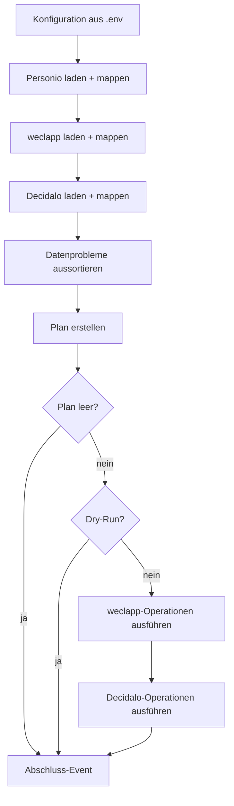

# Umsetzungsplan HR-Sync

> Stand: 2026-10-28 · Ergebnis der ersten Brainstorming-Session · Entwurf

## 1. Ziel und Umfang

HR-Sync überträgt beim Onboarding die Stammdaten neuer Mitarbeiter aus **Personio** nach **weclapp** und **Decidalo**.

- **Richtung:** nur Personio → weclapp und Personio → Decidalo. Personio ist die Quelle.
- **Schlüssel:** die Mitarbeiternummer (MA-Nummer).
- **Operationen:** nur **Anlegen**. Bestehende Personen bleiben unverändert, abweichende Felder werden geloggt.
- **Felder (Phase 1):** MA-Nummer, Vorname, Nachname, E-Mail, Eintrittsdatum. Weitere Felder folgen später
  (siehe [4.3](#43-weitere-felder-ergänzen)).
- **Nicht im Umfang:** Aktualisieren bestehender Personen, Offboarding (Personen, die nur noch im Zielsystem stehen),
  Hosting und Zeitplan.

### 1.1 Entscheidungen aus der Brainstorming-Session

| Thema | Entscheidung |
|---|---|
| MA-Nummer in Personio | Custom Attribute mit `id == "company_employee_id"` (Typ `string`, z. B. `"00165"`). Sie bleibt immer ein String, damit führende Nullen erhalten bleiben |
| Abweichungen bei bestehenden Personen | nicht überschreiben, nur loggen |
| Person ohne MA-Nummer (in jedem System) | Warn-Event, Person wird für den Plan nicht betrachtet |
| Personio-Person ohne E-Mail | Warn-Event, Person wird für den Plan nicht betrachtet |
| E-Mail | wird nach weclapp und Decidalo übertragen (weclapp braucht sie zum Anlegen) |
| Decidalo-displayName | `"Vorname Nachname"` |
| Neue Decidalo-User | `hasLogin=true`, `employeeTypeName="Internal"`. Weitere Felder sind noch offen (O5) |
| Neue weclapp-User | `status=ACTIVE` |
| Eintrittsdatum | `employment_start_date` des neuesten Employments in Personio |
| Logging | Wide Events mit Loguru. Ausgabe umschaltbar (lesbar oder JSON) |
| Personenbezogene Daten in Logs | nein: nur MA-Nummer, systeminterne IDs, Feldnamen und Zahlen |
| Betrieb | erst einmal als CLI, Secrets aus `.env`. Hosting und Zeitplan klären wir später |

## 2. Ablauf



1. Konfiguration aus `.env` laden.
2. Daten nacheinander laden: Personio, weclapp, Decidalo. Jeder Loader mappt auf das gemeinsame Modell und liefert einen
   **Snapshot**: die Datensätze nach MA-Nummer und die Hinweise auf Datenprobleme.
3. Datenprobleme aussortieren (siehe [Abschnitt 5](#5-datenprobleme)). Für jedes gibt es ein Warn-Event.
4. Plan erstellen. Das ist eine reine Funktion ohne IO: Für jede gültige Personio-Person und jedes Zielsystem gilt:
   - Die Person fehlt: Operation `CREATE`.
   - Die Person ist vorhanden: Felder vergleichen und Abweichungen festhalten (nur die Feldnamen).
5. Hat der Plan keine Operationen, endet der Lauf. Im Dry-Run wird der Plan nur geloggt.
6. Plan ausführen, erst weclapp, dann Decidalo.
7. Abschluss-Event mit Summen und Exit-Code.

Schlägt das Laden eines Systems fehl, bricht der Lauf **vor** der Planung ab. Auf unvollständigen Daten wird nicht
geplant, sonst würden bestehende Personen doppelt angelegt.

## 3. Die Systeme und ihre Clients

| System | Paket | Art | MA-Nummer steht in | Besonderheiten |
|---|---|---|---|---|
| Personio | [`personio-client`](https://github.com/Hochfrequenz/personio_client.py) `0.1.0a1` | async (aiohttp), nur lesend | Custom Attribute `company_employee_id` | Eintrittsdatum am Employment, ein Request pro Person |
| weclapp | [`weclapp-client`](https://github.com/Hochfrequenz/weclapp_client.py) `0.1.0a1` | **synchron** (httpx) | Custom Attribute `personalnummer` am `user` | eine Person = `user` + `employee`; E-Mail ist Pflicht; `entryDate` fehlt noch im Client |
| Decidalo | [`decidalo-client`](https://github.com/Hochfrequenz/decidalo_client.py) `0.3.1` | async (aiohttp), Import-API | `employeeID` | nur `displayName`; Anlegen per Batch-Upsert |

Personio und weclapp sind Pre-Releases. Wir pinnen auf die Minor-Version, z. B. `weclapp-client>=0.1.0a1,<0.2`.
Das Programm läuft mit asyncio. weclapp wird darin synchron aufgerufen, das ist unkritisch, weil die Systeme ohnehin
nacheinander abgefragt werden.

### 3.1 Personio (Quelle)

- `iter_persons(status="ACTIVE")`. Der Personenstatus `ACTIVE` umfasst auch die Employment-Status `ONBOARDING` und
  `LEAVE`, neue Mitarbeiter sind also schon vor ihrem Eintritt dabei.
- MA-Nummer: `custom_attributes` mit `id == "company_employee_id"`, `value` ohne führende und folgende Leerzeichen.
- Vorname, Nachname, E-Mail: `first_name`, `last_name`, `email`.
- Eintrittsdatum: `iter_employments(person.id)`, davon das Employment mit dem neuesten `employment_start_date`.
  Weil das ein Request pro Person ist, begrenzen wir die Parallelität mit einem `asyncio.Semaphore` (z. B. 5).
- Credentials nur mit dem Scope `personio:persons:read`.

### 3.2 weclapp (Ziel)

**Laden:**

1. Definition des Custom Attributes über `custom_attribute_definitions.get_by_key("personalnummer")`.
   Fehlt sie, ist das ein Konfigurationsfehler und der Lauf bricht ab.
2. Alle `user` und alle `employee` laden. Die Employees werden über `user_id` den Usern zugeordnet.

**Anlegen** (pro Person, in dieser Reihenfolge):

1. `users.create(UserCreate(email, first_name, last_name, status=ACTIVE, can_edit_dashboard=False, custom_attributes=[personalnummer]))`
2. `employees.create(EmployeeCreate(user_id=user.id, entry_date=...))`

**Halb angelegte Personen:** Scheitert Schritt 2, gibt es einen User mit MA-Nummer, aber ohne Personalakte. Der
Client wiederholt einen `POST` mit unklarem Ausgang bewusst nicht. Der nächste Lauf erkennt diesen Zustand und plant
die Operation `COMPLETE`, die nur noch den Employee anlegt. Das ist kein Update, sondern der Abschluss der Anlage.

**Voraussetzung:** Der `weclapp-client` kennt `entryDate` noch nicht. Er muss vorher um `entry_date` in `Employee` und
`EmployeeCreate` erweitert und neu released werden (AP 2).

### 3.3 Decidalo (Ziel)

**Laden:** `get_users()`, seitenweise mit `top` und `skip`. Wir lesen `employeeID`, `displayName`, `email` und `entryDate`.

**Anlegen:** `import_users_sync(UserBatchInput(users=[...]))` mit allen neuen Personen in einem Batch (bei Bedarf in
mehrere Batches aufgeteilt):

```python
UserInput(
    employeeID=record.employee_number,
    displayName=f"{record.first_name} {record.last_name}",
    email=record.email,
    entryDate=record.entry_date,
    hasLogin=True,
    employeeTypeName="Internal",
)
```

Die Antwort hat ein Ergebnis pro Zeile (`rowIndex`, `status`, `errorMessage`). Daraus wird ein Operation-Event pro
Person. Scheitern einzelne Zeilen, antwortet die API mit HTTP 500 und den Ergebnissen pro Zeile. Der Client liefert
diese Ergebnisse trotzdem zurück.

## 4. Datenmodell und Plan

### 4.1 Gemeinsames Modell

```python
class EmployeeRecord(BaseModel, frozen=True):
    employee_number: str              # Schlüssel, immer ein String
    first_name: str | None = None
    last_name: str | None = None
    display_name: str | None = None   # Decidalo; für Personio als "Vorname Nachname" abgeleitet
    email: str | None = None
    entry_date: date | None = None


class Snapshot(BaseModel):
    system: System                         # PERSONIO | WECLAPP | DECIDALO
    records: dict[str, EmployeeRecord]     # nach MA-Nummer, nur gültige Datensätze
    incomplete: set[str] = set()           # nur weclapp: User ohne Personalakte
    notices: list[Notice]                  # Datenprobleme, siehe Abschnitt 5
```

Systemspezifische Dinge (weclapp-User-IDs, die ID des Custom Attributes) bleiben im jeweiligen Adapter. Der Planner
kennt nur das gemeinsame Modell.

### 4.2 Plan

```python
class OperationType(StrEnum):
    CREATE = "create"        # Person fehlt im Zielsystem
    COMPLETE = "complete"    # nur weclapp: User vorhanden, Personalakte fehlt
    # später: UPDATE


class Operation(BaseModel):
    system: TargetSystem     # WECLAPP | DECIDALO
    type: OperationType
    record: EmployeeRecord   # Sollzustand aus Personio


class Deviation(BaseModel):
    system: TargetSystem
    fields: list[str]        # nur Feldnamen, keine Werte


class EmployeePlan(BaseModel):
    employee_number: str
    operations: list[Operation]
    deviations: list[Deviation]


class SyncPlan(BaseModel):
    employees: list[EmployeePlan]

    @property
    def is_empty(self) -> bool: ...   # True, wenn es keine Operationen gibt; Abweichungen zählen nicht
```

**Vergleich je Zielsystem:** Jeder Adapter legt fest, welche Felder er vergleicht.

| System | verglichene Felder |
|---|---|
| weclapp | `first_name`, `last_name`, `email`, `entry_date` |
| Decidalo | `display_name`, `email`, `entry_date` |

Vor dem Vergleich werden Leerzeichen am Anfang und Ende entfernt. E-Mails werden ohne Rücksicht auf Groß- und
Kleinschreibung verglichen.

### 4.3 Weitere Felder ergänzen

Ein neues Feld braucht diese Schritte:

1. Feld in `EmployeeRecord` aufnehmen.
2. Personio-Mapping ergänzen.
3. Mapping und Anlage-Payload je Zielsystem ergänzen, bei Bedarf den Client erweitern.
4. Feld in die verglichenen Felder des Adapters aufnehmen.
5. Tests ergänzen.

Sollen später auch Updates laufen, macht der Planner aus Abweichungen `UPDATE`-Operationen, und die Executor lernen
den neuen Operationstyp. Das Datenmodell und die Loader bleiben dabei unverändert.

## 5. Datenprobleme

| Fall | System | Folge |
|---|---|---|
| MA-Nummer fehlt oder ist leer | alle | Warn-Event `sync.notice` (`reason=missing_employee_number`), Person nicht im Plan |
| MA-Nummer kommt mehrfach vor | alle | Warn-Event (`reason=duplicate_employee_number`), alle Datensätze mit dieser Nummer nicht im Plan *(Vorschlag, ergänzt)* |
| E-Mail fehlt | Personio | Warn-Event (`reason=missing_email`), Person nicht im Plan |
| Kein Employment oder kein Startdatum | Personio | offen (O8). Vorschlag: ohne Eintrittsdatum anlegen und Warn-Event |
| Person steht nur im Zielsystem | weclapp, Decidalo | nur die Anzahl im Plan-Event (Offboarding kommt später) |

Ohne MA-Nummer wird die Person über ihre **systeminterne ID** benannt (Personio-Person-ID, weclapp-User-ID,
Decidalo-`userID`). So lässt sie sich finden, ohne dass Namen im Log stehen.

## 6. Logging mit Wide Events

**Prinzip:** Für jede Arbeitseinheit gibt es genau **ein** Event mit dem ganzen Kontext. Es wird am Ende der Einheit
ausgegeben, mit Dauer und Ergebnis, statt vieler einzelner Logzeilen.

```python
with wide_event("sync.load", system="personio") as event:
    ...
    event["records"] = len(snapshot.records)
    event["notices"] = len(snapshot.notices)
# beim Verlassen kommen dazu: run_id, dry_run, duration_ms, outcome, bei Fehlern error.type und error.message
# Ausgabe: logger.bind(**fields).log(level, "sync.load")
```

| Event | Wann | Inhalt (Auswahl) | Level |
|---|---|---|---|
| `sync.run` | einmal, am Ende | `run_id`, `dry_run`, Dauer, Summen je System und Operation, Anzahl Hinweise und Fehler, `exit_code` | INFO / ERROR |
| `sync.load` | je System | `system`, `records`, `notices`, Dauer | INFO / ERROR |
| `sync.notice` | je Datenproblem | `system`, `reason`, `system_id` | **WARNING** |
| `sync.deviation` | je Person und Zielsystem mit Abweichung | `employee_number`, `system`, `fields` | INFO |
| `sync.plan` | einmal | Operationen je System und Typ, `is_empty`, `only_in_target` je System | INFO |
| `sync.operation` | je Operation | `employee_number`, `system`, `type`, `outcome` (`success`, `error`, `skipped`, `dry_run`), `target_id`, Fehler | INFO / ERROR |

- **Keine personenbezogenen Werte:** nur MA-Nummer, systeminterne IDs, Feldnamen und Zahlen. Ein Test prüft, dass
  Namen und E-Mail-Adressen der Testdaten nicht in der Log-Ausgabe auftauchen. Fehlertexte der APIs können Werte
  enthalten, deshalb werden sie vor dem Loggen gekürzt bzw. nur mit Fehlertyp und Statuscode geloggt (siehe O12).
- **Im Dry-Run** gibt es für jede geplante Operation ein `sync.operation` mit `outcome=dry_run`. So ist pro Person
  sichtbar, was passieren würde.
- **Ausgabe umschaltbar:** `--log-format pretty|json` bzw. `HR_SYNC_LOG_FORMAT`, Standard ist `pretty`.
  `json` nutzt Loguru mit `serialize=True`, eine Zeile pro Event auf stdout.
- Die Logs der Client-Bibliotheken (stdlib `logging`) leiten wir mit einem Intercept-Handler auf Loguru um, mit dem
  Level WARNING.

## 7. Konfiguration, CLI und Fehlerbehandlung

Die Konfiguration kommt über `pydantic-settings` aus der Umgebung bzw. aus `.env`. Im Repo liegt eine `.env.example`,
die `.env` steht in `.gitignore`.

| Variable | Bedeutung |
|---|---|
| `PERSONIO_CLIENT_ID`, `PERSONIO_CLIENT_SECRET`, `PERSONIO_APP_ID` | Personio-API |
| `PERSONIO_EMPLOYEE_NUMBER_ATTRIBUTE` | Standard `company_employee_id` |
| `WECLAPP_API_TOKEN`, `WECLAPP_BASE_URL` bzw. `WECLAPP_TENANT` | weclapp-API (wie `WeclappConfig.from_env()`) |
| `WECLAPP_EMPLOYEE_NUMBER_ATTRIBUTE_KEY` | Standard `personalnummer` |
| `WECLAPP_NEW_USER_STATUS` | Standard `ACTIVE` |
| `DECIDALO_API_KEY` | Decidalo-Import-API |
| `DECIDALO_EMPLOYEE_TYPE_NAME` | Standard `Internal` |
| `DECIDALO_HAS_LOGIN` | Standard `true` |
| `HR_SYNC_LOG_FORMAT` | `pretty` oder `json` |

**CLI:** `hr-sync [--dry-run] [--log-format pretty|json]`, umgesetzt mit `argparse` (keine weitere Abhängigkeit).

**Exit-Codes:**

| Code | Bedeutung |
|---|---|
| 0 | erfolgreich, auch bei leerem Plan oder Hinweisen |
| 1 | mindestens eine Operation ist fehlgeschlagen |
| 2 | Abbruch (Konfiguration, Authentifizierung, Fehler beim Laden) |

**Fehler beim Ausführen:**

- **Fehler bei einem Datensatz** (Validierung, Konflikt, zu langer Name): Operation-Event mit ERROR, weiter mit der
  nächsten Person.
- **Systemische Fehler** (Authentifizierung, Verbindung, Rate Limit nach allen Retries, 5xx): Die restlichen
  Operationen dieses Systems werden mit `outcome=skipped` übersprungen, das andere Zielsystem läuft weiter.
- Der nächste Lauf holt alles Übersprungene nach, weil der Plan immer aus dem aktuellen Stand entsteht.

## 8. Projektstruktur

```
src/hr_sync/
├── __init__.py
├── __main__.py           # python -m hr_sync
├── cli.py                # argparse, Exit-Codes
├── config.py             # Settings (pydantic-settings)
├── events.py             # Loguru-Setup, wide_event(), Intercept-Handler
├── model.py              # EmployeeRecord, Snapshot, Notice, System
├── plan.py               # Operation, Deviation, EmployeePlan, SyncPlan
├── planner.py            # build_plan(personio, targets) -> SyncPlan, ohne IO
├── sync.py               # Orchestrierung: laden → planen → ausführen
└── systems/
    ├── personio.py       # Loader + Mapping
    ├── weclapp.py        # Loader + Mapping + Executor
    └── decidalo.py       # Loader + Mapping + Executor
unittests/
```

Laufzeit-Abhängigkeiten: `personio-client`, `weclapp-client`, `decidalo-client`, `loguru`, `pydantic`,
`pydantic-settings`. Für die Tests kommen `pytest-asyncio` und `aioresponses` dazu.

## 9. Tests

| Ebene | Wie |
|---|---|
| Planner | reine Unit-Tests ohne IO, tabellengetrieben (fehlt, vorhanden, Abweichung, unvollständig, Datenprobleme) |
| Mapping | Unit-Tests mit Modellinstanzen der Clients |
| Personio, Decidalo | `aioresponses` (beide Clients nutzen aiohttp und testen selbst so) |
| weclapp | `weclapp_client.testing.FakeWeclapp` |
| Ende-zu-Ende | ganzer Lauf gegen die Fakes; **ein zweiter Lauf erzeugt keine Schreibzugriffe**; Dry-Run schreibt nichts |
| Events | Loguru-Sink in eine Liste; Felder und Level prüfen; keine personenbezogenen Werte |

## 10. Arbeitspakete

Die Reihenfolge baut zuerst den Kern ohne IO und hängt dann die Systeme an:

| AP | Inhalt | Ergebnis |
|---|---|---|
| 0 | **Repo-Setup:** Template auf `hr_sync` umbenennen, `pyproject.toml` (Name, Abhängigkeiten, `[project.scripts]`), `.env.example`, README-Gerüst, PyPI-Publish-Workflow entfernen (es ist eine Anwendung, keine Bibliothek) | CI grün mit leerem Paket |
| 1 | **Datenmodell, Plan und Planner** inklusive Datenproblemen | Planner vollständig getestet |
| 2 | **weclapp-client erweitern** (`entry_date` in `Employee` und `EmployeeCreate`), im Repo `weclapp_client.py`, mit Release | neue Client-Version auf PyPI |
| 3 | **Wide Events** mit Loguru, umschaltbare Ausgabe, Intercept-Handler | `wide_event()` getestet |
| 4 | **Personio-Loader** und Mapping | Snapshot aus Personio |
| 5 | **weclapp-Loader und -Executor** (`CREATE`, `COMPLETE`) | gegen `FakeWeclapp` getestet |
| 6 | **Decidalo-Loader und -Executor** (Batch-Import, Ergebnisse pro Zeile) | mit `aioresponses` getestet |
| 7 | **Orchestrierung, CLI, Dry-Run, Exit-Codes**, Ende-zu-Ende-Tests | `hr-sync --dry-run` läuft |
| 8 | **Testlauf:** Dry-Run gegen die echten Systeme (nur lesend), offene Punkte klären, erster echter Lauf mit einer Testperson | Go-live-Entscheidung |

AP 2 liegt in einem anderen Repo und kann parallel zu AP 1, 3 und 4 laufen.

## 11. Offene Punkte

| # | Frage | Bis wann | Bezug |
|---|---|---|---|
| O1 | Kosten aktive weclapp-User (`ACTIVE`) eine Lizenz? Geht `ACTIVE` ohne Lizenz überhaupt? | vor AP 8 | weclapp S1 ([#14](https://github.com/Hochfrequenz/weclapp_client.py/issues/14)) |
| O2 | Verschickt weclapp beim Anlegen eines aktiven Users automatisch eine Einladung? | vor AP 8 | weclapp S3 ([#16](https://github.com/Hochfrequenz/weclapp_client.py/issues/16)) |
| O3 | Gibt es das Custom Attribute `personalnummer` im weclapp-Tenant schon, und sind die Bestands-User gepflegt? | vor AP 8 | weclapp S4 ([#17](https://github.com/Hochfrequenz/weclapp_client.py/issues/17)) |
| O4 | Prüft weclapp E-Mail-Adressen auf Eindeutigkeit? (siehe Risiko R2) | vor AP 8 | weclapp S2 ([#15](https://github.com/Hochfrequenz/weclapp_client.py/issues/15)) |
| O5 | Welche weiteren Felder braucht ein neuer Decidalo-User (Berechtigungsrolle, Team, Standort, Land, …)? Bekommt er bei `hasLogin=true` eine Mail? | vor AP 6 | Brainstorming |
| O6 | Woran erkennt der Decidalo-Import bestehende User (`employeeID`, `email`, beides)? Ein User ohne `employeeID`, aber mit gleicher E-Mail könnte sonst überschrieben werden | vor AP 6 | Risiko R3 |
| O7 | Hat `GET /importapi/User` eine maximale Seitengröße, und wie groß darf ein Import-Batch sein? | AP 6 | – |
| O8 | Personio-Person ohne Employment oder Startdatum: ohne Eintrittsdatum anlegen oder überspringen? | AP 1 | Abschnitt 5 |
| O9 | Betrieb: Hosting, Zeitplan, Verwaltung der Secrets | später | weclapp S6 ([#19](https://github.com/Hochfrequenz/weclapp_client.py/issues/19)) |
| O10 | Brauchen wir eine Ignore-Liste für technische User ohne MA-Nummer (Admins, API-User), damit die Warnungen nicht jedes Mal kommen? | nach AP 8 | Risiko R5 |
| O11 | Welche Python-Version? Laut weclapp-Plan (K3) die neueste | AP 0 | – |
| O12 | Wie gehen wir mit API-Fehlertexten um, die personenbezogene Werte enthalten können? | AP 3 | Abschnitt 6 |

## 12. Risiken

| # | Risiko | Gegenmaßnahme |
|---|---|---|
| R1 | Aktive weclapp-User kosten Lizenzen oder lösen Einladungs-Mails aus | O1 und O2 vor dem ersten echten Lauf klären; erster Lauf mit einer Testperson |
| R2 | In weclapp gibt es schon einen User mit derselben E-Mail, aber ohne MA-Nummer. Der Sync betrachtet ihn nicht und legt die Person neu an: Dublette, oder weclapp lehnt das ab | Warnung für User ohne MA-Nummer; Bestandsdaten vor dem ersten Lauf pflegen (O3); Dry-Run zuerst |
| R3 | Der Decidalo-Import ist ein Upsert. Erkennt er User über die E-Mail, ändert er womöglich einen bestehenden User, obwohl wir nur anlegen wollen | O6 klären; vor dem Import prüfen, ob die E-Mail schon bei einem User ohne `employeeID` vorkommt |
| R4 | Die Clients sind Pre-Releases, weclapp ist noch nicht gegen einen echten Tenant getestet | auf Minor-Version pinnen; AP 8 zuerst nur lesend |
| R5 | Viele Warnungen durch technische User ohne MA-Nummer verdecken die wichtigen | Warnungen gezielt auswerten; bei Bedarf Ignore-Liste (O10) |
| R6 | Personenbezogene Daten gelangen über Fehlertexte oder Client-Logs ins Log | Event-Felder fest definiert; Test auf PII in der Ausgabe; Client-Logs nur ab WARNING (O12) |
| R7 | Laden schlägt teilweise fehl, der Sync legt bestehende Personen doppelt an | Abbruch vor der Planung, wenn ein System nicht vollständig geladen wurde |
