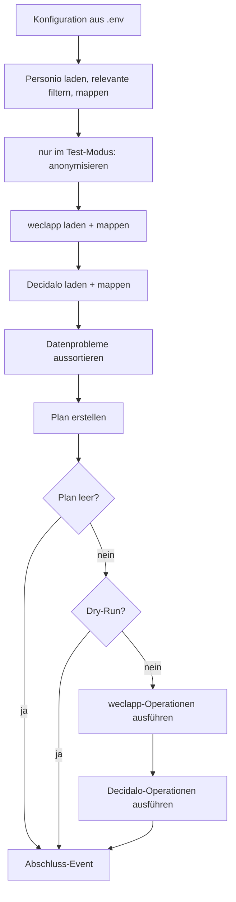

# Umsetzungsplan HR-Sync

> Stand: 2026-10-28 · Ergebnis der ersten Brainstorming-Session · Entwurf

## 1. Ziel und Umfang

HR-Sync überträgt beim Onboarding die Stammdaten neuer Mitarbeiter aus **Personio** nach **weclapp** und **Decidalo**.

- **Richtung:** nur Personio → weclapp und Personio → Decidalo. Personio ist die Quelle.
- **Schlüssel:** die Mitarbeiternummer (MA-Nummer).
- **Operationen:** nur **Anlegen**. Bestehende Personen bleiben unverändert, abweichende Felder werden geloggt.
- **Felder (Phase 1):** MA-Nummer, Vorname, Nachname, E-Mail, Eintrittsdatum. Weitere Felder folgen später
  (siehe [4.3](#43-weitere-felder-ergänzen)).
- **Verteilung:** Am Ende erscheint HR-Sync als PyPI-Paket `hochfrequenz-hr-sync`, das auch andere Firmen nutzen
  können (siehe [Abschnitt 9](#9-pypi-paket)).
- **Nicht im Umfang:** Aktualisieren bestehender Personen, Offboarding (Personen, die nur noch im Zielsystem stehen),
  Hosting und Zeitplan im Detail (die Richtung steht, siehe O9).

### 1.1 Entscheidungen aus der Brainstorming-Session

| Thema | Entscheidung |
|---|---|
| MA-Nummer in Personio | Custom Attribute mit `id == "company_employee_id"` (Typ `string`, z. B. `"00165"`). Sie bleibt immer ein String, damit führende Nullen erhalten bleiben |
| MA-Nummer in weclapp | Custom Attribute am `user`, konfiguriert über die **ID der Definition** (`WECLAPP_EMPLOYEE_NUMBER_ATTRIBUTE_ID`, bei Hochfrequenz `7621`). Der Wert steht als String in `stringValue`, z. B. `"00165"` |
| Abweichungen bei bestehenden Personen | nicht überschreiben, nur loggen |
| Person ohne MA-Nummer (in jedem System) | Warn-Event, Person wird für den Plan nicht betrachtet |
| Personio-Person ohne E-Mail | Warn-Event, Person wird für den Plan nicht betrachtet |
| Personio-E-Mail bei mehreren Mitarbeitern | Warn-Event `duplicate_email` für jeden Betroffenen, keiner wird für den Plan betrachtet |
| **Grundsatz bei Datenproblemen** | Gibt es zu einem Mitarbeiter ein Datenproblem, in Personio oder in einem Zielsystem, passiert mit ihm nichts: in keinem Zielsystem, und es gilt auch kein „der Erste gewinnt“. Angelegt wird nur, wer überall stimmig ist. Das Problem wird als Warnung geloggt. **Abweichungen** (z. B. ein anderer Nachname in weclapp) sind kein Datenproblem: Sie werden nur geloggt und blockieren das Anlegen im anderen System nicht |
| E-Mail | wird nach weclapp und Decidalo übertragen (weclapp braucht sie zum Anlegen) |
| Decidalo-displayName | `"Vorname Nachname"` |
| Anlegen in Decidalo | über den **synchronen Import-Endpunkt** `POST /importapi/User/ImportSync` (Client: `import_users_sync`), nicht über `ImportAsync`. Die Ergebnisse pro Zeile kommen direkt in der Antwort, ohne Polling und ohne Callback |
| Neue Decidalo-User | `hasLogin=true`, `employeeTypeName="Internal"`. `isImported` wird nicht gesetzt. Vorerst nur diese und die Stammdatenfelder, weitere Felder sind noch offen (O5) |
| Decidalo-Zeilenstatus | Nur `Created` ist ein Erfolg. Jeder andere Status, auch `Updated`, ist ein Fehler, weil HR-Sync nur neue User schickt |
| Deaktivierter Decidalo-User | Gehört seine MA-Nummer einem relevanten Personio-Mitarbeiter (z. B. Wiedereintritt), ist das ein Datenproblem: Warn-Event `deactivated_in_target`, und nach dem Grundsatz passiert mit dem Mitarbeiter nichts |
| Gescheiterter Aufruf | Scheitert ein Aufruf als Ganzes, sind die Operationen seines Pakets Fehler. Die restlichen Operationen dieses Systems werden übersprungen (`skipped`) |
| Neue weclapp-User | `status=ACTIVE`. Aktive User kosten Lizenzgebühren, die Kosten sind eingeplant |
| Relevante Personio-Mitarbeiter | **nur mit einem Employment im Status `ACTIVE`, dessen Startdatum heute oder in der Vergangenheit liegt** |
| Eintrittsdatum | `employment_start_date` dieses Employments. Gibt es mehrere, gilt das mit dem neuesten Startdatum |
| Datumswerte | tagesgenau als `datetime.date`, ohne Uhrzeit und ohne Zeitzonen. Alle Mitarbeiter sind in Deutschland. „Heute“ ist `date.today()` beim Start des Laufs |
| Programmstruktur | synchron, gut wart- und debugbar. async nur gekapselt in den Adaptern für Personio und Decidalo, mit einem `asyncio.run` je Lauf und System. Anfragen nacheinander. Jeder Adapter trennt Laden (IO) und Mappen (reine Logik), siehe Abschnitt 3 |
| Logging | Wide Events mit Loguru. Ausgabe umschaltbar (lesbar oder JSON) |
| Personenbezogene Daten in Logs | nein: nur MA-Nummer, systeminterne IDs, Feldnamen und Zahlen |
| Betrieb | zeitgesteuert auf einem internen Server (Cron, Task Scheduler oder Container-Job), die Secrets liegen dort in einer `.env`. Welcher Server, welches Intervall und wer benachrichtigt wird, ist offen (O9) |
| PyPI-Paket | `hochfrequenz-hr-sync`, Befehl `hr-sync`, Import-Paket `hr_sync`, Lizenz MIT wie die Clients. Der Zeitpunkt des ersten Releases ist offen (O14) |
| Zielgruppe des Pakets | auch andere Firmen: Alles Firmenspezifische ist konfigurierbar und dokumentiert. CLI, Umgebungsvariablen, Exit-Codes und Event-Felder sind eine stabile Schnittstelle |
| Stabile Version | erst, wenn auch die Clients stabil sind. Bis dahin erscheint HR-Sync nur als Pre-Release |
| E-Mail im Zielsystem schon vergeben | Gehört die E-Mail eines Mitarbeiters im Zielsystem einem anderen User (ohne oder mit anderer MA-Nummer), ist das ein Datenproblem: Es gibt ein Warn-Event `email_in_use`, und nach dem Grundsatz passiert mit dem Mitarbeiter nichts, in keinem System |
| weclapp-Umgebung | Es gibt keinen Test-Tenant, wir arbeiten in der Produktion. Das Feld für die Personalnummer gibt es dort schon, ein späterer Test-Tenant bekommt es auch |
| Zielsysteme | wählbar mit `--target weclapp` bzw. `--target decidalo`, Standard sind beide |
| Testumgebungen | In Testumgebungen landen keine echten Namen oder E-Mails: Im Test-Modus (`HR_SYNC_ENVIRONMENT=test`) wird anonymisiert. MA-Nummer und Eintrittsdatum bleiben echt |
| Decidalo im Test-Modus | eigene URL und eigener Key (`DECIDALO_TEST_BASE_URL`, `DECIDALO_TEST_API_KEY`), `hasLogin=false`. Die Testumgebung ist nur im Test-Modus erreichbar |
| Integrationstest | Personio produktiv lesen, nur den ersten Planeintrag in die Decidalo-Testumgebung schreiben. Danach die Testperson wahlweise automatisch löschen (erst nachdem geprüft ist, dass sie angelegt wurde) oder zum Ansehen liegen lassen. Läuft nur lokal |

## 2. Ablauf



1. Konfiguration aus `.env` laden.
2. Daten nacheinander laden: Personio und die Zielsysteme aus `--target` (Standard: weclapp und Decidalo). Jeder Loader
   mappt auf das gemeinsame Modell und liefert einen **Snapshot**: die Datensätze nach MA-Nummer und die Hinweise auf
   Datenprobleme. Aus Personio kommen nur relevante Mitarbeiter (siehe [3.1](#31-personio-quelle)).
   Im Test-Modus wird der Personio-Snapshot direkt nach dem Laden anonymisiert (siehe
   [Abschnitt 8](#8-testumgebungen-und-anonymisierung)).
3. Datenprobleme aussortieren (siehe [Abschnitt 5](#5-datenprobleme)). Für jedes gibt es ein Warn-Event.
4. Plan erstellen. Das ist eine reine Funktion ohne IO: Für jede gültige Personio-Person (mit `--only` nur für die
   angegebenen MA-Nummern, siehe [Abschnitt 7](#7-konfiguration-cli-und-fehlerbehandlung)) und jedes Zielsystem gilt:
   - Die Person fehlt: Operation `CREATE`.
   - Die Person ist vorhanden: Felder vergleichen und Abweichungen festhalten (nur die Feldnamen).
   - Gibt es in einem Zielsystem ein Datenproblem zu der Person, z. B. eine doppelte MA-Nummer oder ihre E-Mail an
     einem anderen User, plant der Planner für sie keine Operation, in keinem Zielsystem (siehe 4.2).
5. Hat der Plan keine Operationen, endet der Lauf. Im Dry-Run wird der Plan nur geloggt.
6. Plan ausführen, erst weclapp, dann Decidalo.
7. Abschluss-Event mit Summen und Exit-Code.

Schlägt das Laden eines Systems fehl, bricht der Lauf **vor** der Planung ab. Auf unvollständigen Daten wird nicht
geplant, sonst würden bestehende Personen doppelt angelegt.

## 3. Die Systeme und ihre Clients

| System | Paket | Art | MA-Nummer steht in | Besonderheiten |
|---|---|---|---|---|
| Personio | [`personio-client`](https://github.com/Hochfrequenz/personio_client.py) `0.1.0a1` | async (aiohttp), nur lesend | Custom Attribute `company_employee_id` | Eintrittsdatum am Employment, ein Request pro Person |
| weclapp | [`weclapp-client`](https://github.com/Hochfrequenz/weclapp_client.py) `0.1.0a1` | **synchron** (httpx) | Custom Attribute am `user`, über die ID seiner Definition (bei Hochfrequenz `7621`) | eine Person = `user` + `employee`; E-Mail ist Pflicht; `entryDate` fehlt noch im Client |
| Decidalo | [`decidalo-client`](https://github.com/Hochfrequenz/decidalo_client.py) `0.3.1` | async (aiohttp), Import-API | `employeeID` | nur `displayName`; Anlegen über den synchronen Import `ImportSync` (ein Upsert) |

Personio und weclapp sind Pre-Releases. Wir pinnen auf die Minor-Version, z. B. `weclapp-client>=0.1.0a1,<0.2`.

**HR-Sync ist synchron.** `personio-client` und `decidalo-client` gibt es nur async. Ihre Adapter kapseln das: Je
Schritt (Laden, Ausführen) öffnet genau eine Funktion den Client in einem einzigen `asyncio.run(...)`, stellt die
Anfragen nacheinander und schließt den Client wieder. Für den Rest des Programms (Planner, Events, Orchestrierung, CLI, weclapp)
ist async unsichtbar. Das hält Stacktraces und Breakpoints linear und die Tests ohne Event-Loop.

**Nacheinander statt parallel.** Auch innerhalb eines Systems laufen die Anfragen nacheinander. Die Log-Events kommen
dann in der Reihenfolge der Arbeit, Fehler lassen sich reproduzieren, und das Rate Limit von Personio wird geschont.
Die längere Laufzeit (grob 30 s bei 100 Mitarbeitern) ist für einen zeitgesteuerten Lauf unkritisch. Wird sie doch
zum Problem, lässt sich Parallelität in der Lade-Funktion nachrüsten, ohne dass sich sonst etwas ändert.

**Aufbau jedes Adapters: laden, mappen.**

| Teil | Aufgabe | Tests |
|---|---|---|
| `fetch_…` | nur IO: Daten mit dem Client holen und so zurückgeben, wie sie kommen | wenige Tests mit einem kleinen Fake-Client |
| `map_…` | Regeln, Mapping und Snapshot, ohne IO und ohne async | mit einfachen Daten, ohne Client |
| `load_…` | ruft beides auf und erzeugt das Event `sync.load` | Inhalt des Events |

Die Executor der Zielsysteme folgen demselben Muster:

| Teil | Aufgabe | Tests |
|---|---|---|
| `send_…` | nur IO: die Anfragen stellen und die Antworten zurückgeben | mit einem Fake-Client |
| `evaluate_…` | aus den Antworten ein `OperationResult` je Operation machen, ohne IO | mit einfachen Daten |
| `execute_…` | ruft beides auf und erzeugt ein Event `sync.operation` je Operation | Inhalt der Events |

Fast der ganze fachliche Code steckt damit in reinen Funktionen. Man kann sie im Debugger mit echten Daten aus einem
Lauf füttern.

### 3.1 Personio (Quelle)

**Welche Mitarbeiter relevant sind:** Ein Mitarbeiter ist für den Sync nur relevant, wenn er ein Employment hat, das
beide Bedingungen erfüllt:

1. Der `status` des Employments ist `ACTIVE`. Weil Personio die Groß- und Kleinschreibung nicht einheitlich verwendet,
   vergleichen wir ohne Rücksicht darauf.
2. Das `employment_start_date` liegt **heute oder in der Vergangenheit**.

Erfüllen mehrere Employments beide Bedingungen, gilt das mit dem neuesten Startdatum. Alle anderen Mitarbeiter sind
nicht relevant, z. B. künftige Mitarbeiter (`ONBOARDING` oder Start in der Zukunft), Mitarbeiter in Elternzeit o. Ä.
(`LEAVE`) und ausgeschiedene (`INACTIVE`). Sie werden erst angelegt, sobald ihr Employment die Bedingungen erfüllt.

**Sonderfall: aktives Employment ohne Startdatum.** Erfüllt kein Employment beide Bedingungen, hat der Mitarbeiter
aber ein Employment im Status `ACTIVE` ohne `employment_start_date`, ist das ein Datenproblem: Es gibt ein Warn-Event
(`missing_entry_date`), und der Mitarbeiter kommt nicht in den Plan. Diesen Fall prüfen wir **vor** dem Datumsfilter,
sonst würde er still als „nicht relevant“ verschwinden.

Die Prüfung läuft pro Mitarbeiter in dieser Reihenfolge:

1. Gibt es ein Employment mit `ACTIVE` und Startdatum heute oder früher? Dann ist der Mitarbeiter relevant.
2. Sonst: Gibt es ein Employment mit `ACTIVE` ohne Startdatum? Dann gibt es ein Warn-Event `missing_entry_date`.
3. Sonst ist der Mitarbeiter nicht relevant, mit dem Grund `employment_not_active` oder `start_date_in_future`.

„Heute“ ist `date.today()` beim Start des Laufs. Es zählt nur der Tag, Zeitzonen spielen keine Rolle, weil alle
Mitarbeiter in Deutschland sind. Der Loader bekommt das Datum als Parameter, damit Tests es festlegen können.

**Laden und mappen:**

- `iter_persons(status="ACTIVE")` als Vorfilter. Der Personenstatus `ACTIVE` umfasst die Employment-Status `ACTIVE`,
  `ONBOARDING` und `LEAVE`. Die genaue Regel prüfen wir danach am Employment.
- `iter_employments(person.id)` für jede Person, nacheinander, daraus das relevante Employment bestimmen.
- MA-Nummer, E-Mail und doppelte MA-Nummern prüfen wir erst **nach** diesem Filter (Abschnitt 5). Künftige
  Mitarbeiter, denen MA-Nummer oder E-Mail noch fehlen, lösen also keine Warnung aus.
- Für geladene, aber ausgeschlossene Mitarbeiter mit MA-Nummer merkt sich der Snapshot den Grund (`excluded`). Das
  braucht `--only` für eine genaue Meldung (Abschnitt 7).
- MA-Nummer: `custom_attributes` mit `id == "company_employee_id"`, `value` ohne führende und folgende Leerzeichen.
- Vorname, Nachname, E-Mail: `first_name`, `last_name`, `email`.
- Eintrittsdatum: `employment_start_date` des relevanten Employments.
- Credentials nur mit dem Scope `personio:persons:read`.

Umgesetzt in [`systems/personio.py`](../../src/hr_sync/systems/personio.py) (AP 4):

- `fetch_persons(client)` holt die Personen und ihre Employments nacheinander, als Liste von `LoadedPerson`. Den
  Client öffnet und schließt die Funktion selbst in einem `asyncio.run`, auch bei einem Fehler.
- `map_persons(persons, employee_number_attribute=…, today=…)` ist rein. Sie liefert den Snapshot sowie die Zahlen
  `without_id` und `not_relevant` je Grund.
- `load_personio(client, employee_number_attribute=…, today=…)` ruft beides auf und erzeugt das Event `sync.load` mit
  `persons`, `without_id`, `records`, `notices` und `not_relevant`.
- `relevant_employment(employments, today)` setzt die Relevanzregel um. Das Ergebnis ist das relevante Employment
  oder der Grund, warum es keines gibt.
- `employee_number_of(person, attribute_id)` liest die MA-Nummer. Eine Zahl wird zum String, leere Werte gelten als
  fehlend.
- `client` ist als Protocol `PersonioSource` typisiert (asynchroner Kontextmanager, `iter_persons`,
  `iter_employments`). mypy prüft, dass der echte `PersonioClient` das Protocol erfüllt.
- Personen ohne `id` (laut Spec optional) lassen sich nicht abfragen. Sie werden übersprungen und in `without_id`
  gezählt.

### 3.2 weclapp (Ziel)

**Laden:**

1. Die Definition des Custom Attributes über ihre ID laden: `custom_attribute_definitions.get(WECLAPP_EMPLOYEE_NUMBER_ATTRIBUTE_ID)`.
   Gibt es sie nicht, oder ist sie kein String-Attribut (`attribute_type`) für User (`attribute_entity_type` bzw.
   `entities`), ist das ein Konfigurationsfehler: Der Lauf bricht ab. Diese Prüfung fängt auch eine ID ab, die in einem
   anderen Tenant zu einem ganz anderen Attribut gehört.
2. Alle `user` und alle `employee` laden. Die Employees werden über `user_id` den Usern zugeordnet.
3. MA-Nummer: `user.custom_attribute(definition.id).string_value`, z. B. `"00165"`.

**Anlegen** (pro Person, in dieser Reihenfolge):

1. `users.create(UserCreate(email, first_name, last_name, status=ACTIVE, can_edit_dashboard=False, custom_attributes=[CustomAttribute.of_string(definition.id, employee_number)]))`
2. `employees.create(EmployeeCreate(user_id=user.id, entry_date=...))`

**Halb angelegte Personen:** Scheitert Schritt 2, gibt es einen User mit MA-Nummer, aber ohne Personalakte. Der
Client wiederholt einen `POST` mit unklarem Ausgang bewusst nicht. Der nächste Lauf erkennt diesen Zustand und plant
die Operation `COMPLETE`, die nur noch den Employee anlegt. Das ist kein Update, sondern der Abschluss der Anlage.

**Voraussetzung:** Der `weclapp-client` kennt `entryDate` noch nicht. Er muss vorher um `entry_date` in `Employee` und
`EmployeeCreate` erweitert und neu released werden (AP 2).

### 3.3 Decidalo (Ziel)

**Basis-URL:** Im Produktionsmodus nutzt der Sync fest die produktive URL `https://import.decidalo.dev`, sie lässt
sich nicht umkonfigurieren. Die Testumgebung ist nur im Test-Modus erreichbar, mit eigenen Variablen (siehe
[Abschnitt 8](#8-testumgebungen-und-anonymisierung)). Der Client nimmt die URL als `base_url` an.

**Laden:** `get_users()` ohne `top`. Laut Spec liefert der Endpunkt dann alle User, eine Höchstgrenze ist nicht
dokumentiert (O7). Wir lesen `employeeID`, `displayName`, `email` und `entryDate`.

**Anlegen:** über den synchronen Import-Endpunkt `POST /importapi/User/ImportSync`, im Client
`import_users_sync(UserBatchInput(users=[...]))`. Die neuen Personen gehen in Paketen von höchstens 100 an den Endpunkt.
Eine Höchstgröße dokumentiert die Spec nicht, wir prüfen sie in der Testumgebung (O7). Den asynchronen Endpunkt
`ImportAsync` nutzen wir nicht: Dort müssten wir das Ergebnis über `ImportStatus` abfragen oder einen Callback anbieten.
Bei `ImportSync` stehen die Ergebnisse direkt in der Antwort.

`isImported` senden wir nicht. `includeInResourceManagement` ist beim Anlegen laut Spec standardmäßig `true`.

```python
UserInput(
    employeeID=record.employee_number,
    displayName=record.display_name,  # "Vorname Nachname", siehe display_name_of
    email=record.email,
    entryDate=record.entry_date,
    hasLogin=True,                 # im Test-Modus immer False
    employeeTypeName="Internal",
)
```

Die Antwort von `ImportSync` hat ein Ergebnis pro Zeile (`rowIndex`, `status`, `errorMessage`). Daraus wird ein
Operation-Event pro Person. Scheitern einzelne Zeilen, antwortet die API mit HTTP 500 und den Ergebnissen pro Zeile.
Der Client liefert diese Ergebnisse trotzdem zurück.

Umgesetzt in [`systems/decidalo.py`](../../src/hr_sync/systems/decidalo.py) (AP 6):

- **Laden:**
  - `fetch_users(client)` holt alle User.
  - `map_users(users)` mappt `employeeID`, `displayName`, `email` und `entryDate`. Die `system_id` ist die `userID`.
  - `load_decidalo(client)` ruft beides auf und erzeugt das Event `sync.load` mit `users`, `records`, `deactivated`
    und `notices`.
- **Deaktivierte User** (`deactivationDate` gesetzt) gehören zum Snapshot, sie sind in `Snapshot.deactivated`
  markiert. Ein Problem sind sie nur, wenn ihre MA-Nummer einem relevanten Personio-Mitarbeiter gehört. Dann erzeugt
  der Planner ein Warn-Event `deactivated_in_target`, und mit dem Mitarbeiter passiert in keinem System etwas, z. B.
  bei einem Wiedereintritt, bis jemand den User reaktiviert. Ehemalige Mitarbeiter erzeugen so keine Warnungen.
- **Anlegen:** `execute_decidalo(client, operations, employee_type_name=…, has_login=…, batch_size=100)`. Es nimmt nur
  Decidalo-`CREATE` an, alles andere ist ein Programmierfehler (`ValueError`).
  - `user_input` baut die Zeile. Es sendet vorerst nur die festgelegten Felder (O5).
  - `send_batches` schickt die Pakete nacheinander und hört nach dem ersten Aufruf auf, der als Ganzes scheitert:
    `DecidaloClientError`, `aiohttp.ClientError` oder `TimeoutError`. Andere Exceptions sind Programmierfehler und
    werden nicht abgefangen.
  - `evaluate_batches` ordnet die Zeilen über die `employeeID` zu, nicht über `rowIndex`: Die Spec sagt nicht, ob
    `rowIndex` bei 0 oder 1 beginnt.
    - Nur der Zeilenstatus `Created` ist ein Erfolg. Jeder andere Status ist ein Fehler, denn HR-Sync schickt nur
      neue User. `Updated` oder `NotModified` hieße also, dass Decidalo einen bestehenden User getroffen hat.
    - Fehlt die Zeile, ist das ein Fehler mit `detail=no_result`.
    - Bei einem gescheiterten Aufruf sind die Operationen seines Pakets Fehler und die restlichen `skipped`.
  - Die `errorMessage` von Decidalo wird nie geloggt, weil sie personenbezogene Daten enthalten kann.

## 4. Datenmodell und Plan

### 4.1 Gemeinsames Modell

```python
class EmployeeRecord(BaseModel, frozen=True):
    employee_number: str              # Schlüssel, immer ein String
    first_name: str | None = None
    last_name: str | None = None
    display_name: str | None = None   # Decidalo; für Personio als "Vorname Nachname" abgeleitet
    email: str | None = None
    entry_date: date | None = None


class Snapshot(BaseModel):
    system: System                         # PERSONIO | WECLAPP | DECIDALO
    records: dict[str, EmployeeRecord]     # nach MA-Nummer, nur gültige Datensätze
    system_ids: dict[str, str] = {}        # MA-Nummer → ID des gültigen Datensatzes im System
    incomplete: set[str] = set()           # nur weclapp: User ohne Personalakte
    deactivated: set[str] = set()          # nur Decidalo: deaktivierte User
    excluded: dict[str, ExclusionReason] = {}  # MA-Nummer → Grund des Ausschlusses (in den Zielen: Dubletten)
    email_owners: dict[str, tuple[str, ...]] = {}  # E-Mail (ohne Groß-/Kleinschreibung) → IDs aller User damit
    notices: list[Notice]                  # Datenprobleme, siehe Abschnitt 5
```

Systemspezifische Dinge (weclapp-User-IDs, die ID des Custom Attributes) bleiben im jeweiligen Adapter. Der Planner
kennt nur das gemeinsame Modell.

### 4.2 Plan

```python
class OperationType(StrEnum):
    CREATE = "create"        # Person fehlt im Zielsystem
    COMPLETE = "complete"    # nur weclapp: User vorhanden, Personalakte fehlt
    # später: UPDATE


class Operation(BaseModel):
    system: TargetSystem     # WECLAPP | DECIDALO
    type: OperationType
    record: EmployeeRecord   # Sollzustand aus Personio


class Deviation(BaseModel):
    system: TargetSystem
    fields: list[str]        # nur Feldnamen, keine Werte


class EmployeePlan(BaseModel):
    employee_number: str
    operations: list[Operation]
    deviations: list[Deviation]


class SyncPlan(BaseModel):
    employees: list[EmployeePlan]    # sortiert nach MA-Nummer, damit "der erste Eintrag" eindeutig ist
    only_in_target: dict[TargetSystem, int]  # je Zielsystem: Personen, die in Personio gar nicht vorkommen
    notices: list[Notice]            # Hinweise aus der Planung, z. B. email_in_use

    @property
    def is_empty(self) -> bool: ...   # True, wenn es keine Operationen gibt; Abweichungen zählen nicht
```

**Ergebnis der Ausführung:** Die Executor liefern je Operation ein
`OperationResult(operation, outcome, target_id, detail, error)`.
- `outcome` ist `success`, `error`, `skipped` oder `dry_run`.
- `detail` ist ein Grund aus dem Zielsystem, z. B. der Zeilenstatus von Decidalo.
- `error` enthält die `error_fields` einer Exception.

Daraus entstehen die Events `sync.operation` und die Summen in `sync.run` (AP 7).

**Vergleich je Zielsystem:** Welche Felder je Zielsystem verglichen werden, steht zentral im Planner (`COMPARED_FIELDS`),
damit die Vergleichsregeln an einer Stelle liegen.

| System | verglichene Felder |
|---|---|
| weclapp | `first_name`, `last_name`, `email`, `entry_date` |
| Decidalo | `display_name`, `email`, `entry_date` |

Vor dem Vergleich werden Leerzeichen am Anfang und Ende entfernt. E-Mails werden ohne Rücksicht auf Groß- und
Kleinschreibung verglichen.

**Datenprobleme in den Zielsystemen:** Bevor der Planner für einen Mitarbeiter etwas plant, prüft er jedes gewählte
Zielsystem auf zwei Probleme:

- Die MA-Nummer kommt dort mehrfach vor (sie steht in `excluded`). Das meldet bereits der Snapshot.
- Die E-Mail des Mitarbeiters gehört dort einem anderen User (`email_owners`, ohne Rücksicht auf Groß- und
  Kleinschreibung). Der eigene Datensatz des Mitarbeiters (`system_ids`) zählt nicht. Für jeden anderen User erzeugt
  der Planner ein Warn-Event `email_in_use` mit der MA-Nummer und der `system_id` dieses Users.

Findet er eines davon, gilt der Grundsatz aus 1.1: Für den Mitarbeiter plant er keine Operation, **in keinem
Zielsystem**. Abweichungen bleiben im Plan, weil sie ohnehin nur geloggt werden. So entstehen keine Dubletten in weclapp
(R2), `ImportSync` ändert keinen fremden Decidalo-User (R3), und ein Mitarbeiter steht nie nur halb in den Systemen.

### 4.3 Weitere Felder ergänzen

Ein neues Feld braucht diese Schritte:

1. Feld in `EmployeeRecord` aufnehmen.
2. Personio-Mapping ergänzen.
3. Mapping und Anlage-Payload je Zielsystem ergänzen, bei Bedarf den Client erweitern.
4. Feld in die verglichenen Felder des Adapters aufnehmen.
5. Anonymisierungsregel für den Test-Modus festlegen (siehe [8.2](#82-anonymisierung)).
6. Tests ergänzen.

Sollen später auch Updates laufen, macht der Planner aus Abweichungen `UPDATE`-Operationen, und die Executor lernen
den neuen Operationstyp. Das Datenmodell und die Loader bleiben dabei unverändert.

## 5. Datenprobleme

| Fall | System | Folge |
|---|---|---|
| MA-Nummer fehlt oder ist leer | alle | Warn-Event `sync.notice` (`reason=missing_employee_number`), Person nicht im Plan |
| MA-Nummer kommt mehrfach vor | alle | Warn-Event (`reason=duplicate_employee_number`), alle Datensätze mit dieser Nummer nicht im Plan. Kommt sie in einem Zielsystem mehrfach vor, passiert mit dem Mitarbeiter in keinem System etwas |
| E-Mail fehlt | Personio | Warn-Event (`reason=missing_email`), Person nicht im Plan |
| E-Mail kommt bei mehreren Mitarbeitern vor (auch bei einem ohne MA-Nummer) | Personio | Warn-Event (`reason=duplicate_email`) für jeden Betroffenen; keiner von ihnen kommt in den Plan, auch nicht „der Erste“ |
| Employment `ACTIVE`, aber ohne Startdatum, und kein anderes Employment erfüllt die Bedingungen | Personio | Warn-Event (`reason=missing_entry_date`), Person nicht im Plan. Geprüft wird vor dem Datumsfilter (siehe [3.1](#31-personio-quelle)) |
| Nicht relevant (kein aktives Employment oder Start in der Zukunft) | Personio | kein Warn-Event, weil das der Normalfall ist. Nur die Anzahl je Grund im `sync.load` |
| Person steht nur im Zielsystem | weclapp, Decidalo | nur die Anzahl im Plan-Event (Offboarding kommt später) |
| E-Mail des Mitarbeiters gehört im Zielsystem einem anderen User | weclapp, Decidalo | Warn-Event (`reason=email_in_use`) mit MA-Nummer und `system_id` des anderen Users; mit dem Mitarbeiter passiert in keinem System etwas (siehe 4.2) |
| User eines relevanten Mitarbeiters ist im Zielsystem deaktiviert | Decidalo | Warn-Event (`reason=deactivated_in_target`) mit MA-Nummer und `system_id`; mit dem Mitarbeiter passiert in keinem System etwas. Deaktivierte User ehemaliger Mitarbeiter erzeugen keine Warnung (siehe 3.3) |

Für alle Fälle gilt der **Grundsatz** aus 1.1: Mit einem Mitarbeiter, zu dem es ein Datenproblem gibt, passiert nichts,
in keinem System. Angelegt wird nur, wer überall stimmig ist. Abweichungen zählen nicht dazu: Sie werden nur geloggt
(Abschnitt 4.2).

In Personio werden MA-Nummer, E-Mail, doppelte MA-Nummern und doppelte E-Mails nur bei relevanten Mitarbeitern geprüft. Einzige
Ausnahme ist das fehlende Startdatum eines aktiven Employments: Das prüfen wir vor dem Datumsfilter (siehe
[3.1](#31-personio-quelle)).

Ohne MA-Nummer wird die Person über ihre **systeminterne ID** benannt (Personio-Person-ID, weclapp-User-ID,
Decidalo-`userID`). So lässt sie sich finden, ohne dass Namen im Log stehen.

## 6. Logging mit Wide Events

**Prinzip:** Für jede Arbeitseinheit gibt es genau **ein** Event mit dem ganzen Kontext. Es wird am Ende der Einheit
ausgegeben, mit Dauer und Ergebnis, statt vieler einzelner Logzeilen.

```python
with wide_event("sync.load", system="personio") as event:
    ...
    event["records"] = len(snapshot.records)
    event["notices"] = len(snapshot.notices)
# beim Verlassen kommen dazu: duration_ms, outcome und bei einer Exception error (siehe unten);
# run_id, environment und dry_run kommen aus run_context()
```

Umgesetzt in [`events.py`](../../src/hr_sync/events.py) (AP 3):

| Funktion | Zweck |
|---|---|
| `wide_event(name, level="INFO", **fields)` | Kontextmanager für eine Arbeitseinheit. Gibt am Ende genau ein Event aus, mit `duration_ms` und `outcome` (`success`, sofern der Aufrufer nichts anderes setzt). Bei einer Exception (auch einem Abbruch wie Strg+C) ist `outcome=error`, das Event bekommt `error` und die Exception wird weitergereicht. Events mit `outcome=error` haben das Level ERROR |
| `emit(name, level="INFO", **fields)` | ein Event ohne Arbeitseinheit, z. B. `sync.notice` mit WARNING |
| `run_context(**fields)` | hängt Felder wie `run_id`, `environment`, `dry_run` an alle Events im Block (über `logger.contextualize`) |
| `error_fields(error)` | die Felder einer Exception, die geloggt werden dürfen (siehe „Keine Fehlertexte“) |
| `configure_logging(log_format, stream=None)` | richtet die Ausgabe ein und leitet die Logs der Client-Bibliotheken um |

| Event | Wann | Inhalt (Auswahl) | Level |
|---|---|---|---|
| `sync.run` | einmal, am Ende | `run_id`, `environment`, `dry_run`, `only`, `targets`, Dauer, Summen je System und Operation, Anzahl Hinweise und Fehler, `exit_code` | INFO / ERROR |
| `sync.load` | je System | `system`, `records`, `notices`, Dauer; bei Personio zusätzlich `persons`, `without_id` und `not_relevant` je Grund (`employment_not_active`, `start_date_in_future`); bei Decidalo `users` und `deactivated` | INFO / ERROR |
| `sync.notice` | je Datenproblem | `system`, `reason`, `system_id` | **WARNING** |
| `sync.deviation` | je Person und Zielsystem mit Abweichung | `employee_number`, `system`, `fields` | INFO |
| `sync.plan` | einmal | Operationen je System und Typ, `is_empty`, `only_in_target` je System | INFO |
| `sync.operation` | je Operation | `employee_number`, `system`, `type`, `outcome` (`success`, `error`, `skipped`, `dry_run`), `target_id`, `detail` (z. B. Zeilenstatus), `error` | INFO; ERROR bei `error`, WARNING bei `skipped` |

- **Keine personenbezogenen Werte:** nur MA-Nummer, systeminterne IDs, Feldnamen und Zahlen. Ein Test prüft, dass
  Namen und E-Mail-Adressen der Testdaten nicht in der Log-Ausgabe auftauchen.
- **Keine Fehlertexte:** Meldungen der APIs und `str(error)` können Namen oder E-Mail-Adressen enthalten, auch in
  gekürzter Form. Deshalb kommen nur fest definierte Felder ins Event (im Feld `error`):
  - immer der Fehlertyp (`type`, Klassenname) und, falls vorhanden, der HTTP-Statuscode (`status_code`)
  - bei Personio die `trace_id`
  - bei weclapp `problem_type` und die betroffenen Properties (`locations`, aus `location` der `validation_errors`),
    nicht die Meldungstexte
  - bei Decidalo der `status` der Zeile, nicht `errorMessage` (setzt der Executor in AP 6)

  Loguru läuft mit `diagnose=False`, und die Events enthalten keine Tracebacks, weil diese Variablenwerte zeigen können.
- **Im Dry-Run** gibt es für jede geplante Operation ein `sync.operation` mit `outcome=dry_run`. So ist pro Person
  sichtbar, was passieren würde.
- **Ausgabe umschaltbar:** `--log-format pretty|json` bzw. `HR_SYNC_LOG_FORMAT`, Standard ist `pretty`. Die CLI-Option
  kommt mit AP 7, `configure_logging()` steht schon. Jedes Event ist eine Zeile auf stdout:
  - `json`: ein **flaches** JSON-Objekt mit `timestamp`, `level`, `event` und den Feldern des Events, z. B.
    `{"timestamp": "…", "level": "INFO", "event": "sync.load", "system": "personio", "records": 12, "outcome": "success", "duration_ms": 340}`.
    Verschachtelte Felder wie `error` bleiben Objekte. Bewusst nicht Loguru mit `serialize=True`: Das legt die Felder
    unter `record.extra` zwischen Loguru-Interna ab, die Event-Felder sollen aber eine stabile Schnittstelle sein (9.2).
  - `pretty`: `Zeit | Level | Event key=value …`, verschachtelte Felder mit Punkt, z. B. `error.status_code=503`.
    Zeilenumbrüche in Werten werden als `\n` bzw. `\r` ausgegeben, damit jedes Event eine Zeile bleibt.
- Die Logs der Client-Bibliotheken (stdlib `logging`) leiten wir mit einem Intercept-Handler auf Loguru um, ab dem
  Level WARNING. Der Filter sitzt am Handler selbst, damit auch ein Logger mit eigenem Level DEBUG nichts
  durchreicht. Sie erscheinen als Event `log` mit den Feldern `logger`, `function` und `line`. **Den Text der Meldung
  geben wir nicht weiter**: Client-Bibliotheken können API-Fehler oder Request-Daten hineinformatieren, also
  personenbezogene Daten. Eine angehängte Exception erscheint nur als `error` (siehe „Keine Fehlertexte“).

## 7. Konfiguration, CLI und Fehlerbehandlung

Die Konfiguration kommt über `pydantic-settings` aus der Umgebung bzw. aus einer `.env`-Datei: standardmäßig aus dem
aktuellen Verzeichnis, mit `--env-file` aus einem beliebigen Pfad. Im Repo liegt eine `.env.example`, die `.env` steht in
`.gitignore`.

Alle Werte, die von der Firma abhängen, sind Variablen. Die Standardwerte sind die von Hochfrequenz. Sie sind in der
Tabelle mit *(HF)* markiert und werden im README als solche dokumentiert, damit andere Firmen sie anpassen können
(siehe [9.1](#91-nutzbar-für-andere-firmen)).

| Variable | Bedeutung |
|---|---|
| `PERSONIO_CLIENT_ID`, `PERSONIO_CLIENT_SECRET`, `PERSONIO_APP_ID` | Personio-API |
| `PERSONIO_EMPLOYEE_NUMBER_ATTRIBUTE` | Standard `company_employee_id` *(HF)* |
| `WECLAPP_API_TOKEN`, `WECLAPP_BASE_URL` bzw. `WECLAPP_TENANT` | weclapp-API (wie `WeclappConfig.from_env()`) |
| `WECLAPP_EMPLOYEE_NUMBER_ATTRIBUTE_ID` | ID der Custom-Attribute-Definition für die MA-Nummer am User. Pflicht, wenn weclapp Ziel ist; ohne Standardwert, weil die ID nur im eigenen Tenant gilt. Bei Hochfrequenz `7621` *(HF)* |
| `WECLAPP_NEW_USER_STATUS` | Standard `ACTIVE` *(HF)* |
| `DECIDALO_API_KEY` | Decidalo-Import-API |
| `DECIDALO_TEST_BASE_URL`, `DECIDALO_TEST_API_KEY` | Decidalo-Testumgebung. Werden nur im Test-Modus gelesen und sind dort Pflicht (siehe [Abschnitt 8](#8-testumgebungen-und-anonymisierung)) |
| `DECIDALO_EMPLOYEE_TYPE_NAME` | Standard `Internal` *(HF)* |
| `DECIDALO_HAS_LOGIN` | Standard `true` *(HF)*; im Test-Modus wirkungslos (immer `false`) |
| `HR_SYNC_ENVIRONMENT` | `production` (Standard) oder `test`, siehe [Abschnitt 8](#8-testumgebungen-und-anonymisierung) |
| `HR_SYNC_LOG_FORMAT` | `pretty` oder `json` |

**CLI:** `hr-sync [--dry-run] [--only MA-NR ...] [--target weclapp|decidalo ...] [--env-file PFAD] [--log-format pretty|json]`,
umgesetzt mit `argparse` (keine weitere Abhängigkeit).

- `--env-file PFAD` liest die Konfiguration aus dieser Datei statt aus `.env` im aktuellen Verzeichnis. Das ist wichtig,
  wenn HR-Sync als Tool installiert ist (`uv tool install`, `pipx`) und aus einem beliebigen Verzeichnis läuft.

- `--target` (mehrfach angebbar) wählt die Zielsysteme. Ohne Angabe laufen beide. Systeme, die nicht gewählt sind,
  werden weder geladen noch beschrieben, und ihre Zugangsdaten müssen nicht gesetzt sein.

- `--only MA-NR` (mehrfach angebbar) begrenzt den Plan auf diese MA-Nummern.
  - Geladen wird trotzdem alles, damit Datenprobleme wie doppelte MA-Nummern erkannt werden.
  - Landet eine angegebene MA-Nummer nicht im Plan, gibt es ein Warn-Event. Der Grund kommt aus `excluded` im
    Personio-Snapshot (siehe [3.1](#31-personio-quelle)):
    - Der Mitarbeiter wurde geladen, ist aber nicht relevant: `reason=not_relevant` mit `detail`
      (`employment_not_active` oder `start_date_in_future`).
    - Der Mitarbeiter wurde wegen eines Datenproblems ausgeschlossen, z. B. `missing_email` oder `missing_entry_date`:
      Dessen Warn-Event gibt es ohnehin.
    - Die MA-Nummer steht bei keiner geladenen Person: `reason=unknown_employee_number`. Weil wir nur Personen mit
      dem Personenstatus `ACTIVE` laden, kann das eine unbekannte Nummer oder ein ausgeschiedener Mitarbeiter sein.
      Wir unterscheiden das bewusst nicht, sonst müssten wir für diese Meldung alle ehemaligen Mitarbeiter laden.
  - Der erste echte Lauf läuft verbindlich mit `--only` und der MA-Nummer einer Testperson (AP 9).

**Exit-Codes:**

| Code | Bedeutung |
|---|---|
| 0 | erfolgreich, auch bei leerem Plan oder Hinweisen |
| 1 | mindestens eine Operation ist fehlgeschlagen |
| 2 | Abbruch (Konfiguration, Authentifizierung, Fehler beim Laden, unzulässige Einstellungen im Test-Modus) |

**Fehler beim Ausführen:**

- **Fehler bei einem Datensatz** (Validierung, Konflikt, zu langer Name): Operation-Event mit ERROR, weiter mit der
  nächsten Person.
- **Systemische Fehler** (Authentifizierung, Verbindung, Rate Limit nach allen Retries, 5xx): Die restlichen
  Operationen dieses Systems werden mit `outcome=skipped` übersprungen, das andere Zielsystem läuft weiter.
- Der nächste Lauf holt alles Übersprungene nach, weil der Plan immer aus dem aktuellen Stand entsteht.

## 8. Testumgebungen und Anonymisierung

In Testumgebungen dürfen keine echten personenbezogenen Daten landen. Personio gibt es nur produktiv, dort lesen wir
nur. Eine Testumgebung gibt es bisher nur für Decidalo, mit eigener URL. weclapp hat keinen Test-Tenant: Dort arbeiten
wir direkt in der Produktion, abgesichert durch Dry-Run und `--only` (AP 9).

### 8.1 Test-Modus

`HR_SYNC_ENVIRONMENT=test` schaltet den Test-Modus ein. Dann gilt:

- Der Personio-Snapshot wird direkt nach dem Laden anonymisiert, also vor der Planung. Plan, Ausführung und
  Zielsystem bekommen nur anonymisierte Daten zu sehen. Die Anonymisierung lässt sich im Test-Modus nicht abschalten.
- Neue Decidalo-User bekommen `hasLogin=false`, egal was in `DECIDALO_HAS_LOGIN` steht.
- weclapp ist als Ziel gesperrt, solange es keinen weclapp-Testtenant gibt. Ein Lauf mit weclapp als Ziel bricht mit
  Exit-Code 2 ab. Im Test-Modus braucht es also `--target decidalo`.
- Decidalo wird nur über `DECIDALO_TEST_BASE_URL` und `DECIDALO_TEST_API_KEY` angesprochen. Fehlt eine der beiden,
  oder zeigt die URL auf die produktive URL, bricht der Lauf mit Exit-Code 2 ab.
- Jedes Event trägt `environment=test`.

**Beide Richtungen sind abgesichert:**

- **Test-Modus → Produktion:** Die produktive URL wird abgelehnt, und weclapp ist gesperrt.
- **Produktionsmodus → Testumgebung:** Der Produktionsmodus nutzt fest die produktive Decidalo-URL und liest die
  `DECIDALO_TEST_*`-Variablen nicht. Vergisst jemand `HR_SYNC_ENVIRONMENT=test`, kann der Lauf die Testumgebung also
  gar nicht erreichen. Echte Daten mit aktivem Login gelangen so nicht dorthin.

Kommt später ein weclapp-Testtenant dazu, gilt dasselbe Muster mit `WECLAPP_TEST_*`.

### 8.2 Anonymisierung

| Feld | im Test-Modus |
|---|---|
| MA-Nummer | bleibt echt (Schlüssel) |
| Vorname | `Test` |
| Nachname | `Person-<MA-Nummer>` |
| displayName | ergibt sich daraus: `Test Person-<MA-Nummer>` |
| E-Mail | `test-<MA-Nummer>@example.com`. Die Domain ist für Beispiele reserviert, Mails dorthin werden nicht zugestellt |
| Eintrittsdatum | bleibt echt |

Die Ersatzwerte hängen nur von der MA-Nummer ab. So erkennt ein zweiter Lauf die angelegte Testperson wieder, ohne
Abweichungen. Ein geheimer Schlüssel ist nicht nötig, weil die Ersatzwerte nichts verraten, was nicht schon in der
MA-Nummer steht.

Ein Test stellt sicher, dass jedes Feld von `EmployeeRecord` eine Anonymisierungsregel hat oder ausdrücklich als
„bleibt echt“ markiert ist. Ein neues Feld (siehe [4.3](#43-weitere-felder-ergänzen)) kann also nicht unbemerkt
echte Werte in die Testumgebung tragen.

### 8.3 Integrationstest gegen die Decidalo-Testumgebung

Die Integrationstests laufen nur lokal. Fehlen die Zugangsdaten, werden sie übersprungen. Für Decidalo nutzen sie
dieselben Variablen wie der Test-Modus (`DECIDALO_TEST_BASE_URL`, `DECIDALO_TEST_API_KEY`), nie den produktiven Key.
Personio lesen sie mit den normalen Credentials aus der Produktion.

| Marker | Was | Voraussetzung |
|---|---|---|
| `integration` | Personio lesen, anonymisieren, Decidalo-Testumgebung lesen, Plan erstellen, Dry-Run | Personio-Credentials, `DECIDALO_TEST_*` |
| `integration_write` | zusätzlich den ersten Planeintrag in die Decidalo-Testumgebung schreiben | zusätzlich `HR_SYNC_IT_ALLOW_WRITES=1` |

Ablauf von `integration_write`:

1. Der Test setzt den Test-Modus mit dem Ziel Decidalo.
2. Laden, anonymisieren, Plan erstellen.
3. Den ersten Eintrag des Plans nehmen, der eine Operation hat. Gibt es keinen, wird der Test übersprungen.
4. Nur diesen Eintrag ausführen. Dafür lassen sich die Schritte in `sync.py` (laden, planen, ausführen) einzeln
   aufrufen, und der Test übergibt einen Plan, der nur diesen Eintrag enthält.
5. Prüfen, ob der User angelegt wurde: `get_users(employee_id=...)` findet genau einen User mit den anonymisierten
   Werten, dem echten Eintrittsdatum und ohne Login.
6. Prüfen, dass ein neuer Plan für diese MA-Nummer keine Operation mehr enthält.
7. Aufräumen, wahlweise:
   - **Automatisch löschen** (Standard): per `ImportSync` mit `delete=true`, danach wird geprüft, dass der User weg
     ist.
     Gelöscht wird nur, wenn Schritt 5 den User gefunden hat **und** seine E-Mail genau `test-<MA-Nummer>@example.com`
     lautet. So kann der Test keinen echten User löschen. Das Aufräumen läuft auch dann, wenn eine Prüfung in Schritt 5
     oder 6 fehlschlägt.
   - **Liegen lassen** mit der pytest-Option `--keep-test-data`: Der Test gibt die MA-Nummer aus, damit man den Eintrag
     in Decidalo ansehen kann. Der nächste Lauf nimmt dann den nächsten Planeintrag.

```bash
uv run pytest -m integration_write
uv run pytest -m integration_write --keep-test-data
```

## 9. PyPI-Paket

Am Ende erscheint HR-Sync als Paket auf PyPI. So können es auch andere Firmen nutzen, die Personio mit weclapp
und/oder Decidalo verbinden.

| Punkt | Festlegung |
|---|---|
| Paketname | `hochfrequenz-hr-sync`, installierbar mit `pip install hochfrequenz-hr-sync` oder `uv tool install hochfrequenz-hr-sync` |
| Befehl und Import | Befehl `hr-sync`, Python-Paket `hr_sync` |
| Lizenz | MIT wie die Clients, mit einer `LICENSE`-Datei im Repo |
| Versionen | aus den Git-Tags (`v0.1.0`) über hatch-vcs, nach SemVer. Solange `personio-client` oder `weclapp-client` (oder ein anderer Client) ein Pre-Release ist, erscheint auch HR-Sync nur als Pre-Release, z. B. `0.1.0a1` |
| Veröffentlichung | Ein GitHub-Release mit Tag `v*` startet `python-publish.yml`: Tests, Build und Upload per Trusted Publishing mit dem Environment `release`, wie in den Client-Repos. Bis dahin liegt der Workflow als auskommentierte Vorlage im Repo |
| Zeitpunkt | offen (O14), frühestens nach AP 7, wenn die CLI läuft |

### 9.1 Nutzbar für andere Firmen

- **Firmenspezifisches ist konfigurierbar** (Abschnitt 7): das Attribut der MA-Nummer in Personio, die ID des Custom
  Attributes in weclapp, der Status neuer weclapp-User sowie Mitarbeitertyp und Login in Decidalo. Die
  Standardwerte von Hochfrequenz sind im README als solche gekennzeichnet.
- **Zielsysteme sind wählbar** mit `--target`. Wer nur weclapp oder nur Decidalo nutzt, braucht nur dessen
  Zugangsdaten.
- **`--env-file`** erlaubt eine Konfigurationsdatei außerhalb des aktuellen Verzeichnisses.
- **Fest eingebaut bleiben** die Relevanzregel für Personio, „nur anlegen“, das displayName-Format „Vorname Nachname“
  und die Anonymisierung im Test-Modus. Brauchen andere Firmen dort etwas anderes, kommt das als eigener Punkt (O15).
- **Hochfrequenz-Interna bleiben aus dem Paket:** Der Umsetzungsplan und die Integrationstests liegen nur im Repo. Das
  Wheel enthält nur `src`, das sdist schließt `unittests` aus.

### 9.2 Stabile Schnittstelle

Ab dem ersten Release gelten als öffentliche Schnittstelle:

- die CLI-Optionen
- die Umgebungsvariablen
- die Exit-Codes
- die Namen und Felder der Wide Events (wer die JSON-Ausgabe auswertet, verlässt sich darauf)

Änderungen daran sind Breaking Changes: bei `0.x` eine neue Minor-Version, ab `1.0` eine neue Major-Version, jeweils
mit Release-Notes. Die Python-Module (`hr_sync.*`) sind keine öffentliche API.

### 9.3 Voraussetzungen für das erste Release

- **`LICENSE`-Datei** (MIT, Copyright Hochfrequenz).
- **README als Nutzerdoku** (Englisch):
  - Installation
  - Voraussetzungen je System: Personio-Credentials mit Scope, Custom Attribute in weclapp, Decidalo-API-Key
  - Konfigurationsreferenz mit den Hochfrequenz-Standardwerten
  - CLI und Exit-Codes
  - Events
  - Test-Modus
- **Python-Obergrenze:** `requires-python` steht auf `<3.15`, weil `personio-client` und `decidalo-client` `aiohttp<3.14`
  verlangen und es `aiohttp 3.13` nicht für Python 3.15 gibt. Eine Obergrenze ist für ein Paket ungünstig. Sie sollte vor
  dem Release fallen (O16).
- **Pre-Release-Regel prüfen:** Sind alle Clients stabil? Sonst wird das Release ein Pre-Release.

## 10. Projektstruktur

```
src/hr_sync/
├── __init__.py
├── __main__.py           # python -m hr_sync
├── cli.py                # argparse, Exit-Codes
├── anonymize.py          # Anonymisierung im Test-Modus
├── config.py             # Settings (pydantic-settings), Prüfungen für den Test-Modus
├── events.py             # Loguru-Setup, wide_event(), Intercept-Handler
├── model.py              # EmployeeRecord, Snapshot, SnapshotBuilder, Notice, ExclusionReason, System, TargetSystem
├── plan.py               # Operation, Deviation, EmployeePlan, SyncPlan
├── planner.py            # build_plan(), check_only(), COMPARED_FIELDS; ohne IO
├── sync.py               # Orchestrierung: laden → planen → ausführen, die Schritte einzeln aufrufbar
└── systems/
    ├── __init__.py
    ├── personio.py       # fetch (IO) + map (Logik) + load
    ├── weclapp.py        # fetch + map + load, dazu der Executor
    └── decidalo.py       # fetch + map + load, dazu der Executor
unittests/
└── integration/          # gegen die Decidalo-Testumgebung, nur lokal
```

Laufzeit-Abhängigkeiten: `personio-client`, `weclapp-client`, `decidalo-client`, `loguru`, `pydantic`,
`pydantic-settings`. Die Tests sind synchron und brauchen kein Plugin für async-Tests. Auch für Decidalo genügt ein
Fake-Client, `aioresponses` ist nicht nötig.

## 11. Tests

| Ebene | Wie |
|---|---|
| Planner | reine Unit-Tests ohne IO, tabellengetrieben (fehlt, vorhanden, Abweichung, unvollständig, Datenprobleme, E-Mail schon vergeben); ein Datenproblem in einem Zielsystem blockiert den Mitarbeiter in allen Systemen, aber keine anderen Mitarbeiter |
| Mapping | Unit-Tests mit Modellinstanzen der Clients |
| Relevanz (Personio) | tabellengetrieben: alle Employment-Status inklusive abweichender Schreibweise; Startdatum gestern, heute, morgen; mehrere Employments; aktives Employment ohne Startdatum erzeugt `missing_entry_date`, auch neben einem Employment mit künftigem Start; künftiger Mitarbeiter ohne MA-Nummer erzeugt keine Warnung; `--only` meldet `not_relevant` mit Grund bzw. `unknown_employee_number` |
| Personio | die Logik (`map_persons`, Relevanzregel) mit einfachen Daten ohne Client; das Laden (`fetch_persons`) mit einem kleinen Fake-Client hinter dem Protocol `PersonioSource`. mypy prüft, dass der echte `PersonioClient` es erfüllt |
| Decidalo | dasselbe Muster: Mapping und Auswertung der Zeilen mit einfachen Daten, Laden und Senden mit einem Fake-Client hinter dem Protocol `DecidaloTarget`. mypy prüft, dass der echte `DecidaloClient` es erfüllt. Ein Test prüft, dass `errorMessage` und Fehlertexte nicht in den Events landen |
| weclapp | `weclapp_client.testing.FakeWeclapp` |
| Ende-zu-Ende | ganzer Lauf gegen die Fakes; **ein zweiter Lauf erzeugt keine Schreibzugriffe**; Dry-Run schreibt nichts |
| Events | Loguru-Sink in eine Liste; Felder und Level prüfen; keine personenbezogenen Werte |
| Test-Modus | jedes Feld hat eine Anonymisierungsregel; der Payload an Decidalo enthält keine echten Namen oder E-Mails; `hasLogin=false`; Abbruch bei weclapp als Ziel, bei fehlenden `DECIDALO_TEST_*` oder bei der produktiven Decidalo-URL; der Produktionsmodus nutzt die produktive URL, auch wenn `DECIDALO_TEST_*` gesetzt sind |
| Integration | gegen die Decidalo-Testumgebung, siehe [8.3](#83-integrationstest-gegen-die-decidalo-testumgebung) |

## 12. Arbeitspakete

Die Reihenfolge baut zuerst den Kern ohne IO und hängt dann die Systeme an:

| AP | Inhalt | Ergebnis |
|---|---|---|
| 0 | **Repo-Setup:** Template auf `hr_sync` umbenennen, `pyproject.toml` (Paketname `hochfrequenz-hr-sync`, Abhängigkeiten, `[project.scripts]`), `.env.example`, README-Gerüst. Der PyPI-Publish-Workflow bleibt als auskommentierte Vorlage für AP 10 | CI grün mit leerem Paket |
| 1 | **Datenmodell, Plan und Planner** inklusive Datenproblemen und `email_in_use` | Planner vollständig getestet |
| 2 | **weclapp-client erweitern** (`entry_date` in `Employee` und `EmployeeCreate`), im Repo `weclapp_client.py`, mit Release | neue Client-Version auf PyPI |
| 3 | **Wide Events** mit Loguru, umschaltbare Ausgabe, Intercept-Handler | `wide_event()` getestet |
| 4 | **Personio-Loader** mit Relevanzfilter und Mapping | Snapshot aus Personio, nur relevante Mitarbeiter |
| 5 | **weclapp-Loader und -Executor** (`CREATE`, `COMPLETE`) | gegen `FakeWeclapp` getestet |
| 6 | **Decidalo-Loader und -Executor** (synchroner Import über `ImportSync`, Ergebnisse pro Zeile) | mit Fake-Client und einfachen Daten getestet |
| 7 | **Orchestrierung, CLI** (inklusive `--only`, `--target` und `--env-file`), **Dry-Run, Exit-Codes**, Ende-zu-Ende-Tests | `hr-sync --dry-run` läuft; Tests zeigen, dass `--only` alle anderen Personen aus dem Plan nimmt und `--target` die anderen Systeme nicht anfasst |
| 8 | **Test-Modus und Integrationstest:** Anonymisierung, Prüfungen für den Test-Modus, Integrationstests gegen die Decidalo-Testumgebung mit wählbarem Aufräumen | `uv run pytest -m integration_write` legt den ersten Planeintrag anonymisiert in der Testumgebung an, prüft ihn und räumt auf |
| 9 | **Testlauf:** Dry-Run gegen die echten Systeme (nur lesend) und offene Punkte klären. Dann der erste echte Lauf, **nur mit `--only <MA-Nummer der Testperson>`**, vorher mit denselben Optionen als Dry-Run. Voraussetzung: Die Testperson steht mit MA-Nummer, E-Mail und einem aktiven Employment (Start heute oder früher) in Personio | Go-live-Entscheidung |
| 10 | **PyPI-Paket** (siehe [Abschnitt 9](#9-pypi-paket)): `LICENSE`, README als Nutzerdoku, Publish-Workflow aktivieren, Trusted Publisher auf PyPI und Environment `release` einrichten, Python-Obergrenze prüfen, Release als Pre-Release oder stabil je nach Clients. Zeitpunkt offen (O14) | `hochfrequenz-hr-sync` auf PyPI |

AP 2 liegt in einem anderen Repo und kann parallel zu AP 1, 3 und 4 laufen. Dasselbe gilt für O16 (aiohttp-Grenze in
den Clients), das vor AP 10 erledigt sein sollte.

## 13. Offene Punkte

| # | Frage | Bis wann | Bezug |
|---|---|---|---|
| O1 | ~~Kosten aktive weclapp-User (`ACTIVE`) eine Lizenz?~~ **Erledigt:** Aktive User kosten etwas, die Kosten sind eingeplant. Ob weclapp einen aktiven User ohne Lizenzzuweisung anlegt, zeigt der erste echte Lauf mit der Testperson | – | [#4](https://github.com/Hochfrequenz/HR-Sync/issues/4), AP 9 |
| O2 | Verschickt weclapp beim Anlegen eines aktiven Users automatisch eine Einladung? Prüfen im ersten echten Lauf mit der Testperson (Postfach der Testperson beobachten) | AP 9 | [#6](https://github.com/Hochfrequenz/HR-Sync/issues/6) |
| O3 | ~~Gibt es das Custom Attribute für die Personalnummer im weclapp-Tenant schon?~~ **Weitgehend erledigt:** Das Feld gibt es in der Produktion am User, die ID der Definition ist `7621` (`stringValue`, z. B. `"00165"`). Ob die bestehenden User eine Nummer haben, zeigt der erste Dry-Run: Fehlende Nummern erscheinen als Warnungen | AP 9 | [#7](https://github.com/Hochfrequenz/HR-Sync/issues/7) |
| O4 | ~~Prüft weclapp E-Mail-Adressen auf Eindeutigkeit?~~ **Erledigt durch die Regel `email_in_use`:** HR-Sync legt keinen User mit einer E-Mail an, die in weclapp schon vergeben ist | – | [#5](https://github.com/Hochfrequenz/HR-Sync/issues/5), Abschnitt 4.2 |
| O5 | Welche weiteren Felder braucht ein neuer Decidalo-User (Berechtigungsrolle, Team, Standort, Land, …)? Bekommt er bei `hasLogin=true` eine Mail? Laut Spec ist kein Feld Pflicht, und `includeInResourceManagement` ist beim Anlegen `true`. Die Mail lässt sich in der Testumgebung nicht prüfen, weil dort `hasLogin=false` gilt: also im ersten echten Lauf mit der Testperson oder beim Decidalo-Support | vor AP 9 | Brainstorming |
| O6 | ~~Woran erkennt der Decidalo-Import bestehende User?~~ **Erledigt durch die Regel `email_in_use`:** HR-Sync schickt nur MA-Nummern, die in Decidalo fehlen, und keine E-Mail, die dort schon vergeben ist. Damit trifft `ImportSync` keinen bestehenden User, egal wie es zuordnet | – | R3, Abschnitt 4.2 |
| O7 | **Teilweise geklärt:** Ohne `top` liefert `GET /importapi/User` alle User, Grenzen sind nicht dokumentiert. Wir laden alle User mit einem Aufruf und schicken höchstens 100 Personen pro `ImportSync`-Aufruf (`DEFAULT_BATCH_SIZE`). Offen sind die tatsächlichen Grenzen und Timeouts sowie die Frage, ob `rowIndex` bei 0 oder 1 beginnt. HR-Sync ordnet die Zeilen deshalb über die `employeeID` zu. Beides prüfen wir in der Testumgebung | AP 8 | Abschnitt 3.3 |
| O8 | ~~Personio-Person ohne Employment oder Startdatum: ohne Eintrittsdatum anlegen oder überspringen?~~ **Erledigt:** Ohne aktives Employment mit Startdatum heute oder früher ist ein Mitarbeiter nicht relevant. Ein aktives Employment ohne Startdatum ist ein Datenproblem | – | Abschnitt 3.1, 5 |
| O9 | **Richtung geklärt:** zeitgesteuert auf einem internen Server (Cron, Task Scheduler oder Container-Job), Secrets dort in einer `.env`. Offen: welcher Server, welches Intervall, wer bei Warnungen oder Fehlern benachrichtigt wird | vor dem Go-live | [#9](https://github.com/Hochfrequenz/HR-Sync/issues/9) |
| O10 | Brauchen wir eine Ignore-Liste für technische User ohne MA-Nummer (Admins, API-User), damit die Warnungen nicht jedes Mal kommen? Wir entscheiden nach dem ersten Dry-Run, wenn die Zahl der Warnungen bekannt ist | nach dem ersten Dry-Run (AP 9) | Risiko R5 |
| O11 | ~~Welche Python-Version? Laut weclapp-Plan (K3) die neueste~~ **Erledigt in AP 0:** Python 3.14 (CI 3.11–3.14), `requires-python = ">=3.11,<3.15"`, weil die Clients `aiohttp<3.14` verlangen (siehe O16) | – | AP 0 |
| O12 | ~~URL und API-Key der Decidalo-Testumgebung~~ **Erledigt:** Sie liegen vor und kommen in die lokale `.env`. Offen ist nur noch, ob Decidalo E-Mails mit der Domain `example.com` annimmt. Das zeigt der erste Integrationstest | AP 8 | Abschnitt 8 |
| O13 | **Teilweise geklärt:** `delete=true` löscht wirklich. Deaktivieren ist ein eigenes Flag (`deactivate`), und die Antwort unterscheidet `Deleted` und `Deactivated`. Offen: Lässt sich dieselbe `employeeID` danach wieder anlegen? Das prüfen wir in der Testumgebung | AP 8 | Abschnitt 8.3 |
| O14 | Wann erscheint das erste Pre-Release auf PyPI? Das hängt mit O9 zusammen: Wird HR-Sync auf dem Server als Paket installiert, muss es vor dem Go-live erscheinen | später | Abschnitt 9 |
| O15 | Brauchen andere Firmen weitere Einstellungen, z. B. für das displayName-Format oder die Relevanzregel? | nach Bedarf | Abschnitt 9.1 |
| O16 | `aiohttp`-Grenze in `personio-client` und `decidalo-client` auf `<3.15` anheben und neu releasen (`aiohttp 3.14` unterstützt Python 3.15). Danach entfällt die Obergrenze `<3.15` in HR-Sync. Stand 2026-10-28: Beide Clients verlangen weiterhin `aiohttp<3.14` (`personio-client` 0.1.0a1, `decidalo-client` 0.3.1) | vor AP 10 | Abschnitt 9.3, O11 |
| O17 | Lässt sich die weclapp-Mitarbeiternummer (`employeeNumber`) per API setzen? Dann könnte sie die MA-Nummer tragen. Bis dahin trägt das Custom Attribute die Personalnummer; der Sync braucht die Antwort nicht | nach Bedarf | [#8](https://github.com/Hochfrequenz/HR-Sync/issues/8) |

Keiner der offenen Punkte blockiert AP 2–7:

- O7, O12 und O13 klären wir in der Decidalo-Testumgebung (AP 8).
- O2, O3 und O5 klären wir im ersten echten Lauf mit der Testperson (AP 9).
- O9, O10 und O14 klären wir vor bzw. nach dem Go-live.
- O16 und O17 liegen in anderen Repos bzw. bei weclapp.

## 14. Risiken

| # | Risiko | Gegenmaßnahme |
|---|---|---|
| R1 | Aktive weclapp-User lösen Einladungs-Mails aus (die Lizenzkosten sind eingeplant) | O2 im ersten echten Lauf prüfen; der erste Lauf läuft nur mit `--only` für eine Testperson |
| R2 | In weclapp gibt es schon einen User mit derselben E-Mail, aber ohne MA-Nummer. Der Sync betrachtet ihn nicht und legt die Person neu an: Dublette, oder weclapp lehnt das ab | Regel `email_in_use`: Die Person wird in weclapp nicht angelegt, es gibt eine Warnung; Warnung für User ohne MA-Nummer; Dry-Run zuerst |
| R3 | `ImportSync` ist ein Upsert. Erkennt er User über die E-Mail, ändert er womöglich einen bestehenden User, obwohl wir nur anlegen wollen | Regel `email_in_use`: HR-Sync schickt keine E-Mail, die in Decidalo schon vergeben ist (O6 damit erledigt) |
| R4 | Die Clients sind Pre-Releases, weclapp ist noch nicht gegen einen echten Tenant getestet | auf Minor-Version pinnen; AP 9 zuerst nur lesend |
| R5 | Viele Warnungen durch technische User ohne MA-Nummer verdecken die wichtigen | Warnungen gezielt auswerten; bei Bedarf Ignore-Liste (O10) |
| R6 | Personenbezogene Daten gelangen über Fehlertexte oder Client-Logs ins Log | Event-Felder fest definiert, keine Fehlertexte, `diagnose=False`; Test auf personenbezogene Daten in der Ausgabe; Client-Logs nur ab WARNING und ohne Meldungstext |
| R7 | Laden schlägt teilweise fehl, der Sync legt bestehende Personen doppelt an | Abbruch vor der Planung, wenn ein System nicht vollständig geladen wurde |
| R8 | Echte Namen oder E-Mails gelangen in die Testumgebung, z. B. weil `HR_SYNC_ENVIRONMENT=test` vergessen wurde | Die Testumgebung ist nur im Test-Modus erreichbar, weil der Produktionsmodus fest die produktive URL nutzt; der Test-Modus erzwingt Anonymisierung und `hasLogin=false`; ein Test prüft, dass jedes Feld eine Regel hat; ein Payload-Test findet keine echten Werte |
| R9 | Ein Lauf im Test-Modus schreibt in eine produktive Umgebung | Abbruch bei der produktiven Decidalo-URL und bei weclapp als Ziel; Test-Modus und Integrationstests nutzen nur die `DECIDALO_TEST_*`-Variablen |
| R10 | Das automatische Aufräumen löscht einen echten User | Gelöscht wird nur im Test-Modus, nur nach der Prüfung, dass der User angelegt wurde, und nur ein User mit genau der anonymisierten E-Mail |
| R11 | Annahmen von Hochfrequenz passen für andere Firmen nicht | Firmenspezifisches ist konfigurierbar und im README gekennzeichnet; weitere Einstellungen nach Bedarf (O15) |
| R12 | Änderungen an CLI, Variablen oder Events brechen die Installationen anderer Firmen | Diese sind als stabile Schnittstelle definiert (9.2), Breaking Changes nur mit neuer Minor- bzw. Major-Version und Release-Notes |
