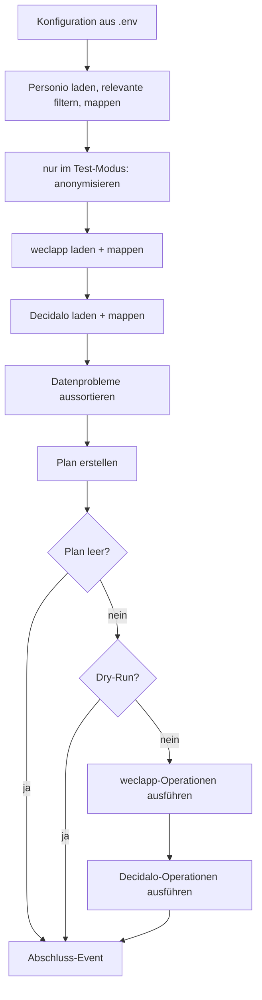

# Umsetzungsplan HR-Sync

> Stand: 2026-10-28 · Ergebnis der ersten Brainstorming-Session · Entwurf

## 1. Ziel und Umfang

HR-Sync überträgt beim Onboarding die Stammdaten neuer Mitarbeiter aus **Personio** nach **weclapp** und **Decidalo**.

- **Richtung:** nur Personio → weclapp und Personio → Decidalo. Personio ist die Quelle.
- **Schlüssel:** die Mitarbeiternummer (MA-Nummer).
- **Operationen:** nur **Anlegen**. Bestehende Personen bleiben unverändert, abweichende Felder werden geloggt.
- **Felder (Phase 1):** MA-Nummer, Vorname, Nachname, E-Mail, Eintrittsdatum. Weitere Felder folgen später
  (siehe [4.3](#43-weitere-felder-ergänzen)).
- **Nicht im Umfang:** Aktualisieren bestehender Personen, Offboarding (Personen, die nur noch im Zielsystem stehen),
  Hosting und Zeitplan.

### 1.1 Entscheidungen aus der Brainstorming-Session

| Thema | Entscheidung |
|---|---|
| MA-Nummer in Personio | Custom Attribute mit `id == "company_employee_id"` (Typ `string`, z. B. `"00165"`). Sie bleibt immer ein String, damit führende Nullen erhalten bleiben |
| Abweichungen bei bestehenden Personen | nicht überschreiben, nur loggen |
| Person ohne MA-Nummer (in jedem System) | Warn-Event, Person wird für den Plan nicht betrachtet |
| Personio-Person ohne E-Mail | Warn-Event, Person wird für den Plan nicht betrachtet |
| E-Mail | wird nach weclapp und Decidalo übertragen (weclapp braucht sie zum Anlegen) |
| Decidalo-displayName | `"Vorname Nachname"` |
| Anlegen in Decidalo | über den **synchronen Import-Endpunkt** `POST /importapi/User/ImportSync` (Client: `import_users_sync`), nicht über `ImportAsync`. Die Ergebnisse pro Zeile kommen direkt in der Antwort, ohne Polling und ohne Callback |
| Neue Decidalo-User | `hasLogin=true`, `employeeTypeName="Internal"`. Weitere Felder sind noch offen (O5) |
| Neue weclapp-User | `status=ACTIVE` |
| Relevante Personio-Mitarbeiter | **nur mit einem Employment im Status `ACTIVE`, dessen Startdatum heute oder in der Vergangenheit liegt** |
| Eintrittsdatum | `employment_start_date` dieses Employments. Gibt es mehrere, gilt das mit dem neuesten Startdatum |
| Logging | Wide Events mit Loguru. Ausgabe umschaltbar (lesbar oder JSON) |
| Personenbezogene Daten in Logs | nein: nur MA-Nummer, systeminterne IDs, Feldnamen und Zahlen |
| Betrieb | erst einmal als CLI, Secrets aus `.env`. Hosting und Zeitplan klären wir später |
| Zielsysteme | wählbar mit `--target weclapp` bzw. `--target decidalo`, Standard sind beide |
| Testumgebungen | In Testumgebungen landen keine echten Namen oder E-Mails: Im Test-Modus (`HR_SYNC_ENVIRONMENT=test`) wird anonymisiert. MA-Nummer und Eintrittsdatum bleiben echt |
| Decidalo im Test-Modus | eigene URL und eigener Key (`DECIDALO_TEST_BASE_URL`, `DECIDALO_TEST_API_KEY`), `hasLogin=false`. Die Testumgebung ist nur im Test-Modus erreichbar |
| Integrationstest | Personio produktiv lesen, nur den ersten Planeintrag in die Decidalo-Testumgebung schreiben. Danach die Testperson wahlweise automatisch löschen (erst nachdem geprüft ist, dass sie angelegt wurde) oder zum Ansehen liegen lassen. Läuft nur lokal |

## 2. Ablauf



1. Konfiguration aus `.env` laden.
2. Daten nacheinander laden: Personio und die Zielsysteme aus `--target` (Standard: weclapp und Decidalo). Jeder Loader
   mappt auf das gemeinsame Modell und liefert einen **Snapshot**: die Datensätze nach MA-Nummer und die Hinweise auf
   Datenprobleme. Aus Personio kommen nur relevante Mitarbeiter (siehe [3.1](#31-personio-quelle)).
   Im Test-Modus wird der Personio-Snapshot direkt nach dem Laden anonymisiert (siehe
   [Abschnitt 8](#8-testumgebungen-und-anonymisierung)).
3. Datenprobleme aussortieren (siehe [Abschnitt 5](#5-datenprobleme)). Für jedes gibt es ein Warn-Event.
4. Plan erstellen. Das ist eine reine Funktion ohne IO: Für jede gültige Personio-Person (mit `--only` nur für die
   angegebenen MA-Nummern, siehe [Abschnitt 7](#7-konfiguration-cli-und-fehlerbehandlung)) und jedes Zielsystem gilt:
   - Die Person fehlt: Operation `CREATE`.
   - Die Person ist vorhanden: Felder vergleichen und Abweichungen festhalten (nur die Feldnamen).
5. Hat der Plan keine Operationen, endet der Lauf. Im Dry-Run wird der Plan nur geloggt.
6. Plan ausführen, erst weclapp, dann Decidalo.
7. Abschluss-Event mit Summen und Exit-Code.

Schlägt das Laden eines Systems fehl, bricht der Lauf **vor** der Planung ab. Auf unvollständigen Daten wird nicht
geplant, sonst würden bestehende Personen doppelt angelegt.

## 3. Die Systeme und ihre Clients

| System | Paket | Art | MA-Nummer steht in | Besonderheiten |
|---|---|---|---|---|
| Personio | [`personio-client`](https://github.com/Hochfrequenz/personio_client.py) `0.1.0a1` | async (aiohttp), nur lesend | Custom Attribute `company_employee_id` | Eintrittsdatum am Employment, ein Request pro Person |
| weclapp | [`weclapp-client`](https://github.com/Hochfrequenz/weclapp_client.py) `0.1.0a1` | **synchron** (httpx) | Custom Attribute `personalnummer` am `user` | eine Person = `user` + `employee`; E-Mail ist Pflicht; `entryDate` fehlt noch im Client |
| Decidalo | [`decidalo-client`](https://github.com/Hochfrequenz/decidalo_client.py) `0.3.1` | async (aiohttp), Import-API | `employeeID` | nur `displayName`; Anlegen über den synchronen Import `ImportSync` (ein Upsert) |

Personio und weclapp sind Pre-Releases. Wir pinnen auf die Minor-Version, z. B. `weclapp-client>=0.1.0a1,<0.2`.
Das Programm läuft mit asyncio. weclapp wird darin synchron aufgerufen, das ist unkritisch, weil die Systeme ohnehin
nacheinander abgefragt werden.

### 3.1 Personio (Quelle)

**Welche Mitarbeiter relevant sind:** Ein Mitarbeiter ist für den Sync nur relevant, wenn er ein Employment hat, das
beide Bedingungen erfüllt:

1. Der `status` des Employments ist `ACTIVE`. Weil Personio die Groß- und Kleinschreibung nicht einheitlich verwendet,
   vergleichen wir ohne Rücksicht darauf.
2. Das `employment_start_date` liegt **heute oder in der Vergangenheit**.

Erfüllen mehrere Employments beide Bedingungen, gilt das mit dem neuesten Startdatum. Alle anderen Mitarbeiter sind
nicht relevant, z. B. künftige Mitarbeiter (`ONBOARDING` oder Start in der Zukunft), Mitarbeiter in Elternzeit o. Ä.
(`LEAVE`) und ausgeschiedene (`INACTIVE`). Sie werden erst angelegt, sobald ihr Employment die Bedingungen erfüllt.

**Sonderfall: aktives Employment ohne Startdatum.** Erfüllt kein Employment beide Bedingungen, hat der Mitarbeiter
aber ein Employment im Status `ACTIVE` ohne `employment_start_date`, ist das ein Datenproblem: Es gibt ein Warn-Event
(`missing_entry_date`), und der Mitarbeiter kommt nicht in den Plan. Diesen Fall prüfen wir **vor** dem Datumsfilter,
sonst würde er still als „nicht relevant“ verschwinden.

Die Prüfung läuft pro Mitarbeiter in dieser Reihenfolge:

1. Gibt es ein Employment mit `ACTIVE` und Startdatum heute oder früher? Dann ist der Mitarbeiter relevant.
2. Sonst: Gibt es ein Employment mit `ACTIVE` ohne Startdatum? Dann gibt es ein Warn-Event `missing_entry_date`.
3. Sonst ist der Mitarbeiter nicht relevant, mit dem Grund `employment_not_active` oder `start_date_in_future`.

„Heute“ ist das Datum in Europe/Berlin beim Start des Laufs. Der Loader bekommt es als Parameter, damit Tests es
festlegen können.

**Laden und mappen:**

- `iter_persons(status="ACTIVE")` als Vorfilter. Der Personenstatus `ACTIVE` umfasst die Employment-Status `ACTIVE`,
  `ONBOARDING` und `LEAVE`. Die genaue Regel prüfen wir danach am Employment.
- `iter_employments(person.id)` für jede Person, daraus das relevante Employment bestimmen. Weil das ein Request pro
  Person ist, begrenzen wir die Parallelität mit einem `asyncio.Semaphore` (z. B. 5).
- MA-Nummer, E-Mail und doppelte MA-Nummern prüfen wir erst **nach** diesem Filter (Abschnitt 5). Künftige
  Mitarbeiter, denen MA-Nummer oder E-Mail noch fehlen, lösen also keine Warnung aus.
- Für geladene, aber ausgeschlossene Mitarbeiter mit MA-Nummer merkt sich der Snapshot den Grund (`excluded`). Das
  braucht `--only` für eine genaue Meldung (Abschnitt 7).
- MA-Nummer: `custom_attributes` mit `id == "company_employee_id"`, `value` ohne führende und folgende Leerzeichen.
- Vorname, Nachname, E-Mail: `first_name`, `last_name`, `email`.
- Eintrittsdatum: `employment_start_date` des relevanten Employments.
- Credentials nur mit dem Scope `personio:persons:read`.

### 3.2 weclapp (Ziel)

**Laden:**

1. Definition des Custom Attributes über `custom_attribute_definitions.get_by_key("personalnummer")`.
   Fehlt sie, ist das ein Konfigurationsfehler und der Lauf bricht ab.
2. Alle `user` und alle `employee` laden. Die Employees werden über `user_id` den Usern zugeordnet.

**Anlegen** (pro Person, in dieser Reihenfolge):

1. `users.create(UserCreate(email, first_name, last_name, status=ACTIVE, can_edit_dashboard=False, custom_attributes=[personalnummer]))`
2. `employees.create(EmployeeCreate(user_id=user.id, entry_date=...))`

**Halb angelegte Personen:** Scheitert Schritt 2, gibt es einen User mit MA-Nummer, aber ohne Personalakte. Der
Client wiederholt einen `POST` mit unklarem Ausgang bewusst nicht. Der nächste Lauf erkennt diesen Zustand und plant
die Operation `COMPLETE`, die nur noch den Employee anlegt. Das ist kein Update, sondern der Abschluss der Anlage.

**Voraussetzung:** Der `weclapp-client` kennt `entryDate` noch nicht. Er muss vorher um `entry_date` in `Employee` und
`EmployeeCreate` erweitert und neu released werden (AP 2).

### 3.3 Decidalo (Ziel)

**Basis-URL:** Im Produktionsmodus nutzt der Sync fest die produktive URL `https://import.decidalo.dev`, sie lässt
sich nicht umkonfigurieren. Die Testumgebung ist nur im Test-Modus erreichbar, mit eigenen Variablen (siehe
[Abschnitt 8](#8-testumgebungen-und-anonymisierung)). Der Client nimmt die URL als `base_url` an.

**Laden:** `get_users()`, seitenweise mit `top` und `skip`. Wir lesen `employeeID`, `displayName`, `email` und `entryDate`.

**Anlegen:** über den synchronen Import-Endpunkt `POST /importapi/User/ImportSync`, im Client
`import_users_sync(UserBatchInput(users=[...]))`. Alle neuen Personen gehen in einen Aufruf, bei Bedarf auf mehrere
Aufrufe aufgeteilt (O7). Den asynchronen Endpunkt `ImportAsync` nutzen wir nicht: Dort müssten wir das Ergebnis über
`ImportStatus` abfragen oder einen Callback anbieten. Bei `ImportSync` stehen die Ergebnisse direkt in der Antwort.

```python
UserInput(
    employeeID=record.employee_number,
    displayName=record.display_name,  # "Vorname Nachname", siehe display_name_of
    email=record.email,
    entryDate=record.entry_date,
    hasLogin=True,                 # im Test-Modus immer False
    employeeTypeName="Internal",
)
```

Die Antwort von `ImportSync` hat ein Ergebnis pro Zeile (`rowIndex`, `status`, `errorMessage`). Daraus wird ein
Operation-Event pro Person. Scheitern einzelne Zeilen, antwortet die API mit HTTP 500 und den Ergebnissen pro Zeile.
Der Client liefert diese Ergebnisse trotzdem zurück.

## 4. Datenmodell und Plan

### 4.1 Gemeinsames Modell

```python
class EmployeeRecord(BaseModel, frozen=True):
    employee_number: str              # Schlüssel, immer ein String
    first_name: str | None = None
    last_name: str | None = None
    display_name: str | None = None   # Decidalo; für Personio als "Vorname Nachname" abgeleitet
    email: str | None = None
    entry_date: date | None = None


class Snapshot(BaseModel):
    system: System                         # PERSONIO | WECLAPP | DECIDALO
    records: dict[str, EmployeeRecord]     # nach MA-Nummer, nur gültige Datensätze
    incomplete: set[str] = set()           # nur weclapp: User ohne Personalakte
    excluded: dict[str, ExclusionReason] = {}  # nur Personio: MA-Nummer → Grund des Ausschlusses
    notices: list[Notice]                  # Datenprobleme, siehe Abschnitt 5
```

Systemspezifische Dinge (weclapp-User-IDs, die ID des Custom Attributes) bleiben im jeweiligen Adapter. Der Planner
kennt nur das gemeinsame Modell.

### 4.2 Plan

```python
class OperationType(StrEnum):
    CREATE = "create"        # Person fehlt im Zielsystem
    COMPLETE = "complete"    # nur weclapp: User vorhanden, Personalakte fehlt
    # später: UPDATE


class Operation(BaseModel):
    system: TargetSystem     # WECLAPP | DECIDALO
    type: OperationType
    record: EmployeeRecord   # Sollzustand aus Personio


class Deviation(BaseModel):
    system: TargetSystem
    fields: list[str]        # nur Feldnamen, keine Werte


class EmployeePlan(BaseModel):
    employee_number: str
    operations: list[Operation]
    deviations: list[Deviation]


class SyncPlan(BaseModel):
    employees: list[EmployeePlan]    # sortiert nach MA-Nummer, damit "der erste Eintrag" eindeutig ist

    @property
    def is_empty(self) -> bool: ...   # True, wenn es keine Operationen gibt; Abweichungen zählen nicht
```

**Vergleich je Zielsystem:** Jeder Adapter legt fest, welche Felder er vergleicht.

| System | verglichene Felder |
|---|---|
| weclapp | `first_name`, `last_name`, `email`, `entry_date` |
| Decidalo | `display_name`, `email`, `entry_date` |

Vor dem Vergleich werden Leerzeichen am Anfang und Ende entfernt. E-Mails werden ohne Rücksicht auf Groß- und
Kleinschreibung verglichen.

### 4.3 Weitere Felder ergänzen

Ein neues Feld braucht diese Schritte:

1. Feld in `EmployeeRecord` aufnehmen.
2. Personio-Mapping ergänzen.
3. Mapping und Anlage-Payload je Zielsystem ergänzen, bei Bedarf den Client erweitern.
4. Feld in die verglichenen Felder des Adapters aufnehmen.
5. Anonymisierungsregel für den Test-Modus festlegen (siehe [8.2](#82-anonymisierung)).
6. Tests ergänzen.

Sollen später auch Updates laufen, macht der Planner aus Abweichungen `UPDATE`-Operationen, und die Executor lernen
den neuen Operationstyp. Das Datenmodell und die Loader bleiben dabei unverändert.

## 5. Datenprobleme

| Fall | System | Folge |
|---|---|---|
| MA-Nummer fehlt oder ist leer | alle | Warn-Event `sync.notice` (`reason=missing_employee_number`), Person nicht im Plan |
| MA-Nummer kommt mehrfach vor | alle | Warn-Event (`reason=duplicate_employee_number`), alle Datensätze mit dieser Nummer nicht im Plan *(Vorschlag, ergänzt)* |
| E-Mail fehlt | Personio | Warn-Event (`reason=missing_email`), Person nicht im Plan |
| Employment `ACTIVE`, aber ohne Startdatum, und kein anderes Employment erfüllt die Bedingungen | Personio | Warn-Event (`reason=missing_entry_date`), Person nicht im Plan. Geprüft wird vor dem Datumsfilter (siehe [3.1](#31-personio-quelle)) |
| Nicht relevant (kein aktives Employment oder Start in der Zukunft) | Personio | kein Warn-Event, weil das der Normalfall ist. Nur die Anzahl je Grund im `sync.load` |
| Person steht nur im Zielsystem | weclapp, Decidalo | nur die Anzahl im Plan-Event (Offboarding kommt später) |

In Personio werden MA-Nummer, E-Mail und doppelte MA-Nummern nur bei relevanten Mitarbeitern geprüft. Einzige
Ausnahme ist das fehlende Startdatum eines aktiven Employments: Das prüfen wir vor dem Datumsfilter (siehe
[3.1](#31-personio-quelle)).

Ohne MA-Nummer wird die Person über ihre **systeminterne ID** benannt (Personio-Person-ID, weclapp-User-ID,
Decidalo-`userID`). So lässt sie sich finden, ohne dass Namen im Log stehen.

## 6. Logging mit Wide Events

**Prinzip:** Für jede Arbeitseinheit gibt es genau **ein** Event mit dem ganzen Kontext. Es wird am Ende der Einheit
ausgegeben, mit Dauer und Ergebnis, statt vieler einzelner Logzeilen.

```python
with wide_event("sync.load", system="personio") as event:
    ...
    event["records"] = len(snapshot.records)
    event["notices"] = len(snapshot.notices)
# beim Verlassen kommen dazu: run_id, environment, dry_run, duration_ms, outcome, bei Fehlern error.type und error.status_code
# Ausgabe: logger.bind(**fields).log(level, "sync.load")
```

| Event | Wann | Inhalt (Auswahl) | Level |
|---|---|---|---|
| `sync.run` | einmal, am Ende | `run_id`, `environment`, `dry_run`, `only`, `targets`, Dauer, Summen je System und Operation, Anzahl Hinweise und Fehler, `exit_code` | INFO / ERROR |
| `sync.load` | je System | `system`, `records`, `notices`, Dauer; bei Personio zusätzlich `not_relevant` je Grund (`employment_not_active`, `start_date_in_future`) | INFO / ERROR |
| `sync.notice` | je Datenproblem | `system`, `reason`, `system_id` | **WARNING** |
| `sync.deviation` | je Person und Zielsystem mit Abweichung | `employee_number`, `system`, `fields` | INFO |
| `sync.plan` | einmal | Operationen je System und Typ, `is_empty`, `only_in_target` je System | INFO |
| `sync.operation` | je Operation | `employee_number`, `system`, `type`, `outcome` (`success`, `error`, `skipped`, `dry_run`), `target_id`, Fehler | INFO / ERROR |

- **Keine personenbezogenen Werte:** nur MA-Nummer, systeminterne IDs, Feldnamen und Zahlen. Ein Test prüft, dass
  Namen und E-Mail-Adressen der Testdaten nicht in der Log-Ausgabe auftauchen.
- **Keine Fehlertexte:** Meldungen der APIs und `str(error)` können Namen oder E-Mail-Adressen enthalten, auch in
  gekürzter Form. Deshalb kommen nur fest definierte Felder ins Event:
  - immer der Fehlertyp (Klassenname) und der HTTP-Statuscode
  - bei Personio die `trace_id`
  - bei weclapp `problem_type` und die betroffenen Properties (`location` aus `validation_errors`), nicht die
    Meldungstexte
  - bei Decidalo der `status` der Zeile, nicht `errorMessage`

  Loguru läuft mit `diagnose=False`, und die Events enthalten keine Tracebacks, weil diese Variablenwerte zeigen können.
- **Im Dry-Run** gibt es für jede geplante Operation ein `sync.operation` mit `outcome=dry_run`. So ist pro Person
  sichtbar, was passieren würde.
- **Ausgabe umschaltbar:** `--log-format pretty|json` bzw. `HR_SYNC_LOG_FORMAT`, Standard ist `pretty`.
  `json` nutzt Loguru mit `serialize=True`, eine Zeile pro Event auf stdout.
- Die Logs der Client-Bibliotheken (stdlib `logging`) leiten wir mit einem Intercept-Handler auf Loguru um, mit dem
  Level WARNING.

## 7. Konfiguration, CLI und Fehlerbehandlung

Die Konfiguration kommt über `pydantic-settings` aus der Umgebung bzw. aus `.env`. Im Repo liegt eine `.env.example`,
die `.env` steht in `.gitignore`.

| Variable | Bedeutung |
|---|---|
| `PERSONIO_CLIENT_ID`, `PERSONIO_CLIENT_SECRET`, `PERSONIO_APP_ID` | Personio-API |
| `PERSONIO_EMPLOYEE_NUMBER_ATTRIBUTE` | Standard `company_employee_id` |
| `WECLAPP_API_TOKEN`, `WECLAPP_BASE_URL` bzw. `WECLAPP_TENANT` | weclapp-API (wie `WeclappConfig.from_env()`) |
| `WECLAPP_EMPLOYEE_NUMBER_ATTRIBUTE_KEY` | Standard `personalnummer` |
| `WECLAPP_NEW_USER_STATUS` | Standard `ACTIVE` |
| `DECIDALO_API_KEY` | Decidalo-Import-API |
| `DECIDALO_TEST_BASE_URL`, `DECIDALO_TEST_API_KEY` | Decidalo-Testumgebung. Werden nur im Test-Modus gelesen und sind dort Pflicht (siehe [Abschnitt 8](#8-testumgebungen-und-anonymisierung)) |
| `DECIDALO_EMPLOYEE_TYPE_NAME` | Standard `Internal` |
| `DECIDALO_HAS_LOGIN` | Standard `true`; im Test-Modus wirkungslos (immer `false`) |
| `HR_SYNC_ENVIRONMENT` | `production` (Standard) oder `test`, siehe [Abschnitt 8](#8-testumgebungen-und-anonymisierung) |
| `HR_SYNC_LOG_FORMAT` | `pretty` oder `json` |

**CLI:** `hr-sync [--dry-run] [--only MA-NR ...] [--target weclapp|decidalo ...] [--log-format pretty|json]`, umgesetzt
mit `argparse` (keine weitere Abhängigkeit).

- `--target` (mehrfach angebbar) wählt die Zielsysteme. Ohne Angabe laufen beide. Systeme, die nicht gewählt sind,
  werden weder geladen noch beschrieben, und ihre Zugangsdaten müssen nicht gesetzt sein.

- `--only MA-NR` (mehrfach angebbar) begrenzt den Plan auf diese MA-Nummern.
  - Geladen wird trotzdem alles, damit Datenprobleme wie doppelte MA-Nummern erkannt werden.
  - Landet eine angegebene MA-Nummer nicht im Plan, gibt es ein Warn-Event. Der Grund kommt aus `excluded` im
    Personio-Snapshot (siehe [3.1](#31-personio-quelle)):
    - Der Mitarbeiter wurde geladen, ist aber nicht relevant: `reason=not_relevant` mit `detail`
      (`employment_not_active` oder `start_date_in_future`).
    - Der Mitarbeiter wurde wegen eines Datenproblems ausgeschlossen, z. B. `missing_email` oder `missing_entry_date`:
      Dessen Warn-Event gibt es ohnehin.
    - Die MA-Nummer steht bei keiner geladenen Person: `reason=unknown_employee_number`. Weil wir nur Personen mit
      dem Personenstatus `ACTIVE` laden, kann das eine unbekannte Nummer oder ein ausgeschiedener Mitarbeiter sein.
      Wir unterscheiden das bewusst nicht, sonst müssten wir für diese Meldung alle ehemaligen Mitarbeiter laden.
  - Der erste echte Lauf läuft verbindlich mit `--only` und der MA-Nummer einer Testperson (AP 9).

**Exit-Codes:**

| Code | Bedeutung |
|---|---|
| 0 | erfolgreich, auch bei leerem Plan oder Hinweisen |
| 1 | mindestens eine Operation ist fehlgeschlagen |
| 2 | Abbruch (Konfiguration, Authentifizierung, Fehler beim Laden, unzulässige Einstellungen im Test-Modus) |

**Fehler beim Ausführen:**

- **Fehler bei einem Datensatz** (Validierung, Konflikt, zu langer Name): Operation-Event mit ERROR, weiter mit der
  nächsten Person.
- **Systemische Fehler** (Authentifizierung, Verbindung, Rate Limit nach allen Retries, 5xx): Die restlichen
  Operationen dieses Systems werden mit `outcome=skipped` übersprungen, das andere Zielsystem läuft weiter.
- Der nächste Lauf holt alles Übersprungene nach, weil der Plan immer aus dem aktuellen Stand entsteht.

## 8. Testumgebungen und Anonymisierung

In Testumgebungen dürfen keine echten personenbezogenen Daten landen. Personio gibt es nur produktiv, dort lesen wir
nur. Eine Testumgebung gibt es bisher nur für Decidalo, mit eigener URL (O12).

### 8.1 Test-Modus

`HR_SYNC_ENVIRONMENT=test` schaltet den Test-Modus ein. Dann gilt:

- Der Personio-Snapshot wird direkt nach dem Laden anonymisiert, also vor der Planung. Plan, Ausführung und
  Zielsystem bekommen nur anonymisierte Daten zu sehen. Die Anonymisierung lässt sich im Test-Modus nicht abschalten.
- Neue Decidalo-User bekommen `hasLogin=false`, egal was in `DECIDALO_HAS_LOGIN` steht.
- weclapp ist als Ziel gesperrt, solange es keinen weclapp-Testtenant gibt. Ein Lauf mit weclapp als Ziel bricht mit
  Exit-Code 2 ab. Im Test-Modus braucht es also `--target decidalo`.
- Decidalo wird nur über `DECIDALO_TEST_BASE_URL` und `DECIDALO_TEST_API_KEY` angesprochen. Fehlt eine der beiden,
  oder zeigt die URL auf die produktive URL, bricht der Lauf mit Exit-Code 2 ab.
- Jedes Event trägt `environment=test`.

**Beide Richtungen sind abgesichert:**

- **Test-Modus → Produktion:** Die produktive URL wird abgelehnt, und weclapp ist gesperrt.
- **Produktionsmodus → Testumgebung:** Der Produktionsmodus nutzt fest die produktive Decidalo-URL und liest die
  `DECIDALO_TEST_*`-Variablen nicht. Vergisst jemand `HR_SYNC_ENVIRONMENT=test`, kann der Lauf die Testumgebung also
  gar nicht erreichen. Echte Daten mit aktivem Login gelangen so nicht dorthin.

Kommt später ein weclapp-Testtenant dazu, gilt dasselbe Muster mit `WECLAPP_TEST_*`.

### 8.2 Anonymisierung

| Feld | im Test-Modus |
|---|---|
| MA-Nummer | bleibt echt (Schlüssel) |
| Vorname | `Test` |
| Nachname | `Person-<MA-Nummer>` |
| displayName | ergibt sich daraus: `Test Person-<MA-Nummer>` |
| E-Mail | `test-<MA-Nummer>@example.com`. Die Domain ist für Beispiele reserviert, Mails dorthin werden nicht zugestellt |
| Eintrittsdatum | bleibt echt |

Die Ersatzwerte hängen nur von der MA-Nummer ab. So erkennt ein zweiter Lauf die angelegte Testperson wieder, ohne
Abweichungen. Ein geheimer Schlüssel ist nicht nötig, weil die Ersatzwerte nichts verraten, was nicht schon in der
MA-Nummer steht.

Ein Test stellt sicher, dass jedes Feld von `EmployeeRecord` eine Anonymisierungsregel hat oder ausdrücklich als
„bleibt echt“ markiert ist. Ein neues Feld (siehe [4.3](#43-weitere-felder-ergänzen)) kann also nicht unbemerkt
echte Werte in die Testumgebung tragen.

### 8.3 Integrationstest gegen die Decidalo-Testumgebung

Die Integrationstests laufen nur lokal. Fehlen die Zugangsdaten, werden sie übersprungen. Für Decidalo nutzen sie
dieselben Variablen wie der Test-Modus (`DECIDALO_TEST_BASE_URL`, `DECIDALO_TEST_API_KEY`), nie den produktiven Key.
Personio lesen sie mit den normalen Credentials aus der Produktion.

| Marker | Was | Voraussetzung |
|---|---|---|
| `integration` | Personio lesen, anonymisieren, Decidalo-Testumgebung lesen, Plan erstellen, Dry-Run | Personio-Credentials, `DECIDALO_TEST_*` |
| `integration_write` | zusätzlich den ersten Planeintrag in die Decidalo-Testumgebung schreiben | zusätzlich `HR_SYNC_IT_ALLOW_WRITES=1` |

Ablauf von `integration_write`:

1. Der Test setzt den Test-Modus mit dem Ziel Decidalo.
2. Laden, anonymisieren, Plan erstellen.
3. Den ersten Eintrag des Plans nehmen, der eine Operation hat. Gibt es keinen, wird der Test übersprungen.
4. Nur diesen Eintrag ausführen. Dafür lassen sich die Schritte in `sync.py` (laden, planen, ausführen) einzeln
   aufrufen, und der Test übergibt einen Plan, der nur diesen Eintrag enthält.
5. Prüfen, ob der User angelegt wurde: `get_users(employee_id=...)` findet genau einen User mit den anonymisierten
   Werten, dem echten Eintrittsdatum und ohne Login.
6. Prüfen, dass ein neuer Plan für diese MA-Nummer keine Operation mehr enthält.
7. Aufräumen, wahlweise:
   - **Automatisch löschen** (Standard): per `ImportSync` mit `delete=true`, danach wird geprüft, dass der User weg
     ist.
     Gelöscht wird nur, wenn Schritt 5 den User gefunden hat **und** seine E-Mail genau `test-<MA-Nummer>@example.com`
     lautet. So kann der Test keinen echten User löschen. Das Aufräumen läuft auch dann, wenn eine Prüfung in Schritt 5
     oder 6 fehlschlägt.
   - **Liegen lassen** mit der pytest-Option `--keep-test-data`: Der Test gibt die MA-Nummer aus, damit man den Eintrag
     in Decidalo ansehen kann. Der nächste Lauf nimmt dann den nächsten Planeintrag.

```bash
uv run pytest -m integration_write
uv run pytest -m integration_write --keep-test-data
```

## 9. Projektstruktur

```
src/hr_sync/
├── __init__.py
├── __main__.py           # python -m hr_sync
├── cli.py                # argparse, Exit-Codes
├── anonymize.py          # Anonymisierung im Test-Modus
├── config.py             # Settings (pydantic-settings), Prüfungen für den Test-Modus
├── events.py             # Loguru-Setup, wide_event(), Intercept-Handler
├── model.py              # EmployeeRecord, Snapshot, Notice, ExclusionReason, System
├── plan.py               # Operation, Deviation, EmployeePlan, SyncPlan
├── planner.py            # build_plan(personio, targets) -> SyncPlan, ohne IO
├── sync.py               # Orchestrierung: laden → planen → ausführen, die Schritte einzeln aufrufbar
└── systems/
    ├── personio.py       # Loader + Mapping
    ├── weclapp.py        # Loader + Mapping + Executor
    └── decidalo.py       # Loader + Mapping + Executor
unittests/
└── integration/          # gegen die Decidalo-Testumgebung, nur lokal
```

Laufzeit-Abhängigkeiten: `personio-client`, `weclapp-client`, `decidalo-client`, `loguru`, `pydantic`,
`pydantic-settings`. Für die Tests kommen `pytest-asyncio` und `aioresponses` dazu.

## 10. Tests

| Ebene | Wie |
|---|---|
| Planner | reine Unit-Tests ohne IO, tabellengetrieben (fehlt, vorhanden, Abweichung, unvollständig, Datenprobleme) |
| Mapping | Unit-Tests mit Modellinstanzen der Clients |
| Relevanz (Personio) | tabellengetrieben: alle Employment-Status inklusive abweichender Schreibweise; Startdatum gestern, heute, morgen; mehrere Employments; aktives Employment ohne Startdatum erzeugt `missing_entry_date`, auch neben einem Employment mit künftigem Start; künftiger Mitarbeiter ohne MA-Nummer erzeugt keine Warnung; `--only` meldet `not_relevant` mit Grund bzw. `unknown_employee_number` |
| Personio, Decidalo | `aioresponses` (beide Clients nutzen aiohttp und testen selbst so) |
| weclapp | `weclapp_client.testing.FakeWeclapp` |
| Ende-zu-Ende | ganzer Lauf gegen die Fakes; **ein zweiter Lauf erzeugt keine Schreibzugriffe**; Dry-Run schreibt nichts |
| Events | Loguru-Sink in eine Liste; Felder und Level prüfen; keine personenbezogenen Werte |
| Test-Modus | jedes Feld hat eine Anonymisierungsregel; der Payload an Decidalo enthält keine echten Namen oder E-Mails; `hasLogin=false`; Abbruch bei weclapp als Ziel, bei fehlenden `DECIDALO_TEST_*` oder bei der produktiven Decidalo-URL; der Produktionsmodus nutzt die produktive URL, auch wenn `DECIDALO_TEST_*` gesetzt sind |
| Integration | gegen die Decidalo-Testumgebung, siehe [8.3](#83-integrationstest-gegen-die-decidalo-testumgebung) |

## 11. Arbeitspakete

Die Reihenfolge baut zuerst den Kern ohne IO und hängt dann die Systeme an:

| AP | Inhalt | Ergebnis |
|---|---|---|
| 0 | **Repo-Setup:** Template auf `hr_sync` umbenennen, `pyproject.toml` (Name, Abhängigkeiten, `[project.scripts]`), `.env.example`, README-Gerüst, PyPI-Publish-Workflow entfernen (es ist eine Anwendung, keine Bibliothek) | CI grün mit leerem Paket |
| 1 | **Datenmodell, Plan und Planner** inklusive Datenproblemen | Planner vollständig getestet |
| 2 | **weclapp-client erweitern** (`entry_date` in `Employee` und `EmployeeCreate`), im Repo `weclapp_client.py`, mit Release | neue Client-Version auf PyPI |
| 3 | **Wide Events** mit Loguru, umschaltbare Ausgabe, Intercept-Handler | `wide_event()` getestet |
| 4 | **Personio-Loader** mit Relevanzfilter und Mapping | Snapshot aus Personio, nur relevante Mitarbeiter |
| 5 | **weclapp-Loader und -Executor** (`CREATE`, `COMPLETE`) | gegen `FakeWeclapp` getestet |
| 6 | **Decidalo-Loader und -Executor** (synchroner Import über `ImportSync`, Ergebnisse pro Zeile) | mit `aioresponses` getestet |
| 7 | **Orchestrierung, CLI** (inklusive `--only` und `--target`), **Dry-Run, Exit-Codes**, Ende-zu-Ende-Tests | `hr-sync --dry-run` läuft; Tests zeigen, dass `--only` alle anderen Personen aus dem Plan nimmt und `--target` die anderen Systeme nicht anfasst |
| 8 | **Test-Modus und Integrationstest:** Anonymisierung, Prüfungen für den Test-Modus, Integrationstests gegen die Decidalo-Testumgebung mit wählbarem Aufräumen | `uv run pytest -m integration_write` legt den ersten Planeintrag anonymisiert in der Testumgebung an, prüft ihn und räumt auf |
| 9 | **Testlauf:** Dry-Run gegen die echten Systeme (nur lesend) und offene Punkte klären. Dann der erste echte Lauf, **nur mit `--only <MA-Nummer der Testperson>`**, vorher mit denselben Optionen als Dry-Run. Voraussetzung: Die Testperson steht mit MA-Nummer, E-Mail und einem aktiven Employment (Start heute oder früher) in Personio | Go-live-Entscheidung |

AP 2 liegt in einem anderen Repo und kann parallel zu AP 1, 3 und 4 laufen.

## 12. Offene Punkte

| # | Frage | Bis wann | Bezug |
|---|---|---|---|
| O1 | Kosten aktive weclapp-User (`ACTIVE`) eine Lizenz? Geht `ACTIVE` ohne Lizenz überhaupt? | vor AP 9 | weclapp S1 ([#14](https://github.com/Hochfrequenz/weclapp_client.py/issues/14)) |
| O2 | Verschickt weclapp beim Anlegen eines aktiven Users automatisch eine Einladung? | vor AP 9 | weclapp S3 ([#16](https://github.com/Hochfrequenz/weclapp_client.py/issues/16)) |
| O3 | Gibt es das Custom Attribute `personalnummer` im weclapp-Tenant schon, und sind die Bestands-User gepflegt? | vor AP 9 | weclapp S4 ([#17](https://github.com/Hochfrequenz/weclapp_client.py/issues/17)) |
| O4 | Prüft weclapp E-Mail-Adressen auf Eindeutigkeit? (siehe Risiko R2) | vor AP 9 | weclapp S2 ([#15](https://github.com/Hochfrequenz/weclapp_client.py/issues/15)) |
| O5 | Welche weiteren Felder braucht ein neuer Decidalo-User (Berechtigungsrolle, Team, Standort, Land, …)? Bekommt er bei `hasLogin=true` eine Mail? | vor AP 6 | Brainstorming |
| O6 | Woran erkennt der Decidalo-Import bestehende User (`employeeID`, `email`, beides)? Ein User ohne `employeeID`, aber mit gleicher E-Mail könnte sonst überschrieben werden | vor AP 6 | Risiko R3 |
| O7 | Hat `GET /importapi/User` eine maximale Seitengröße? Wie viele User darf ein `ImportSync`-Aufruf enthalten, und ab wann droht ein Timeout, weil der Endpunkt synchron arbeitet? | AP 6 | – |
| O8 | ~~Personio-Person ohne Employment oder Startdatum: ohne Eintrittsdatum anlegen oder überspringen?~~ **Erledigt:** Ohne aktives Employment mit Startdatum heute oder früher ist ein Mitarbeiter nicht relevant. Ein aktives Employment ohne Startdatum ist ein Datenproblem | – | Abschnitt 3.1, 5 |
| O9 | Betrieb: Hosting, Zeitplan, Verwaltung der Secrets | später | weclapp S6 ([#19](https://github.com/Hochfrequenz/weclapp_client.py/issues/19)) |
| O10 | Brauchen wir eine Ignore-Liste für technische User ohne MA-Nummer (Admins, API-User), damit die Warnungen nicht jedes Mal kommen? | nach AP 9 | Risiko R5 |
| O11 | Welche Python-Version? Laut weclapp-Plan (K3) die neueste | AP 0 | – |
| O12 | URL und API-Key der Decidalo-Testumgebung. Akzeptiert Decidalo E-Mails mit der Domain `example.com`? | vor AP 8 | Abschnitt 8 |
| O13 | Was bewirkt `delete=true` in `ImportSync`: endgültig löschen oder nur deaktivieren? Lässt sich dieselbe `employeeID` danach wieder anlegen? | vor AP 8 | Abschnitt 8.3 |

O5–O7 und O13 lassen sich in der Decidalo-Testumgebung klären, ohne produktive Daten anzufassen.

## 13. Risiken

| # | Risiko | Gegenmaßnahme |
|---|---|---|
| R1 | Aktive weclapp-User kosten Lizenzen oder lösen Einladungs-Mails aus | O1 und O2 vor dem ersten echten Lauf klären; der erste Lauf läuft nur mit `--only` für eine Testperson |
| R2 | In weclapp gibt es schon einen User mit derselben E-Mail, aber ohne MA-Nummer. Der Sync betrachtet ihn nicht und legt die Person neu an: Dublette, oder weclapp lehnt das ab | Warnung für User ohne MA-Nummer; Bestandsdaten vor dem ersten Lauf pflegen (O3); Dry-Run zuerst |
| R3 | `ImportSync` ist ein Upsert. Erkennt er User über die E-Mail, ändert er womöglich einen bestehenden User, obwohl wir nur anlegen wollen | O6 klären; vor dem Import prüfen, ob die E-Mail schon bei einem User ohne `employeeID` vorkommt |
| R4 | Die Clients sind Pre-Releases, weclapp ist noch nicht gegen einen echten Tenant getestet | auf Minor-Version pinnen; AP 9 zuerst nur lesend |
| R5 | Viele Warnungen durch technische User ohne MA-Nummer verdecken die wichtigen | Warnungen gezielt auswerten; bei Bedarf Ignore-Liste (O10) |
| R6 | Personenbezogene Daten gelangen über Fehlertexte oder Client-Logs ins Log | Event-Felder fest definiert, keine Fehlertexte, `diagnose=False`; Test auf personenbezogene Daten in der Ausgabe; Client-Logs nur ab WARNING |
| R7 | Laden schlägt teilweise fehl, der Sync legt bestehende Personen doppelt an | Abbruch vor der Planung, wenn ein System nicht vollständig geladen wurde |
| R8 | Echte Namen oder E-Mails gelangen in die Testumgebung, z. B. weil `HR_SYNC_ENVIRONMENT=test` vergessen wurde | Die Testumgebung ist nur im Test-Modus erreichbar, weil der Produktionsmodus fest die produktive URL nutzt; der Test-Modus erzwingt Anonymisierung und `hasLogin=false`; ein Test prüft, dass jedes Feld eine Regel hat; ein Payload-Test findet keine echten Werte |
| R9 | Ein Lauf im Test-Modus schreibt in eine produktive Umgebung | Abbruch bei der produktiven Decidalo-URL und bei weclapp als Ziel; Test-Modus und Integrationstests nutzen nur die `DECIDALO_TEST_*`-Variablen |
| R10 | Das automatische Aufräumen löscht einen echten User | Gelöscht wird nur im Test-Modus, nur nach der Prüfung, dass der User angelegt wurde, und nur ein User mit genau der anonymisierten E-Mail |
